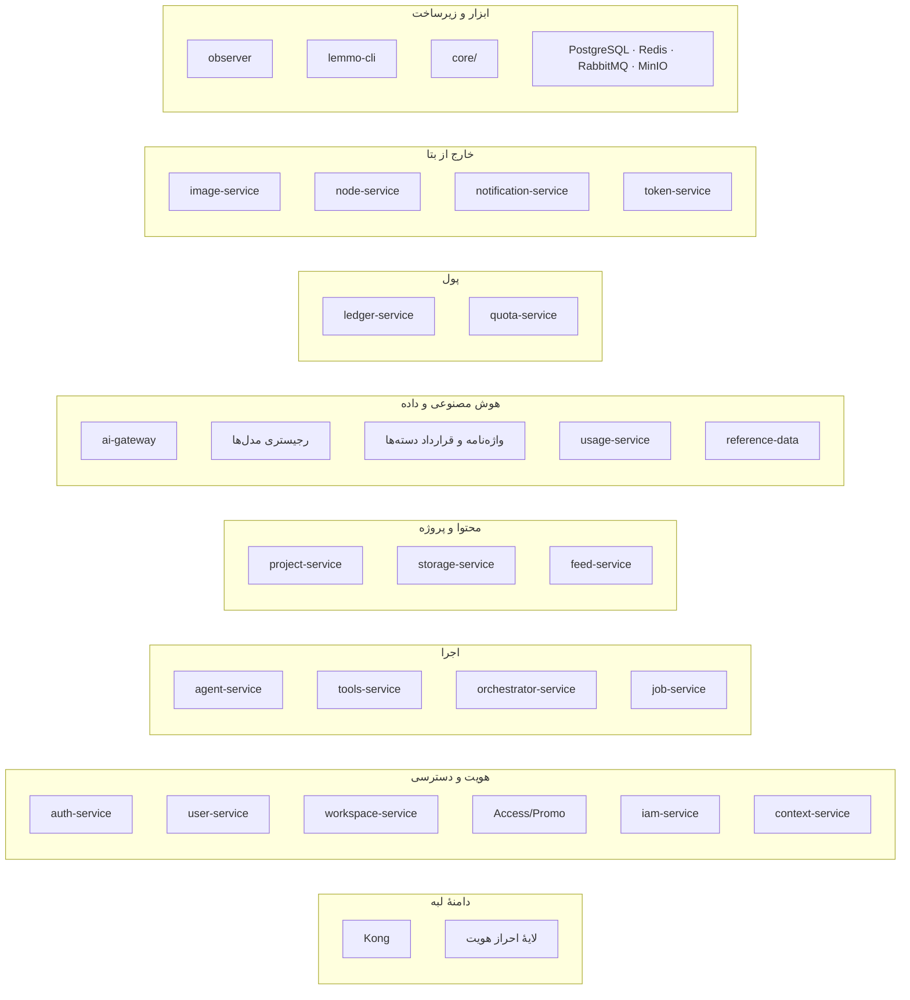

| فیلد / Field | مقدار / Value |
| :--- | :--- |
| **Title (EN)** | Lemmo Service Responsibility Registry — Single Source of Truth |
| **Title (FA)** | سند مرجع مسئولیت سرویس‌های لمو — منبع یگانه‌ی حقیقت |
| **ID** | DOC-ARCH-013 |
| **Category** | `architecture` |
| **Status** | `Draft` |
| **Owner** | Senior Architect / Project Management |
| **Last Updated** | 2026-10-24 |
| **Summary (EN)** | Single authoritative registry of every Lemmo service and platform component: one owner per responsibility and per data, explicit "does not" lists, inverse responsibility index, six canonical paths, glossary, and change rule. Defines target state, not current code; gaps are referenced only via QF/Ratchet IDs. |
| **Summary (FA)** | سند مرجع یگانه برای مسئولیت همهٔ سرویس‌ها و اجزای پلتفرم لمو: یک مالک برای هر مسئولیت و هر داده، فهرست صریح «نمی‌کند»، شاخص معکوس، شش مسیر متعارف، واژه‌نامه و قاعدهٔ تغییر. وضعیت هدف را تعریف می‌کند، نه کد فعلی؛ فاصله‌ها فقط با شناسهٔ QF/Ratchet ارجاع می‌شوند. |
| **Tags** | `architecture`, `services`, `responsibility`, `ssot`, `registry`, `ownership` |

---

# سند مرجع مسئولیت سرویس‌های لمو (Service Responsibility Registry)

> **این سند وضعیت هدف را تعریف می‌کند، نه وضعیت فعلی کد.** فاصلهٔ کد امروز با این سند فقط با ارجاع به بدهی ثبت‌شده (QF یا Ratchet) بیان می‌شود؛ هیچ توضیح یا راه‌حلی در این سند نیست.

> **این سند تنها منبع حقیقت برای «هر سرویس چه می‌کند و چه نمی‌کند» است.** هر سند دیگری که مسئولیت سرویس را تعریف کند و با این سند تعارض داشته باشد، اشتباه است و باید اصلاح شود. اسناد سرویس (`service.md`، specها) فقط **به کارت آن سرویس در این سند ارجاع** می‌دهند و جزئیات پیاده‌سازی را می‌گویند.

---

## ۱. اصول (دقیقاً این شش مورد)

1. **یک سرویس، یک مسئولیت؛ یک مسئولیت، یک مالک.** محور سرویس‌ها مسئولیت است، نه نوع خروجی (D-46 T1).
2. **یک مالک برای هر داده.** هیچ داده‌ای دو منبع حقیقت ندارد.
3. **بدون استثنای معماری** (A1)؛ **انحراف کد موجود بدهی است، نه استثنا** (A2): شناسه، مالک، تاریخ هدف، و قاعدهٔ «فقط کاهش».
4. **قرارداد، نه کتابخانهٔ مشترک** (D-28)؛ ارتباط سرویس‌ها فقط از راه قرارداد.
5. **پول فقط در ledger.** هیچ سرویس دیگری موجودی نگه نمی‌دارد، محاسبهٔ مالی نمی‌کند، یا به TigerBeetle دسترسی ندارد.
6. **این سند مرجع است.** هر سند دیگری که مسئولیت تعریف کند و با این سند تعارض داشته باشد، اشتباه است و باید اصلاح شود.

---

## ۲. نقشهٔ کلی

---

## ۳. کارت‌های سرویس‌ها

> هر کارت دقیقاً فیلدهای زیر را دارد. فیلدی که مقدار ندارد «ندارد» نوشته شده است، نه خالی.

### ۳.۱. Kong
| فیلد | مقدار |
|---|---|
| شناسه | `Kong` |
| دامنه | لبه |
| وضعیت | فعال در بتا |
| مسئولیت در یک جمله | مسیریابی بر اساس URL، CORS، محدودیت نرخ |
| مسئولیت‌ها | مسیرها: `/v1/chat` → agent-service؛ `/v1/workflows` → orchestrator-service؛ خواندن وضعیت اجرا → job-service |
| نمی‌کند / نمی‌داند | تصمیم هویت؛ اعتماد به هدر `X-User-ID`؛ چک عضویت workspace (در هدف)؛ هیچ مسیر بیرونی به ai-gateway |
| دادهٔ متعلق | ندارد |
| قراردادها | مسیرهای HTTP (Kong declarative config) |
| فراخوانی می‌کند / فراخوانده می‌شود از | فراخوانده می‌شود از کلاینت؛ فراخوانی می‌کند سرویس‌های بالادست |
| لمس پول | ندارد |
| تصمیم‌های مرجع | ADR-013، D-38، تصمیم مسیرها |
| بدهی شناخته‌شده | QF-ARCH08-02 (header spoofing) |

### ۳.۲. لایهٔ احراز هویت (Oathkeeper)
| فیلد | مقدار |
|---|---|
| شناسه | `Oathkeeper` (لایهٔ احراز هویت) |
| دامنه | لبه |
| وضعیت | جدید پیش از بتا / در حال تکامل |
| مسئولیت در یک جمله | تنها نقطهٔ تصمیم هویت |
| مسئولیت‌ها | خواندن کوکی یا توکن کاربر از Kratos و Hydra؛ ساخت توکن داخلی کوتاه‌عمر و امضاشده (`user_id`، `workspace_id`، `roles`)؛ forward-auth برای Kong؛ رد در صورت شک (fail-closed)؛ چند نمونه |
| نمی‌کند / نمی‌داند | چک مالکیت داده (IDOR)؛ منطق محصول |
| دادهٔ متعلق | ندارد |
| قراردادها | forward-auth، توکن داخلی (قرارداد درونی) |
| فراخوانی می‌کند / فراخوانده می‌شود از | فراخوانده می‌شود از Kong؛ فراخوانی می‌کند Kratos/Hydra |
| لمس پول | ندارد |
| تصمیم‌های مرجع | D-38 |
| بدهی شناخته‌شده | ندارد |

### ۳.۳. auth-service
| فیلد | مقدار |
|---|---|
| شناسه | `auth-service` |
| دامنه | هویت و دسترسی |
| وضعیت | فعال در بتا |
| مسئولیت در یک جمله | پوشش Kratos: ورود و تأیید OTP، نشست، رویداد هویت به user-service |
| مسئولیت‌ها | ورود/ثبت‌نام passwordless، تأیید OTP، مدیریت نشست، رویداد هویت به user-service |
| نمی‌کند / نمی‌داند | پروفایل؛ workspace؛ پول |
| دادهٔ متعلق | نشست (Kratos) |
| قراردادها | REST (Kratos)، رویداد هویت |
| فراخوانی می‌کند / فراخوانده می‌شود از | فراخوانده می‌شود از Kong/فرانت؛ فراخوانی می‌کند user-service (webhook) |
| لمس پول | ندارد |
| تصمیم‌های مرجع | ADR-015 |
| بدهی شناخته‌شده | ندارد |

### ۳.۴. user-service
| فیلد | مقدار |
|---|---|
| شناسه | `user-service` |
| دامنه | هویت و دسترسی |
| وضعیت | فعال در بتا |
| مسئولیت در یک جمله | پروفایل، handle، ریسک، تعلیق کاربر |
| مسئولیت‌ها | پروفایل کاربر، handle، ارزیابی ریسک ایمیل موقت، تعلیق موقت |
| نمی‌کند / نمی‌داند | نشست؛ پول؛ دسترسی |
| دادهٔ متعلق | پروفایل کاربر (`lemmo_user`) |
| قراردادها | gRPC `GetUser`؛ رویداد هویت (consumer) |
| فراخوانی می‌کند / فراخوانده می‌شود از | فراخوانده می‌شود از context-service، orchestrator؛ فراخوانی می‌کند (ندارد) |
| لمس پول | ندارد |
| تصمیم‌های مرجع | — |
| بدهی شناخته‌شده | ندارد |

### ۳.۵. workspace-service
| فیلد | مقدار |
|---|---|
| شناسه | `workspace-service` |
| دامنه | هویت و دسترسی |
| وضعیت | فعال در بتا |
| مسئولیت در یک جمله | workspace، عضویت، نقش، دعوت به تیم؛ تنها نویسندهٔ projection عضویت در Redis |
| مسئولیت‌ها | workspace، سازمان، تیم، نقش، دعوت به تیم (workspace invitation)، **تنها نویسندهٔ projection عضویت در Redis** با انتشار پایدار تغییرات عضویت؛ مجوز مبتنی بر عضویت در بتا |
| نمی‌کند / نمی‌داند | دعوت پلتفرم (بتا)؛ پول |
| دادهٔ متعلق | workspace، membership، invitation (`lemmo_workspace`) |
| قراردادها | gRPC 50060/HTTP 8089؛ رویداد `workspace.created` |
| فراخوانی می‌کند / فراخوانده می‌شود از | فراخوانی می‌کند quota-service (provisioning wallet)؛ فراخوانده می‌شود از context-service، فرانت |
| لمس پول | فقط درخواست provisioning wallet به quota (نه محاسبه) |
| تصمیم‌های مرجع | ADR-010، تصمیم ۲ و ۷ این دور |
| بدهی شناخته‌شده | QF-ARCH07-F1 (projection عضویت) |

### ۳.۶. Access/Promo
| فیلد | مقدار |
|---|---|
| شناسه | `Access/Promo` (`access-promo-service`) |
| دامنه | هویت و دسترسی |
| وضعیت | جدید پیش از بتا |
| مسئولیت در یک جمله | دعوت پلتفرم (بتا)، ظرفیت، کد Promo، تعیین واجد شرایط بودن، آغاز claim هدیه |
| مسئولیت‌ها | صدور/لغو/انقضای کد دعوت بتا، سقف ظرفیت و enforcement سمت سرور، اعتبارسنجی و مصرف اتمیک یک‌باره، قواعد پروموی اعتباری، تعیین استحقاق، آغاز claim هدیه |
| نمی‌کند / نمی‌داند | محاسبه یا ثبت پول؛ مقدار هدیه (مال quota) |
| دادهٔ متعلق | کد دعوت، ظرفیت، وضعیت مصرف (به‌محض پیاده‌سازی) |
| قراردادها | (پس از تصویب ADR-025) |
| فراخوانی می‌کند / فراخوانده می‌شود از | فراخوانی می‌کند quota-service (claim)؛ فراخوانده می‌شود از فرانت/agent |
| لمس پول | فقط درخواست claim به quota (نه محاسبه/ثبت) |
| تصمیم‌های مرجع | D-03، D-53، ADR-025 |
| بدهی شناخته‌شده | QF-ARCH07-F2 (دروازهٔ دعوت) |

### ۳.۷. iam-service
| فیلد | مقدار |
|---|---|
| شناسه | `iam-service` |
| دامنه | هویت و دسترسی |
| وضعیت | Day-1 سرویس (RBAC محلی در بتا؛ ارتقا به ReBAC در نسخه‌های آتی) — تصمیم Q2 |
| مسئولیت در یک جمله | entitlement امنیتی و سیستمی (RBAC/ABAC) |
| مسئولیت‌ها | ورود به پنل ادمین، دسترسی به پروژه یا منبع |
| نمی‌کند / نمی‌داند | entitlement تجاری و پلن (مال quota) |
| دادهٔ متعلق | permission tuples (به‌محض پیاده‌سازی) |
| قراردادها | gRPC CheckPermission/BatchCheckPermissions/... |
| فراخوانی می‌کند / فراخوانده می‌شود از | فراخوانده می‌شود از workspace-service (adapter) |
| لمس پول | ندارد |
| تصمیم‌های مرجع | تصمیم ۶ دور سوم |
| بدهی شناخته‌شده | ندارد |

### ۳.۸. context-service
| فیلد | مقدار |
|---|---|
| شناسه | `context-service` |
| دامنه | هویت و دسترسی |
| وضعیت | فعال در بتا |
| مسئولیت در یک جمله | BFF: ساخت زمینهٔ کاربر برای فرانت |
| مسئولیت‌ها | ساخت context (پروفایل، workspace، entitlement) برای فرانت |
| نمی‌کند / نمی‌داند | مالکیت هیچ داده‌ای |
| دادهٔ متعلق | ندارد |
| قراردادها | REST (BFF) |
| فراخوانی می‌کند / فراخوانده می‌شود از | فراخوانی می‌کند user-service، workspace-service |
| لمس پول | ندارد |
| تصمیم‌های مرجع | — |
| بدهی شناخته‌شده | ندارد |

### ۳.۹. agent-service
| فیلد | مقدار |
|---|---|
| شناسه | `agent-service` |
| دامنه | اجرا |
| وضعیت | فعال در بتا |
| مسئولیت در یک جمله | تاریخچهٔ چت و پیام؛ تشخیص نیت از راه ai-gateway با نام مستعار `intent-classifier` (هزینه پای پلتفرم) |
| مسئولیت‌ها | تاریخچهٔ چت و پیام؛ تشخیص نیت از راه ai-gateway با نام مستعار `intent-classifier`؛ در مسیر چت، اگر مدل یا ابزار پولی مستقیماً فراخوانده شود: پرسش از quota، سپس درخواست رزرو و تسویه از ledger |
| نمی‌کند / نمی‌داند | نام provider یا کلید؛ اجرای workflow؛ محاسبهٔ پول |
| دادهٔ متعلق | چت و پیام (`lemmo_agent`) |
| قراردادها | SSE (استریم)، gRPC/REST |
| فراخوانی می‌کند / فراخوانده می‌شود از | فراخوانی می‌کند ai-gateway، quota-service، tools-service؛ فراخوانده می‌شود از Kong/فرانت |
| لمس پول | فقط درخواست رزرو/تسویه به quota (نه محاسبه) |
| تصمیم‌های مرجع | A3، تصمیم ۱ و ۳ دور سوم |
| بدهی شناخته‌شده | ندارد |

### ۳.۱۰. tools-service
| فیلد | مقدار |
|---|---|
| شناسه | `tools-service` |
| دامنه | اجرا |
| وضعیت | فعال در بتا |
| مسئولیت در یک جمله | فقط تعریف ابزارها: پرامپت آماده و ترتیب مراحل |
| مسئولیت‌ها | تعریف ابزارها: `tool.yaml`، `prompts/`، `examples/`؛ نیازها از واژه‌نامهٔ ویژگی‌ها؛ نام مستعار مدل؛ schema ورودی؛ نوع خروجی؛ ارجاع به rate-card؛ ارائهٔ کاتالوگ و پارامترهای قابل انتخاب به فرانت |
| نمی‌کند / نمی‌داند | اجرا؛ نگهداری مدل؛ پول |
| دادهٔ متعلق | تعریف ابزارها (`tools-service/tools/`) |
| قراردادها | gRPC/REST (کاتالوگ ابزار) |
| فراخوانی می‌کند / فراخوانده می‌شود از | فراخوانی می‌کند (ندارد)؛ فراخوانده می‌شود از orchestrator، agent، فرانت |
| لمس پول | ندارد |
| تصمیم‌های مرجع | T1–T5، تصمیم مالک این دور |
| بدهی شناخته‌شده | ندارد |

### ۳.۱۱. orchestrator-service
| فیلد | مقدار |
|---|---|
| شناسه | `orchestrator-service` |
| دامنه | اجرا |
| وضعیت | فریز در مسیر بتا (پس از MVP) — تصمیم Q1 |
| مسئولیت در یک جمله | تنها موتور اجرا |
| مسئولیت‌ها | ترتیب مراحل؛ نگهداری وضعیت و ادامه پس از ری‌استارت؛ جبران (Saga)؛ انشعاب شرطی؛ timeout و retry؛ رساندن هر مرحله به ai-gateway یا سرویس لازم طبق تعریف tools؛ در مسیر workflow: پرسش از quota و درخواست رزرو، تسویه یا آزادسازی از ledger؛ انتشار وضعیت برای job-service. موتور: اجراکنندهٔ ساده با وضعیت در دیتابیس؛ قالب تعریف مستقل از موتور؛ Temporal فقط هنگام نیاز |
| نمی‌کند / نمی‌داند | محاسبه یا نگهداری پول |
| دادهٔ متعلق | وضعیت اجرا (`lemmo_orchestrator`) |
| قراردادها | gRPC (workflow)، رویدادهای وضعیت |
| فراخوانی می‌کند / فراخوانده می‌شود از | فراخوانی می‌کند ai-gateway، tools-service، quota-service، ledger؛ فراخوانده می‌شود از Kong/فرانت |
| لمس پول | فقط درخواست رزرو/تسویه/آزادسازی به quota/ledger (نه محاسبه) |
| تصمیم‌های مرجع | T6 (تأیید شد)؛ جایگزین D-46 T5 |
| بدهی شناخته‌شده | ندارد |

### ۳.۱۲. job-service
| فیلد | مقدار |
|---|---|
| شناسه | `job-service` |
| دامنه | اجرا |
| وضعیت | فعال در بتا |
| مسئولیت در یک جمله | نمای خواندنی (read model) وضعیت اجرا برای کاربر و فرانت، از رویدادهای orchestrator |
| مسئولیت‌ها | نمای خواندنی وضعیت اجرا |
| نمی‌کند / نمی‌داند | اجرا؛ مجوز؛ مالکیت وضعیت اجرا |
| دادهٔ متعلق | read model وضعیت (cache/view) |
| قراردادها | gRPC/HTTP، SSE (وضعیت) |
| فراخوانی می‌کند / فراخوانده می‌شود از | فراخوانده می‌شود از فرانت (خواندن وضعیت) |
| لمس پول | ندارد |
| تصمیم‌های مرجع | تصمیم ۲ دور سوم |
| بدهی شناخته‌شده | ندارد |

### ۳.۱۳. project-service
| فیلد | مقدار |
|---|---|
| شناسه | `project-service` |
| دامنه | محتوا و پروژه |
| وضعیت | فعال (جایگاه در بتا: تأیید تیم) |
| مسئولیت در یک جمله | فقط متادیتا و سازمان‌دهی پروژه |
| مسئولیت‌ها | نام، تنظیمات، توضیحات، ارتباط پروژه با کاربران |
| نمی‌کند / نمی‌داند | دسترسی (iam)؛ پول (ledger)؛ اجرا (orchestrator) |
| دادهٔ متعلق | پروژه (`lemmo_project`) |
| قراردادها | gRPC/REST |
| فراخوانی می‌کند / فراخوانده می‌شود از | فراخوانده می‌شود از فرانت، orchestrator |
| لمس پول | ندارد |
| تصمیم‌های مرجع | تصمیم ۴ دور چهارم |
| بدهی شناخته‌شده | ندارد |

### ۳.۱۴. `storage-service`
| فیلد | مقدار |
|---|---|
| شناسه | `storage-service` |
| دامنه | محتوا و پروژه |
| وضعیت | فعال در بتا |
| مسئولیت در یک جمله | دارایی‌های کاربر (تصویر، رسانه، فایل)؛ ثبت دارایی با مالکیت workspace؛ لینک امضاشده |
| مسئولیت‌ها | دارایی‌های کاربر (تصویر، رسانه، فایل)؛ ثبت دارایی با مالکیت workspace؛ لینک امضاشده. فایل خام را ai-gateway در مسیر داده‌شده (با پیشوند tenant) ذخیره می‌کند و این سرویس آن را به‌عنوان دارایی ثبت می‌کند |
| نمی‌کند / نمی‌داند | مدل؛ ابزار؛ پول |
| دادهٔ متعلق | دارایی (`lemmo_storage`، جدول `stored_assets`) |
| قراردادها | `contracts/openapi/assets/v1`؛ gRPC/HTTP |
| فراخوانی می‌کند / فراخوانده می‌شود از | فراخوانده می‌شود از فرانت، orchestrator، agent |
| لمس پول | ندارد |
| تصمیم‌های مرجع | ADR-018 §۲.۳، تصمیم ۳ دور چهارم |
| بدهی شناخته‌شده | بسته (۲۰۲۶-۱۰-۲۴) — OQ-072 با ارجاع به این سند و ADR-018 §۲.۳ |

> **یادداشت (۲۰۲۶-۱۰-۲۴):** مالک محصول نام نهایی سرویس دارایی را **`storage-service`** (بدون تغییر نام) تأیید کرد. ابهام OQ-072 بسته شد. این سرویس مالک یگانهٔ دارایی کاربر است.

### ۳.۱۵. feed-service
| فیلد | مقدار |
|---|---|
| شناسه | `feed-service` |
| دامنه | محتوا و پروژه |
| وضعیت | فعال در بتا (غیر اصلی) |
| مسئولیت در یک جمله | خوراک عمومی |
| مسئولیت‌ها | خوراک عمومی (نمایش) |
| نمی‌کند / نمی‌داند | ندارد (جزئیات در Q1 پژوهش) |
| دادهٔ متعلق | خوراک (`lemmo_feed`) |
| قراردادها | REST `/api/v1/feed` |
| فراخوانی می‌کند / فراخوانده می‌شود از | فراخوانده می‌شود از فرانت |
| لمس پول | ندارد |
| تصمیم‌های مرجع | Q1 (پژوهش) |
| بدهی شناخته‌شده | ندارد |

### ۳.۱۶. ai-gateway
| فیلد | مقدار |
|---|---|
| شناسه | `ai-gateway` (تکامل model-router) |
| دامنه | هوش مصنوعی و داده |
| وضعیت | در حال تکامل |
| مسئولیت در یک جمله | تنها راه رسیدن به providerها |
| مسئولیت‌ها | قرارداد ورودی و خروجی هر دسته؛ adapter به‌ازای پروتکل؛ اتصال مستقیم به پرووایدرهای واقعی ابری در همه محیط‌ها (شامل لوکال؛ بدون ماک/داده مصنوعی)؛ تبدیل نام secret به کلید (کلید هرگز خارج نمی‌شود)؛ چک ویژگی‌های لازم (fail-closed)؛ fallback فقط به مدلی با همهٔ ویژگی‌های لازم و نه گران‌تر؛ ذخیرهٔ خروجی خام و برگرداندن شناسهٔ فایل؛ **تنها منتشرکنندهٔ رویداد مصرف**، همراه نسخهٔ رجیستری؛ فقط فراخواننده‌های مجاز؛ کاملاً داخلی |
| نمی‌کند / نمی‌داند | هیچ نقش مالی؛ کاربر؛ ابزار؛ لاگ prompt خام یا هدر احراز هویت؛ فیلتر داخلی محتوای نامتعارف (NSFW منحصراً به provider واگذار است)؛ شبیه‌ساز ماک در ران‌تایم |
| دادهٔ متعلق | خروجی خام provider (موقت) |
| قراردادها | gRPC/REST داخلی (OpenAI-compatible text endpoint) |
| فراخوانی می‌کند / فراخوانده می‌شود از | فراخوانی می‌کند providerها؛ فراخوانده می‌شود از agent-service، orchestrator-service، tools-service |
| لمس پول | ندارد |
| تصمیم‌های مرجع | ADR-027، تصمیم ۷ دور سوم |
| بدهی شناخته‌شده | ندارد |

### ۳.۱۷. رجیستری مدل‌ها
| فیلد | مقدار |
|---|---|
| شناسه | `رجیستری مدل‌ها` (داده، نه سرویس) |
| دامنه | هوش مصنوعی و داده |
| وضعیت | داده (نه سرویس) |
| مسئولیت در یک جمله | بستهٔ دادهٔ نسخه‌دار |
| مسئولیت‌ها | بستهٔ دادهٔ نسخه‌دار: پوشه به‌ازای provider (`provider.yaml`)، فایل به‌ازای مدل (`models/*.yaml`: دسته، ویژگی‌ها، محدودیت‌ها، هزینهٔ provider، وضعیت)، `aliases.yaml` در ریشه؛ فقط نام secret |
| نمی‌کند / نمی‌داند | محاسبه؛ کلید خام؛ اجرا |
| دادهٔ متعلق | رجیستری (فایل‌های YAML) |
| قراردادها | فایل‌های YAML (داده) |
| فراخوانی می‌کند / فراخوانده می‌شود از | خوانده می‌شود توسط ai-gateway، orchestrator، quota |
| لمس پول | ندارد |
| تصمیم‌های مرجع | R1–R6، تصمیم جداسازی رجیستری |
| بدهی شناخته‌شده | ندارد |

### ۳.۱۸. واژه‌نامهٔ ویژگی‌ها و قرارداد دسته‌ها
| فیلد | مقدار |
|---|---|
| شناسه | `واژه‌نامهٔ ویژگی‌ها` (داده، قرارداد) |
| دامنه | هوش مصنوعی و داده |
| وضعیت | داده (قرارداد) |
| مسئولیت در یک جمله | `contracts/platform/ai/` |
| مسئولیت‌ها | ویژگی‌های تایپ‌دار؛ سکوت یعنی «ندارد» |
| نمی‌کند / نمی‌داند | مالکیت سرویسی |
| دادهٔ متعلق | قرارداد (فایل‌های YAML/JSON در contracts) |
| قراردادها | `contracts/platform/ai/` |
| فراخوانی می‌کند / فراخوانده می‌شود از | خوانده می‌شود توسط tools-service، ai-gateway |
| لمس پول | ندارد |
| تصمیم‌های مرجع | K1–K9 |
| بدهی شناخته‌شده | ندارد |

### ۳.۱۹. usage-service
| فیلد | مقدار |
|---|---|
| شناسه | `usage-service` |
| دامنه | هوش مصنوعی و داده |
| وضعیت | فعال (Audit Trail — متریک خام مصرف) — تصمیم Q3 |
| مسئولیت در یک جمله | فقط متریک خام مصرف |
| مسئولیت‌ها | فقط متریک خام مصرف (تعداد درخواست، توکن، تصویر) از رویدادهای ai-gateway |
| نمی‌کند / نمی‌داند | پول؛ جدول `credit_ledger_entries` حذف یا بازتعریف می‌شود |
| دادهٔ متعلق | متریک مصرف (`lemmo_usage`) |
| قراردادها | gRPC/REST، consumer RabbitMQ (`ledger.#`) |
| فراخوانی می‌کند / فراخوانده می‌شود از | فراخوانده می‌شود از ai-gateway (رویداد) |
| لمس پول | ندارد |
| تصمیم‌های مرجع | تصمیم ۶ دور چهارم |
| بدهی شناخته‌شده | QF-ARCH07-F? (usage مرده — producer وجود ندارد) |

### ۳.۲۰. reference-data
| فیلد | مقدار |
|---|---|
| شناسه | `reference-data` |
| دامنه | هوش مصنوعی و داده |
| وضعیت | فعال در بتا |
| مسئولیت در یک جمله | دادهٔ مرجع عمومی، غیرمالی، غیرمحرمانه، کم‌تغییر و مستقل از دامنه |
| مسئولیت‌ها | دادهٔ مرجع عمومی (کشورها، شهرها، پیش‌شماره، ایمیل موقت، handle رزرو) |
| نمی‌کند / نمی‌داند | مدل؛ قیمت؛ provider |
| دادهٔ متعلق | دادهٔ مرجع (`lemmo_reference`) |
| قراردادها | gRPC/REST |
| فراخوانی می‌کند / فراخوانده می‌شود از | فراخوانده می‌شود از user-service و دیگران |
| لمس پول | ندارد |
| تصمیم‌های مرجع | ARCH-04 |
| بدهی شناخته‌شده | ندارد |

### ۳.۲۱. ledger-service (TigerBeetle داخل آن)
| فیلد | مقدار |
|---|---|
| شناسه | `ledger-service` |
| دامنه | پول |
| وضعیت | جدید / در حال تکامل |
| مسئولیت در یک جمله | تنها منبع حقیقت وضعیت مالی |
| مسئولیت‌ها | حساب، موجودی، تراکنش، رزرو دومرحله‌ای (pending) با مهلت داخلی TigerBeetle، تسویه و آزادسازی. هیچ سرویس دیگری به TigerBeetle دسترسی ندارد |
| نمی‌کند / نمی‌داند | قانون؛ پلن؛ منطق محصول؛ هیچ sweeper جداگانه |
| دادهٔ متعلق | حساب و تراکنش (`financial-ledger` / TigerBeetle + `lemmo_quota`) |
| قراردادها | gRPC (transfer) |
| فراخوانی می‌کند / فراخوانده می‌شود از | فراخوانی می‌شود از quota-service |
| لمس پول | **مالک یگانهٔ وضعیت مالی** |
| تصمیم‌های مرجع | تصمیم ۱ دور دوم، تصمیم ۴ دور سوم |
| بدهی شناخته‌شده | QF-ARCH07-F4 (رزرو منقضی نمی‌شود) |

### ۳.۲۲. quota-service
| فیلد | مقدار |
|---|---|
| شناسه | `quota-service` |
| دامنه | پول |
| وضعیت | در حال تکامل |
| مسئولیت در یک جمله | موتور قوانین (Policy) — مرجع یگانه مالی (تصمیم Q3) |
| مسئولیت‌ها | پلن، نرخ‌ها (rate-card)، سقف بودجه (از جمله بودجهٔ پلتفرم D-07، شامل هزینهٔ مدل‌های پشت‌صحنه)، مقدار هدیه، entitlement تجاری؛ پاسخ به «مجاز است؟» و «چقدر؟»؛ فقط می‌خواند از ledger و usage |
| نمی‌کند / نمی‌داند | هیچ موجودی یا پول؛ هیچ نوشتن در ledger یا usage؛ ظرفیت بتا (مال Access/Promo) |
| دادهٔ متعلق | پلن، نرخ، entitlement تجاری (`lemmo_quota`) |
| قراردادها | gRPC 50058/HTTP 8087 |
| فراخوانی می‌کند / فراخوانده می‌شود از | فراخوانی می‌کند ledger-service؛ فراخوانده می‌شود از agent-service، orchestrator-service، tools-service، workspace-service، Access/Promo |
| لمس پول | فقط درخواست به ledger (نه ثبت/محاسبهٔ ledger) |
| تصمیم‌های مرجع | تصمیم ۱ دور دوم، ۵ و ۶ دور سوم |
| بدهی شناخته‌شده | QF-ARCH07-F5 (settle با 0) |

### ۳.۲۳. image-service
| فیلد | مقدار |
|---|---|
| شناسه | `image-service` |
| دامنه | خارج از بتا |
| وضعیت | در حال بازنشستگی |
| مسئولیت در یک جمله | هیچ مسئولیت جدید |
| مسئولیت‌ها | هیچ مسئولیت جدید؛ اجرا ← orchestrator؛ فراخوانی provider ← ai-gateway؛ ثبت دارایی ← سرویس دارایی؛ پس از جابه‌جایی حذف |
| نمی‌کند / نمی‌داند | همهٔ مسئولیت‌ها (در حال انتقال) |
| دادهٔ متعلق | ندارد (انتقال) |
| قراردادها | gRPC 50057/HTTP 8082 (legacy) |
| فراخوانی می‌کند / فراخوانده می‌شود از | (legacy) |
| لمس پول | (legacy) |
| تصمیم‌های مرجع | D-36 |
| بدهی شناخته‌شده | ندارد |

### ۳.۲۴. node-service (امروز node-registry)
| فیلد | مقدار |
|---|---|
| شناسه | `node-service` (امروز `node-registry`) |
| دامنه | خارج از بتا |
| وضعیت | فریز تا فاز بوم |
| مسئولیت در یک جمله | چیدمان و توپولوژی بوم |
| مسئولیت‌ها | مختصات نود، ترتیب، ارتباط‌ها (edge) برای بوم چندکاربره. اجرای ابزار مال آن نیست |
| نمی‌کند / نمی‌داند | اجرا |
| دادهٔ متعلق | توپولوژی بوم (به‌محض فاز بوم) |
| قراردادها | gRPC 50052 (legacy) |
| فراخوانی می‌کند / فراخوانده می‌شود از | (فریز) |
| لمس پول | ندارد |
| تصمیم‌های مرجع | Q1 (پژوهش) |
| بدهی شناخته‌شده | کد فعلی (کاتالوگ نوع گره) با این نقش نمی‌خواند — بدهی |

### ۳.۲۵. notification-service
| فیلد | مقدار |
|---|---|
| شناسه | `notification-service` |
| دامنه | خارج از بتا |
| وضعیت | فریز |
| مسئولیت در یک جمله | Novu، فاز ۳ |
| مسئولیت‌ها | Novu، فاز ۳ |
| نمی‌کند / نمی‌داند | — |
| دادهٔ متعلق | ندارد |
| قراردادها | (فریز) |
| فراخوانی می‌کند / فراخوانده می‌شود از | (فریز) |
| لمس پول | ندارد |
| تصمیم‌های مرجع | — |
| بدهی شناخته‌شده | ندارد |

### ۳.۲۶. token-service
| فیلد | مقدار |
|---|---|
| شناسه | `token-service` |
| دامنه | خارج از بتا |
| وضعیت | فریز |
| مسئولیت در یک جمله | Hydra، کلاینت‌های خارجی |
| مسئولیت‌ها | Hydra، کلاینت‌های خارجی |
| نمی‌کند / نمی‌داند | — |
| دادهٔ متعلق | ندارد |
| قراردادها | (فریز) |
| فراخوانی می‌کند / فراخوانده می‌شود از | (فریز) |
| لمس پول | ندارد |
| تصمیم‌های مرجع | — |
| بدهی شناخته‌شده | ندارد |

### ۳.۲۷. observer
| فیلد | مقدار |
|---|---|
| شناسه | `observer` |
| دامنه | ابزار و زیرساخت پلتفرم |
| وضعیت | ابزار پلتفرم |
| مسئولیت در یک جمله | فقط پیکربندی پایش |
| مسئولیت‌ها | فقط پیکربندی پایش؛ ابزارهایش ماژول `lemmo-cli`؛ هرگز سرویسی را متوقف نمی‌کند |
| نمی‌کند / نمی‌داند | متوقف کردن سرویس |
| دادهٔ متعلق | ندارد |
| قراردادها | ماژول `lemmo-cli` |
| فراخوانی می‌کند / فراخوانده می‌شود از | (ابزار) |
| لمس پول | ندارد |
| تصمیم‌های مرجع | D-26، D-27 |
| بدهی شناخته‌شده | ندارد |

### ۳.۲۸. lemmo-cli
| فیلد | مقدار |
|---|---|
| شناسه | `lemmo-cli` |
| دامنه | ابزار و زیرساخت پلتفرم |
| وضعیت | ابزار پلتفرم |
| مسئولیت در یک جمله | یک CLI ماژولار برای همهٔ ابزارهای تولید و بررسی |
| مسئولیت‌ها | یک CLI ماژولار برای همهٔ ابزارهای تولید و بررسی |
| نمی‌کند / نمی‌داند | — |
| دادهٔ متعلق | ندارد |
| قراردادها | CLI |
| فراخوانی می‌کند / فراخوانده می‌شود از | (ابزار) |
| لمس پول | ندارد |
| تصمیم‌های مرجع | D-24، ADR-026 |
| بدهی شناخته‌شده | ندارد |

### ۳.۲۹. `core/`
| فیلد | مقدار |
|---|---|
| شناسه | `core/` |
| دامنه | ابزار و زیرساخت پلتفرم |
| وضعیت | ابزار پلتفرم |
| مسئولیت در یک جمله | کتابخانهٔ مشترک قدیمی |
| مسئولیت‌ها | کتابخانهٔ مشترک قدیمی؛ هیچ وابستگی جدید؛ تا صفر کوچک و سپس حذف |
| نمی‌کند / نمی‌داند | وابستگی جدید |
| دادهٔ متعلق | ندارد |
| قراردادها | (کتابخانه) |
| فراخوانی می‌کند / فراخوانده می‌شود از | (کتابخانه) |
| لمس پول | ندارد |
| تصمیم‌های مرجع | D-26، D-28، D-29 |
| بدهی شناخته‌شده | ندارد |

### ۳.۳۰. زیرساخت (PostgreSQL، Redis، RabbitMQ، MinIO)
| فیلد | مقدار |
|---|---|
| شناسه | `زیرساخت` |
| دامنه | ابزار و زیرساخت پلتفرم |
| وضعیت | ابزار پلتفرم |
| مسئولیت در یک جمله | زیرساخت |
| مسئولیت‌ها | زیرساخت؛ هر دیتابیس مال یک سرویس |
| نمی‌کند / نمی‌داند | — |
| دادهٔ متعلق | دادهٔ هر سرویس (مالکیت سرویس) |
| قراردادها | (زیرساخت) |
| فراخوانی می‌کند / فراخوانده می‌شود از | (زیرساخت) |
| لمس پول | ندارد |
| تصمیم‌های مرجع | ADR-009 |
| بدهی شناخته‌شده | ندارد |

---

## ۴. شاخص معکوس مسئولیت‌ها (مسئولیت → تنها مالک)

| مسئولیت | مالک یگانه |
|---|---|
| مسیریابی URL / CORS / rate limit لبه | Kong |
| تصمیم هویت (cookie/token → internal token) | لایهٔ احراز هویت |
| ورود/OTP/نشست | auth-service |
| پروفایل/handle/ریسک/تعلیق | user-service |
| workspace/عضویت/نقش/دعوت تیم | workspace-service |
| projection عضویت در Redis | workspace-service |
| دعوت پلتفرم (بتا)/ظرفیت/Promo | Access/Promo |
| entitlement امنیتی (RBAC/ABAC) | iam-service |
| BFF context | context-service |
| تاریخچهٔ چت/پیام | agent-service |
| تشخیص نیت | agent-service (از راه ai-gateway) |
| تعریف ابزار (پرامپت/ترتیب/نیازها) | tools-service |
| موتور اجرا (ترتیب/وضعیت/Saga/timeout) | orchestrator-service |
| نمای خواندنی وضعیت اجرا | job-service |
| متادیتا/سازمان‌دهی پروژه | project-service |
| دارایی کاربر (تصویر/رسانه/فایل) | `storage-service` |
| خوراک عمومی | feed-service |
| تنها راه رسیدن به provider | ai-gateway |
| قرارداد/ویژگی دسته‌ها | واژه‌نامه (قرارداد) |
| رجیستری مدل‌ها/قیمت‌ها | رجیستری (داده) |
| متریک خام مصرف | usage-service |
| دادهٔ مرجع عمومی | reference-data |
| وضعیت مالی (حساب/موجودی/تراکنش/رزرو) | ledger-service |
| قوانین مالی (پلن/نرخ/سقف/entitlement تجاری) | quota-service |
| مدل‌ها/ابزارها/پول در مسیر بتا | (همان بالا) |
| احراز هویت کلاینت خارجی | token-service (فریز) |
| اعلان | notification-service (فریز) |
| چیدمان/توپولوژی بوم | node-service (فریز) |
| اجرا (legacy) | image-service (در حال بازنشستگی) |

---

## ۵. مسیرهای اصلی

### ۵.۱. مسیر چت
Kong (`/v1/chat`) ← agent ← [فقط اگر فراخوانی پولی: quota مجاز؟ ← ledger رزرو] ← ai-gateway ← provider ← [ledger تسویه]. ai-gateway رویداد مصرف را منتشر می‌کند.

### ۵.۲. مسیر workflow (پس از MVP — تصمیم Q1)
Kong (`/v1/workflows`) ← orchestrator ← quota مجاز و مبلغ؟ ← ledger رزرو ← مراحل از راه ai-gateway یا سرویس‌ها ← ledger تسویه یا آزادسازی (جبران). job-service وضعیت را از orchestrator نمایش می‌دهد. *(در فاز بتا فریز است.)*

### ۵.۳. انتخاب مسیر
در لایهٔ API با endpoint جدا، پیش از رزرو اعتبار. هیچ سرویس یا ایجنتی مسیر را حدس نمی‌زند.

### ۵.۴. مسیر پول
درخواست‌کننده (agent یا orchestrator) ← quota (مجاز؟ مبلغ؟ بر اساس rate-card و نسخهٔ رجیستری) ← ledger (رزرو pending) ← اجرا ← ledger (تسویه با مبلغ واقعی که quota محاسبه می‌کند، یا آزادسازی). رزرو رهاشده با مهلت داخلی TigerBeetle منقضی می‌شود.

### ۵.۵. مسیر claim هدیه
Access/Promo (واجد شرایط؟ ظرفیت؟) ← quota (مقدار هدیه) ← ledger (انتقال).

### ۵.۶. مسیر احراز هویت
Kong ← لایهٔ احراز هویت (تصمیم، توکن امضاشده) ← سرویس (فقط تأیید امضا با کلید عمومی) ← سرویس مالک داده (چک IDOR).

### ۵.۷. مسیر مصرف
ai-gateway ← رویداد مصرف (همراه نسخهٔ رجیستری) ← usage (متریک خام) ← quota فقط می‌خواند.

---

## ۶. واژه‌نامه

| اصطلاح | تعریف |
|---|---|
| دعوت پلتفرم | ورود به لمو در بتا؛ مال Access/Promo |
| دعوت تیم | عضویت در یک workspace؛ مال workspace-service |
| entitlement امنیتی | اجازهٔ دسترسی سیستمی یا منبع؛ مال iam |
| entitlement تجاری | حق استفاده طبق پلن و سهمیه؛ مال quota |
| رزرو | تراکنش pending در ledger پیش از اجرا |
| تسویه | قطعی‌شدن کسر با مبلغ واقعی و برگشت مازاد |
| آزادسازی | لغو رزرو در شکست یا جبران |
| مصرف | مقدار خام (توکن، تصویر)؛ مال usage |
| هزینهٔ provider | آنچه provider از ما می‌گیرد؛ در رجیستری |
| قیمت کاربر | آنچه از اعتبار کاربر کسر می‌شود؛ quota از rate-card محاسبه می‌کند |
| رجیستری | دادهٔ مدل‌ها و قیمت‌ها؛ نه سرویس |
| Gateway | تنها مسیر ترافیک به provider؛ بدون منطق مالی |
| وضعیت اجرا | مال orchestrator |
| نمای وضعیت | مال job-service؛ فقط خواندنی |
| استثنا | ممنوع |
| بدهی | انحراف ثبت‌شده با شناسه، مالک، تاریخ و Ratchet |

---

## ۷. قاعدهٔ تغییر

- هر تغییر در مسئولیت یک سرویس فقط با **ردیف تصمیم در `decision-register.md`** ممکن است، و در **همان commit** این سند به‌روز می‌شود.
- هیچ سند دیگری مسئولیت سرویس را **تعریف** نمی‌کند. اسناد سرویس (`service.md`، specها) فقط **به کارت آن سرویس در این سند ارجاع** می‌دهند و جزئیات پیاده‌سازی را می‌گویند.
- سرویس جدید فقط وقتی وجود دارد که کارت‌ش در این سند ثبت شده باشد.
- این قاعده به‌عنوان تصمیم جدید در `decision-register.md` ثبت می‌شود (D-54).

---

## ضمیمه — یادداشت اجرایی

- **شناسهٔ سند (DOC-ARCH-013)** توسط مدیر پروژه تأیید می‌شود.
- **نام نهایی سرویس دارایی** توسط مالک محصول تأیید شد: **`storage-service`** (بدون تغییر نام). ابهام OQ-072 بسته شد (۲۰۲۶-۱۰-۲۴).
- **وضعیت هدف** را تعریف می‌کند، نه وضعیت فعلی کد. فاصله با کد امروز فقط با ارجاع به بدهی ثبت‌شده (QF یا Ratchet) بیان می‌شود.