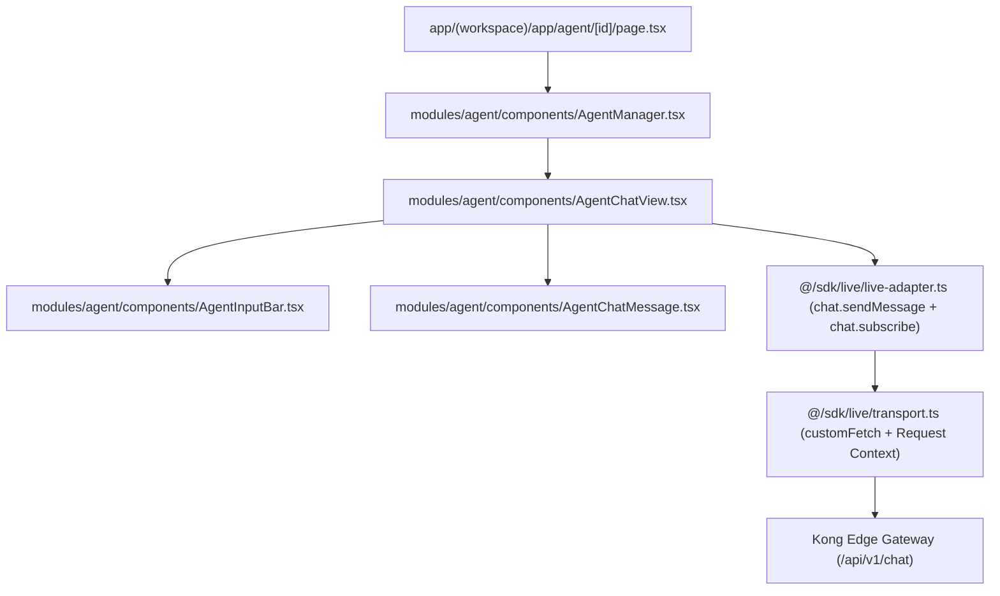
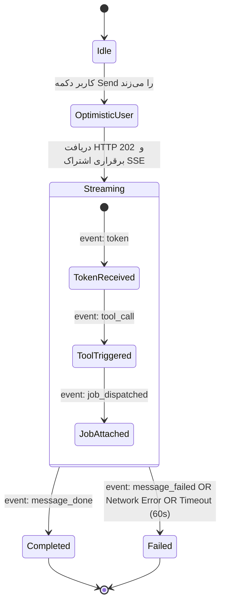

| فیلد / Field | مقدار / Value |
| :--- | :--- |
| **Title (EN)** | Studio Agent Chat State Machine & SSE Lifecycle Specification |
| **Title (FA)** | مشخصات فنی ماشین وضعیت چت ایجنت و چرخه حیات SSE در استودیو |
| **ID** | DOC-FE-004 |
| **Category** | `frontend` |
| **Status** | `Approved` |
| **Owner** | Frontend Team |
| **Last Updated** | 2026-10-12 |
| **Summary (EN)** | Technical specification governing the Next.js Studio Agent Chat state machine, Server-Sent Events (SSE) streaming lifecycle, error parsing protocol, and timeout safeguards. |
| **Summary (FA)** | مشخصات فنی ناظر بر ماشین وضعیت چت ایجنت استودیو در Next.js، چرخه حیات استریم SSE، پروتکل پارس خطا و الزامات تاب‌آوری کلاینت در برابر تاخیر سرور. |
| **Tags** | `frontend`, `state-machine`, `sse`, `agent-chat`, `error-handling`, `nextjs`, `resilience` |

---

# مشخصات فنی ماشین وضعیت چت ایجنت و چرخه حیات SSE (DOC-FE-004)

> **منبع موثق فنی (SSOT):** این سند مرجع رسمی معماری کلاینت برای ماژول `@/modules/agent` و درگاه `@/sdk` در مواجهه با پردازش‌های ناهمگام ایجنت و استریم رویدادها است.  
> **ران‌بوک عملیاتی مرتبط:** جهت عیب‌یابی سرتاسری سرور، شبکه و زیرساخت، به [ران‌بوک عملیاتی عیب‌یابی ایجنت (DOC-OPS-RB-001)](../07-devops/runbooks/RB-AGENT-001-execution-and-tool-lifecycle.md) مراجعه کنید.

---

## ۱. ساختار کامپوننت و مرزهای لایه‌ای (Component Architecture)

بر اساس قانون وابستگی یک‌طرفه ([DOC-FE-001](./workspace-architecture.md))، فرآیند چت ایجنت در مسیر زیر جریان دارد:



### ۱.۱. جداسازی وظایف کانتکست (Context Governance)
- **مالکیت کانتکست:** منحصراً در اختیار `StudioContextProvider` است. کامپوننت‌های UI چت (`AgentChatView`, `AgentInputBar`) **حق فراخوانی مستقیم متد `setTransportContext` یا نوشتن در `localStorage` را ندارند**.
- **ایزولاسیون شناسه فضای کاری (ADR-016):** شناسه فضای کاری فعال (`activeWorkspaceId`) مستقیماً از هویت تاییدشده سرور (`/api/v1/me/context`) دریافت می‌شود. کلاینت هرگز نباید در حالت فال‌بک، شناسه کاربر (`userId`) را به عنوان شناسه فضای کاری به هدر `X-Workspace-ID` تزریق کند.

---

## ۲. چرخه حیات رویدادهای سرور (SSE Event Protocol)

ارتباط استریمینگ ایجنت بر بستر Server-Sent Events از طریق مسیر زیر برقرار می‌شود:
$$\text{GET } /api/v1/chat/threads/\{threadId\}/messages/\{messageId\}/events$$

### ۲.۱. انواع رویدادها و پاکت‌های داده (Payload Contracts)
بر اساس قرارداد پروتکل چت ایجنت ([DOC-BE-006](../03-backend/media-and-model-pipeline.md))، رویدادهای زیر توسط کلاینت مصرف می‌شوند:

| نام رویداد (`event`) | ساختار دیتا (`data`) | وضعیت در ماشین حالت کلاینت | توضیحات |
|---|---|---|---|
| `token` | `{"delta": "Generating image..."}` | `streaming` | توکن‌های متنی استریم‌شده برای نمایش بلادرنگ به کاربر |
| `tool_call` | `{"tool_id": "text-to-image", "index": 0}` | `streaming` | سیگنال انتخاب و آماده‌سازی ابزار توسط ایجنت |
| `job_dispatched` | `{"job_id": "job-...", "tool_id": "..."}` | `streaming` (با انتساب Job ID) | ارسال موفقیت‌آمیز تسک به صف پردازش ناهمگام |
| `message_done` | `[{"type": "text"}, {"type": "job_ref"}]` | `completed` | اتمام مرحله ارکستراسیون ایجنت و تحویل رفرنس جاب |
| `message_failed` | `{"reason": "...", "error": "..."}` | `failed` | شکست اجرای ایجنت یا خطای رزرو سهمیه |

---

### ۲.۳. استاندارد فریم‌های سه‌خطی SSE و شِمای رویدادها (مصوب D-82)

پیرو تصمیم مصوب [D-82](../09-governance/decision-register.md#d-82):
- انواع رویدادهای استریم چت در لایه Protobuf تعریف شده و در کلاینت با تایپینگ قوی مصرف می‌شوند.
- قالب رسمی استریم در مسیر `GET /api/v1/chat/messages/{id}/events` سه‌خطی استاندارد است:
  ```http
  event: <event_type>
  data: <JSON_payload>

  ```
- کلاینت استودیو و لایه آداپتور `@/sdk` بر مبنای نام رویداد در خط `event:` و بدنه معتبر JSON در خط `data:` فریم‌ها را پردازش و وضعیت ماشین ایجنت را به‌روزرسانی می‌کنند.

---

## ۳. ماشین وضعیت پیام (Message State Machine)

هر پیام در کامپوننت چت دارای یکی از سه وضعیت قطعی زیر است:



### ۳.۱. قوانین انتقال وضعیت (Transition Invariants)
1. **پاکسازی وضعیت بارگذاری:** به محض دریافت رویداد `message_failed`، وضعیت پیام از `streaming` به `failed` جهش می‌کند. باقی ماندن اسپینر لودینگ یا متن موقت («در حال تولید تصویر...») پس از دریافت ایونت خطا **اکیداً ممنوع** است.
2. **عدم انباشت تردهای تکراری:** هر اشتراک SSE پس از صدور رویداد ترمینال (`message_done` یا `message_failed`) باید بلافاصله بسته (`unsubscribe()`) شود تا نشت حافظه رخ ندهد.

---

## ۴. استاندارد پارس خطا و نگاشت کاربرپسند (AIP-193 Error Handling)

### ۴.۱. تقدم فیلد `reason` بر `error`
در آداپتور زنده فرانت‌اند (`live-adapter.ts`)، پارس خطای رویداد `message_failed` طبق قانون زیر انجام می‌شود:
```typescript
const rawError = payload.error || payload.reason || (typeof payload === 'string' ? payload : undefined);
```

### ۴.۲. نگاشت دوزبانه خطاها (`formatAgentErrorMessage`)
کدهای خطای استاندارد پلتفرم نباید به صورت خام (مانند متن استک تریس یا خطای gRPC) به کاربر نمایش داده شوند. هلپر متمرکز `@/modules/agent/utils/errorMapping` نگاشت زیر را اعمال می‌کند:

| کد خطای استاندارد (AIP-193) | پیام فارسی (fa) | پیام انگلیسی (en) |
|---|---|---|
| `WALLET_NOT_FOUND` | کیف‌پول این فضای کاری یافت نشد. لطفاً وضعیت اشتراک و فضای کاری خود را بررسی کنید. | Workspace wallet not found. Please check your workspace and subscription status. |
| `INSUFFICIENT_CREDITS` | اعتبار حساب شما برای این عملیات کافی نیست. | Insufficient credits for this operation. |
| `PRICE_CHANGED` | هزینه تولید تغییر کرده است. لطفاً دوباره تلاش کنید. | Execution price changed. Please try again. |
| `RATE_LIMIT_EXCEEDED` | محدودیت تعداد درخواست. لطفاً کمی صبر کنید. | Rate limit exceeded. Please wait a moment. |
| `DEADLINE_EXCEEDED` / `timeout` | مهلت پردازش به پایان رسید. لطفاً مجدداً تلاش کنید. | Operation timed out. Please try again. |

---

## ۵. الزامات پایدار و خطوط قرمز مهندسی (Engineering Invariants)

1. **ممنوعیت لودینگ نامحدود (Bounded Spinners):**  
   هیچ المان رابط کاربری در فرانت‌اند مجاز به داشتن وضعیت لودینگ بی‌نهایت نیست. پس از حداکثر **۶۰ ثانیه** در صورت عدم دریافت رویداد تکمیلی از سرور، وضعیت باید به صورت خودکار به `failed` با پیام تایم‌اوت تغییر کند.
2. **جلوگیری از چرخه ارسال مجدد در رفرش مرورگر (Idempotent URL Consumption):**  
   هنگام انتقال از صفحه خالی به چت با پرامپت اولیه (`?prompt=...`)، به محض ارسال پرامپت باید کوئری‌استرینگ با متد `window.history.replaceState` از آدرس مرورگر حذف شود تا فشردن کلید **F5** منجر به تکرار درخواست هزینه‌دار نشود.
3. **عدم نشت سشن و اطلاعات فضای کاری:**  
   در متد خروج از حساب کاربری (`notifySignedOut`) در لایه ترنسپورت، کلید `lemmo_active_workspace` باید به طور کامل از `localStorage` پاک شود تا شناسه‌های سشن قبلی به حساب‌های بعدی سرایت نکنند.

---

## ۶. اسناد مرتبط
- [معماری فرانت‌اند Workspace (DOC-FE-001)](./workspace-architecture.md)
- [تصمیمات کلیدی معماری و SDK Gateway (DOC-FE-002)](./workspace-decisions.md)
- [تصمیم معماری فرم داینامیک و اتصال ابزارها (ADR-021)](../01-architecture/decisions/ADR-021-dynamic-generation-form-and-tool-model-binding.md)
- [ران‌بوک عملیاتی عیب‌یابی ایجنت و ابزارها (DOC-OPS-RB-001)](../07-devops/runbooks/RB-AGENT-001-execution-and-tool-lifecycle.md)
