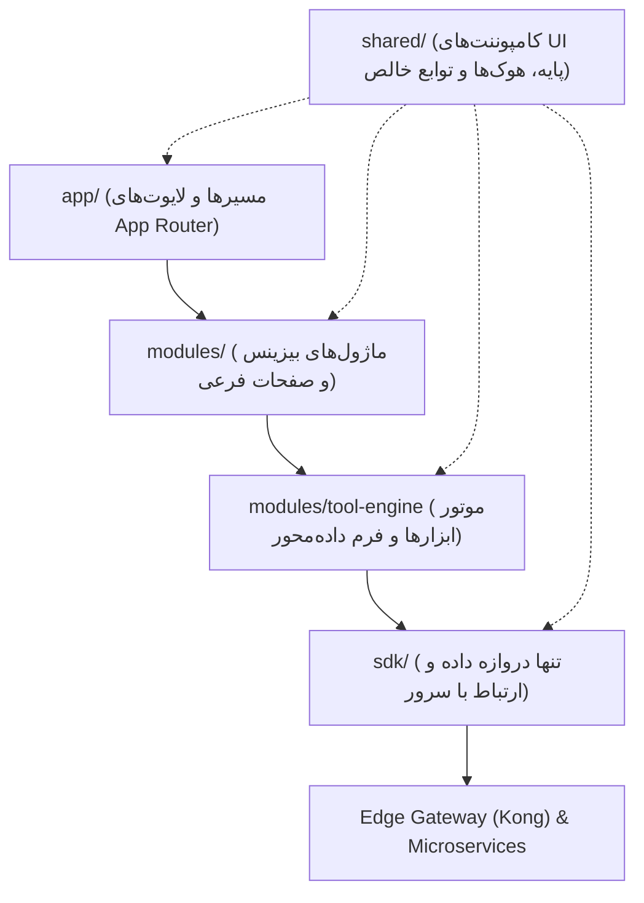
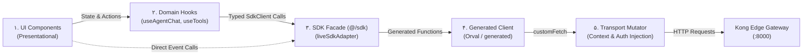

| فیلد / Field | مقدار / Value |
| :--- | :--- |
| **Title (EN)** | Frontend Engineering Style Guide & Architecture Standards |
| **Title (FA)** | راهنمای سبک کدنویسی و استانداردهای مهندسی فرانت‌اند |
| **ID** | DOC-FE-005 |
| **Category** | `frontend` |
| **Status** | `Draft` |
| **Owner** | Frontend Team / Architecture Guild |
| **Last Updated** | 2026-10-12 |
| **Summary (EN)** | Comprehensive frontend engineering guide: Zero-Endpoint Awareness, SDK Facade, multi-tier state management, strict TypeScript, logical CSS, and error handling. |
| **Summary (FA)** | سند جامع استانداردهای فرانت‌اند: کپسوله‌سازی شبکه، الگوی فاساد SDK، مدیریت چندلایه‌ای استیت، تایپ‌اسکریپت سخت‌گیرانه، خواص منطقی CSS و مدیریت خطا. |
| **Tags** | `frontend`, `styleguide`, `sdk`, `nextjs`, `react19`, `zustand`, `tanstack-query`, `adr-016` |

---

# راهنمای جامع سبک کدنویسی و استانداردهای مهندسی فرانت‌اند (DOC-FE-005)

> **وضعیت سند:** `پیش‌نویس حاکمیتی (Draft — Conditionally Approved)`  
> **مرجع تصمیم:** بررسی حاکمیت معماری مورخ ۲۰۲۶-۱۰-۱۲  
> **دامنه کاربرد:** کلیه ماژول‌ها، صفحات، هوک‌ها و کامپوننت‌های مخزن فرانت‌اند (`app/`)  
> **مراجع مصوب مادر:** [DOC-FE-001](./workspace-architecture.md)، [DOC-FE-002](./workspace-decisions.md)، [DOC-FE-004](./agent-chat-state-and-sse-lifecycle.md)، [ADR-013](../01-architecture/decisions/ADR-013-three-tier-edge-gateway-and-bff-architecture.md)، [ADR-016](../01-architecture/decisions/ADR-016-request-context-governance-and-workspace-policy.md)، [ADR-021](../01-architecture/decisions/ADR-021-dynamic-generation-form-and-tool-model-binding.md)، [DOC-DS-001](../04-design-system/STYLEGUIDE.md) و [RULES.md](../../../../RULES.md)

---

## ۱. اصول بنیادین و جهت‌گیری معماری (Foundational Philosophy)

### ۱.۱. جهت وابستگی یک‌طرفه (Strict One-Way Dependency)
طبق مصوبه قطعی [DOC-FE-001](./workspace-architecture.md)، ساختار کدهای برنامه دارای سلسله‌مراتب صلب و یک‌طرفه است. هرگونه پرش از لایه‌ها یا ایجاد وابستگی معکوس اکیداً ممنوع است:



- `app/` فاقد هرگونه منطق بیزینس (Domain Logic) یا فراخوانی سرور است.
- `shared/` فاقد هرگونه دانش از مفاهیم دامنه (چت، کانواس، تولید محتوا، کردیت) است.

### ۱.۲. اصل کپسوله‌سازی مطلق شبکه در لایه رابط کاربری (Zero-Endpoint Awareness)
طبق مصوبات [DOC-FE-001](./workspace-architecture.md) و [DOC-FE-002](./workspace-decisions.md)، فرانت‌اند فاقد هرگونه دانش از ساختار آدرس اندپوینت‌ها، پورت‌ها، یا کلاینت تولیدی Orval است:
- **مرز دسترسی الزامی:** هیچ کامپوننت، صفحه یا هوکی در لایه UI حق استفاده از رشته‌های حاوی آدرس شبکه (مانند `/api/v1/*`)، متدهای انتقال HTTP (`GET/POST`)، ایمپورت از مسیرهای `generated` یا فراخوانی مستقیم ترانسپورت شبکه (`fetch`، `axios` یا `customFetch`) را ندارد. تمام ارتباطات با سرور منحصراً از مرز تایپ‌شده `@/sdk` عبور می‌کنند.
- **الگوی مصرف داده (Recommended Architectural Pattern):** برای مدیریت وضعیت‌های ناهمگام، استریم‌ها، و کش سرور، الگوی استاندارد و توصیه‌شده، استفاده از **هوک‌های دامنه (Domain Hooks)** مبتنی بر `@tanstack/react-query` است (نظیر `useChatThread` یا `useGalleryItems`). بااین‌حال، مصرف مستقیم متدهای `@/sdk` توسط کامپوننت‌ها برای اکشن‌های ساده و رویدادمحور (Event Handlers) بدون ایجاد استیت پیچیده، تا زمان تصویب محدودیت جدید در یک ADR مستقل، مجاز شمرده می‌شود.

---

## ۲. معماری ارتباط با داده‌ها و الگوی SDK Facade

### ۲.۱. تفکیک عملیات ابزارمحور از عملیات عمومی پلتفرم
برای حفظ شفافیت و جلوگیری از رجیستری‌های موازی، عملیات فرانت‌اند به دو دسته رسمی تقسیم می‌شوند:

1. **عملیات پلتفرمی ثابت (Static Platform Methods):**  
   شامل مدیریت نشست، چت ایجنت، سوییچ ورک‌اسپیس و پروفایل کاربر. این عملیات از متدهای صریح و تایپ‌شده اینترفیس `SdkClient` استفاده می‌کنند (نظیر `sdk.chat.sendMessage(...)` یا `sdk.context.get()`). هیچ‌گونه شناسه رشته‌ای یا رجیستری دستی برای این متدها تعریف نمی‌شود.
2. **عملیات ابزارمحور کاتالوگ (Catalog-Driven Tool Operations):**  
   شامل ابزارهای هوش مصنوعی تولید و ویرایش محتوا (تولید تصویر، حذف پس‌زمینه و...). این عملیات از طریق متد عمومی `sdk.tools.execute(toolId, parameters)` فراخوانی شده و شناسه ابزار (`toolId` نظیر `'text-to-image'`) منحصراً از کاتالوگ رسمی ابزارها ([ADR-021](../01-architecture/decisions/ADR-021-dynamic-generation-form-and-tool-model-binding.md)) استخراج می‌شود.

### ۲.۲. مرزبندی لایه‌های دسترسی به داده (Layered Data Flow)
جریان فراخوانی داده و تفکیک مسئولیت‌ها مطابق دیاگرام زیر تعریف می‌شود:



1. **لایه کامپوننت‌ها (UI Components):** لایه نمایش که وضعیت‌ها را رندر کرده و با استفاده از هوک‌های دامنه یا فراخوانی مستقیم متدهای SDK، تعاملات کاربر را هدایت می‌کند.
2. **لایه هوک‌های دامنه (Domain Hooks Layer):** مدیریت چرخه‌عمر، کش‌گذاری با `@tanstack/react-query`، هماهنگی ماشین‌های وضعیت محلی و مصرف متدهای اینترفیس `SdkClient`.
3. **لایه فاساد پایدار (SDK Facade Layer - `src/sdk/`):** پیاده‌سازی اینترفیس عمومی و پایدار `SdkClient` توسط `liveSdkAdapter` (با سیاست تکامل و نسخه‌بندی کنترل‌شده قراردادها). این لایه نقش لایه ضدفساد (Anti-Corruption Layer) را در برابر نوسانات قراردادهای شبکه ایفا می‌کند.
4. **لایه کلاینت جنریت‌شده (Generated Client Layer - `src/sdk/live/generated/`):** کدهای خودکار و دست‌نخورده خروجی ابزار Orval که مستقیماً از `openapi.yaml` کامپایل می‌شوند.
5. **لایه ترانسپورت (Transport Mutator - `src/sdk/live/transport.ts`):** تابع `customFetch` که وظیفه انجماد کانتکست سشن، درج هدرهای چندمستأجره (`X-Workspace-Id`) و مدیریت نشست احراز هویت Kratos را بر عهده دارد (مصوب [ADR-016](../01-architecture/decisions/ADR-016-request-context-governance-and-workspace-policy.md)).

### ۲.۳. سیاست تفکیک تایپ‌های شبکه از مدل‌های دامنه
برای تضمین تفکیک لایه‌ها و مدیریت تکامل نرم‌افزار، سه سطح تایپ مجزا تعریف می‌شود:

1. **مدل‌های تبادل شبکه (Network DTOs):** تایپ‌های کامپایل‌شده درون `src/sdk/live/generated/` که نماینده دقیق ساختار بایت‌های دریافتی از سرور هستند. این تایپ‌ها فقط در لایه‌های Transport، Generated Client و آداپتور SDK قابل مشاهده هستند.
2. **مدل‌های دامنه مستقل (Independent Domain Entities):** اینترفیس‌ها و تعاریف مدل در `src/sdk/types.ts` یا ماژول‌های دامنه که نیازمندی‌های پردازش منطقی و تجمیع داده‌های کلاینت را بازتاب می‌دهند.
3. **وضعیت محلی رابط کاربری (Local UI View State):** تایپ‌های وضعیت بصری و زودگذر کامپوننت‌ها (مانند `isExpanded`، وضعیت تعامل کاربر و خطاهای فرم محلی).

> **قاعده Direct Alias:** بازنشر مستقیم تایپ‌های شبکه از طریق `export type { ... } from './generated'` صرفاً برای DTOهای کاملاً پایدار که نیازی به فیلدهای محاسباتی کلاینت ندارند مجاز است. لازم به یادآوری است که Direct Alias به خودی خود ثبات اینترفیس عمومی SDK را تضمین نمی‌کند و در صورت تغییر فیلدهای OpenAPI، لایه فاساد موظف به کنترل شکست احتمالی در سازگاری تایپ‌ها است.

### ۲.۴. قرارداد داده و سیاست برخورد با داده‌های ناقص (Data Contract Policy)
- **منع مطلق تولید داده‌های ساختگی خاموش (No Silent Fallback / Synthetic Data):** لایه آداپتور یا ترانسپورت تحت هیچ شرایطی حق ندارد نقص داده‌های سرور را با تولید مقادیر فرضی (مانند `Date.now()` جعلی برای تاریخ‌های غایب، رشته‌های توصیفی فیک، یا آرایه‌های پوچ به جای خطای معتبر) بپوشاند.
- **تفاوت لایه نمایش با لایه داده:** استفاده از اسکلت بارگذاری (Skeleton) یا متن پیش‌فرض در رابط کاربری (مانند «نامشخص» برای فیلدهای اختیاری UI) یک الگوی معتبر UX است، اما جایگزین‌سازی داده ساختگی در لایه آداپتور شبکه نقض صریح معماری است.
- **رفتار در زمان نقض قرارداد (Contract Violation):**  
  - فیلدهای اختیاری سرور در صورت غیبت با مقدار `undefined` به لایه‌های بالاتر تحویل داده می‌شوند.
  - فقدان فیلدهای اجباری طبق شِمای OpenAPI، خطای نقض قرارداد تلقی شده، در کنسول مانیتورینگ ثبت می‌گردد و سیستم را وارد وضعیت خطای صریح (Explicit Error State) می‌کند.

### ۲.۵. تحلیل شعاع تخریب تغییرات API (Blast Radius Calibration)
میزان تأثیرپذیری لایه‌های فرانت‌اند از تغییرات قراردادهای شبکه به صورت واقع‌بینانه در سه سطح ارزیابی می‌شود:
- **تغییرات ترانسپورت و روتینگ:** تغییرات فیزیکی نظیر تغییر مسیر اندپوینت، پارامترهای کوئری، یا بسته‌بندی پاسخ‌ها در پاکت ترانسپورت (مانند `{ data: ... }`) در وهله اول توسط کلاینت جنریت‌شده Orval و لایه `live-adapter.ts` جذب و تطبیق داده می‌شوند تا شعاع تخریب تغییرات شبکه به لایه‌های بالاتر به حداقل ممکن برسد، مشروط بر اینکه معنا و قرارداد بیزینسی داده تغییر نکرده باشد.
- **تکامل سازگار شِما (Compatible Evolution):** افزودن فیلدهای اختیاری سرور بدون شکستن لایه‌های بالا در آداپتور پشتیبانی می‌شود.
- **تغییرات رفتاری و شکسته‌شدن قرارداد (Breaking Behavioral/Semantic Changes):** تغییر در وضعیت‌های ماشین حالت، حذف یا اجباری‌شدن فیلدها، یا تغییر الزامات ورودی بیزینس ذاتاً در سراسر لایه‌ها (فاساد، هوک‌ها و کامپوننت‌ها) اثرگذار بوده و نیازمند به‌روزرسانی کنترل‌شده و هماهنگ است.

---

## ۳. مدیریت وضعیت و چرخه عمر برنامه (State Architecture)

### ۳.۱. مدل چهارسطحی استیت (Multi-Tier State)
1. **وضعیت کانتکست و ورک‌اسپیس (Studio State):** مدیریت وضعیت ۶‌گانه نشست (`uninitialized`, `loading`, `ready`, `no-workspace`, `error`, `signed-out`) منحصراً از طریق `StudioContextProvider` (مصوب [ADR-016](../01-architecture/decisions/ADR-016-request-context-governance-and-workspace-policy.md)).
2. **وضعیت سرور و کش (Server Cache):** مدیریت تمام داده‌های ناپایدار سرور توسط `@tanstack/react-query`. کلیدهای کش داده‌های چندمستأجره با شناسه کاربر و شناسه ورک‌اسپیس اسکوپ می‌شوند:
   ```typescript
   // استاندارد کلید کش داده‌های چندمستأجره وابسته به فضای کاری
   const queryKey = ['user', userId, 'workspace', wsId, 'chat', 'thread', threadId];

   // استاندارد کلید کش داده‌های سراسری کاربر
   const globalUserKey = ['user', userId, 'profile'];
   ```
3. **وضعیت کلاینت و فرم‌ها (Client Store):** استورهای ماژولار Zustand برای نگهداری ابزار فعال، تنظیمات ظاهری، تب‌های باز و فیلدهای موقت فرم.
4. **وضعیت محلی کامپوننت (Local State):** هوک‌های `useState` و `useReducer` برای مدیریت انیمیشن‌ها، حالت پاپ‌آپ‌ها و فوکوس عناصر.

### ۳.۲. تفکیک سیاست کش در خروج و تعویض فضای کاری (Session & Workspace Invalidation Protocol)
طبق مصوبات صریح [ADR-016](../01-architecture/decisions/ADR-016-request-context-governance-and-workspace-policy.md) (بند ۲.۱۸) و [DOC-FE-002](./workspace-decisions.md) (مصوبه OQ-037):

1. **پروتکل خروج و تعویض حساب کاربری (Sign-out / User Account Switch):**
   - **لغو درخواست‌های فعال:** اجرای قطعی `await queryClient.cancelQueries()`.
   - **تخلیه کامل حافظه نهان:** اجرای قطعی `queryClient.clear()` جهت حذف تمام داده‌های متعلق به کاربر پیشین.
   - **بازنشانی استورهای Zustand:** اجرای متد صریح `reset()` روی کلیه استورهای ماژولار مرتبط با کاربر.
   - **بازسازی درخت کامپوننت:** بازسازی (Remount) کامل درخت رابط کاربری از طریق تغییر `sessionGenerationId` در لایه ریشه.
2. **پروتکل تغییر فضای کاری (Workspace Switch):**
   - **ایزولاسیون بر پایه کلید:** از آنجا که کلیدهای داده‌های چندمستأجره حاوی `workspace: wsId` هستند، داده‌های ورک‌اسپیس‌های مختلف کاربر در کش تداخل نمی‌کنند؛ بنابراین نیازی به تخریب کل کش کاربر با `clear()` نیست.
   - **لغو کوئری‌های معلق و بستن استریم‌ها:** اجرای `queryClient.cancelQueries()` برای کوئری‌های در حال اجرای ورک‌اسپیس قبلی و فراخوانی فوری `close()` بر روی تمامی اتصالات باز `EventSource` جهت پیشگیری از نشت داده‌های جاب‌های فعال.
   - داده‌های عمومی کاربر با کلید `['user', userId, ...]` همچنان معتبر باقی می‌مانند.

---

## ۴. استانداردهای طراحی رابط کاربری و سیستم دیزاین (Design System Consumption)

این سند استانداردهای بصری را بازتعریف نمی‌کند؛ این استانداردها منحصراً تابع اسناد مصوب [DOC-DS-001](../04-design-system/STYLEGUIDE.md) و [DOC-DS-002](../04-design-system/typography.md) هستند:

### ۴.۱. توکن‌های رنگ و پوسته تیره (Color & Theme)
- برنامه به صورت ۱۰۰٪ Dark-only طراحی شده و پوسته روشن ندارد.
- درج مقادیر مستقیم Hex در کامپوننت‌ها ممنوع است؛ تمام رنگ‌ها از توکن‌های رسمی CSS (`--lemmo-color-*`, `--lemmo-surface-*`) مصرف می‌شوند.

### ۴.۲. تایپوگرافی و نمایش مقادیر عددی
- درج دستی `font-family` در کامپوننت‌ها ممنوع است. فونت‌های مصوب IRANSansX و Morabba به صورت محلی لود می‌شوند.
- کلیه فیلدهای عددی، مبالغ کردیت، تایمرها، شمارنده‌ها و تاریخ‌ها موظف به داشتن اتربیوت `data-numeric` یا کلاس `tabular-nums` هستند تا با فونت عددی Satoshi و با جهت ایزوله رندر شوند.

### ۴.۳. قوانین استفاده از CSS Logical Properties و وضعیت مختصات کانواس
- جهت پایه برنامه `<html dir="rtl">` است.
- استفاده از خواص فیزیکی `left`، `right`، `margin-left`، `margin-right`، `padding-left` و `padding-right` اکیداً ممنوع است.
- منحصراً از معادل‌های منطقی استفاده می‌شود: `margin-inline-start`, `margin-inline-end`, `padding-inline-*`, `inset-inline-*`.
- **رویه سیستم مختصات آزاد کانواس (تحت بررسی در OQ-061):** در ماژول‌های گرافیکی دوبعدی مختصات‌محور (نظیر Canvas Node Card)، سیستم موقعیت‌یابی برداری دکارتی با استفاده از `transform: translate(x, y)` مدیریت می‌شود. این موضوع به عنوان یک مشاهده تحلیلی از پیاده‌سازی جاری ثبت شده و استثنای قطعی تلقی نمی‌گردد؛ تصمیم‌گیری معماری نهایی در چارچوب OQ-061 انجام خواهد شد.

### ۴.۴. آیکون‌ها
- منحصراً از پکیج `synthline/react` استفاده می‌شود.
- سایزهای مجاز منحصراً: `12 | 16 | 20 | 24 | 28` پیکسل.
- ضخامت خطوط (`strokeWidth`) همواره ۱.۵ و رنگ آیکون همواره `color="currentColor"` تنظیم می‌شود.

---

## ۵. مدیریت تاب‌آوری و خطاها (Resilience & Error Handling)

### ۵.۱. استاندارد خطاهای سرور (RFC 7807 & AIP-193)
- خطاهای شبکه سرور ساختار استاندارد `ProblemDetails` همراه با فیلد یکتا و ماشین‌خوان `reason` را بازمی‌گردانند.
- لایه UI هرگز نباید متون خام فنی انگلیسی سرور یا استک‌ترس‌ها را به کاربر نمایش دهد.
- کدهای خطا بر اساس فیلد `reason` به پیام‌های بومی کاربری مپ شده و شناسه رهگیری (`request_id` یا `tracking_id`) جهت پشتیبانی ارائه می‌شود.

### ۵.۲. پوشش سه‌گانه حالت‌های رندرینگ
هر نمایی که داده‌های آسنکرون را نمایش می‌دهد موظف به پیاده‌سازی مستقل سه حالت است:
1. **Loading State:** اسکلت بارگذاری (Skeleton) سازگار با ابعاد بدون ایجاد Layout Shift.
2. **Empty State:** پیام راهنمای شفاف همراه با اکشن اصلی (CTA).
3. **Error State:** پیام خطای قابل فهم با دکمه تلاش مجدد (Retry) در صورت امکان.

---

## ۶. خط‌مشی کدنویسی و کیفیت مهندسی (Code Hygiene)

1. **زبان انگلیسی در سورس کد:**  
   طبق قانون ۳ سند `RULES.md`، تمام نام‌گذاری‌ها، تایپ‌ها، توابع، کامنت‌های درون کد و پیام‌های کامیت ۱۰۰٪ انگلیسی هستند. متن‌های فارسی صرفاً درون فایل‌های منبع زبان یا رشته‌های محلی‌شده UI مجاز می‌باشند.
2. **تایپ‌اسکریپت سخت‌گیرانه (TypeScript Strict Mode):**  
   استفاده از `any` در تعریف اینترفیس‌ها ممنوع است. کلیه تایپ‌ها باید به صورت ایستا و صریح تعیین گردند.
3. **پرهیز از مقادیر جادویی (No Magic Numbers):**  
   فواصل و اندازه‌ها منحصراً از پله‌های استاندارد توکن‌ها (`4px ladder`) استخراج می‌شوند.
