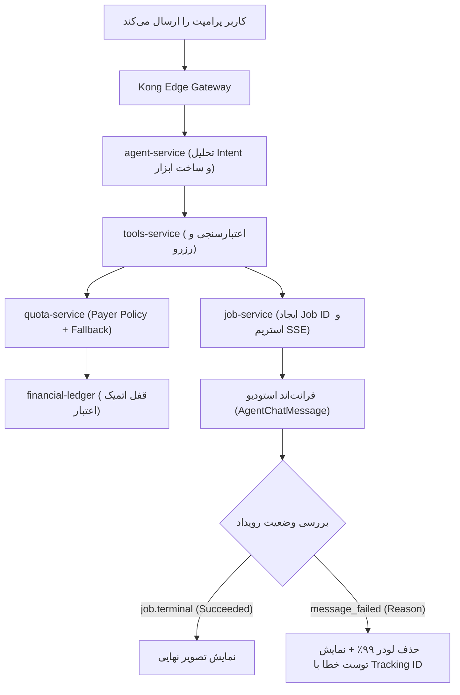

| فیلد / Field | مقدار / Value |
| :--- | :--- |
| **Title (EN)** | Agent Execution Lifecycle & State Remediation Guide |
| **Title (FA)** | راهنمای جامع عیب‌یابی و اصلاح چرخه وضعیت اجرای ایجنت در استودیو |
| **ID** | DOC-FE-004 |
| **Category** | `frontend` |
| **Status** | `Approved` |
| **Owner** | Frontend & Product Team |
| **Last Updated** | 2026-10-12 |
| **Summary (EN)** | Product and engineering guide detailing the root causes, frontend state machine fixes, quota wallet fallback resolutions, and diagnostic playbooks for agent tool execution issues in Studio. |
| **Summary (FA)** | مستند تحلیل مشکلات و راهکارهای ثبت‌شده برای تیم محصول و فنی پیرامون گیر کردن اجرای ابزارهای ایجنت در استودیو (وضعیت ۹۹٪)، همگام‌سازی ماشین وضعیت SSE، اصلاحات کیف‌پول و جعبه‌ابزار عیب‌یابی. |
| **Tags** | `frontend`, `product`, `troubleshooting`, `agent`, `state-machine`, `sse`, `remediation`, `quota` |

---

# راهنمای جامع عیب‌یابی و اصلاح چرخه وضعیت اجرای ایجنت (Agent Execution Remediation)

> **مخاطبان این سند:** تیم محصول (Product Managers)، تیم مهندسی فرانت‌اند و بک‌اند، و تیم پشتیبانی فنی و عملیات پلتفرم لِمو.

---

## ۱. شرح مسئله و نشانه‌های تجربه کاربری (Problem Statement)

در جریان استفاده از بخش گفتگوی هوشمند (Studio Agent Chat)، کاربران و تست‌کنندگان محصول در زمان درخواست تولید تصویر یا استفاده از ابزارهای هوش مصنوعی با نشانه‌های زیر مواجه می‌شدند:

1. **گیر کردن در وضعیت پردازش بدون پایان (Perpetual 99% Spinner):**
   * پس از ارسال پرامپت، وضعیت پیام به شکل `Generating image...` و سپس `Executing tool & synthesizing output... (99%)` تغییر می‌یافت اما تصویر یا خطایی تولید نمی‌شد و انیمیشن لودینگ تا ابد باقی می‌ماند.
2. **بی‌پاسخ ماندن بدون ارائه پیام خطای مناسب:**
   * در صورت بروز هرگونه اختلال در سرویس‌های پشتیبان (مانند نبود اعتبار، نبود کیف‌پول، یا قطع ارتباط با مدل ابری)، وضعیت پیام متوقف نمی‌شد و کاربر هیچ خطای قابل درکی دریافت نمی‌کرد.
3. **عدم وضوح در شناسایی محل توقف:**
   * تیم محصول و پشتیبانی ابزاری جهت سنجش سریع اینکه آیا درخواست کاربر به سرور رسیده یا در لایه کلاینت/اینتنت گیر کرده در اختیار نداشتند.

---

## ۲. تحلیل ریشه‌ای مشکلات (Root Cause Analysis)

بررسی دقیق و زنجیره‌ای هاپ‌های سیستم (از مرورگر تا لجر مالی) نشان داد که این مشکل از تجمیع ۴ عامل مستقل زیر پدید آمده بود:

### علت ۱: نقص ماشین وضعیت و پارس خطا در فرانت‌اند (Frontend State Handling)
* در لایه ارتباطی فرانت‌اند (`live-adapter.ts`)، رویداد خطای خاتمه پیام (`message_failed`) منحصراً فیلد `payload.error` را پارس می‌کرد. بر اساس پروتکل استاندارد پلتفرم، کد دلیل خطا در فیلد `payload.reason` (مانند `WALLET_NOT_FOUND` یا `DISPATCH_FAILED`) ارسال می‌شد.
* به دلیل خوانده نشدن این فیلد، فرانت‌اند ایونت خطا را نادیده می‌گرفت، وضعیت پیام از `generating` پاک نمی‌شد و کامپوننت چت در وضعیت معلق می‌ماند.

### علت ۲: رفتار شبیه‌سازی پیشرفت SSE در سرویس جاب (Simulated 99% Progress)
* در هندلر استریمینگ `job-service`، برای حفظ پایداری ارتباط HTTP کلاینت و جلوگیری از بسته شدن سوکت، به محض ثبت جاب ۳ فریم پیشرفت اولیه صادر می‌شد:
  $$\text{Progress} = i \times 33\% \implies 33\% \rightarrow 66\% \rightarrow 99\%$$
* پس از رسیدن به ۹۹٪، سرور منتظر پیام اتمام یا شکست قطعی از ورکر تصویرساز (`image-service`) می‌ماند.
* زمانی که ورکر به دلیل فیلترینگ یا تاخیر شبکه نتواند با پراویدر ابری ارتباط برقرار کند، هیچ ایونت پایانی صادر نمی‌شد و در نتیجه فرانت‌اند برای همیشه روی ۹۹٪ متوقف می‌ماند.

### علت ۳: تضاد معنایی شناسه کیف‌پول و ورک‌اسپیس در بک‌اند (Wallet vs Workspace ID)
* در لایه ارتباطی ابزارها (`tools-service`)، کلاینت در زمان رزرو سهمیه فیلد `WalletId` را با شناسه ورک‌اسپیس پر می‌کرد.
* سرویس سهمیه (`quota-service`) با دیدن مقدار در `WalletId`، فقط روی کلید اصلی دیتابیس (`wallet_id = UUID`) جستجو می‌کرد و جستجوی Fallback بر روی `owner_id = WorkspaceID` را متوقف می‌نمود که به خطای کاذب `WALLET_NOT_FOUND` منجر می‌شد.

### علت ۴: پنیک مانیفست ابزارها به دلیل کست صریح مقادیر عددی
* در متد `ListTools` سرویس ابزارها، کد تلاش می‌کرد مقدار فیلد پیش‌فرض ورودی (`f.DefaultValue`) را مستقیماً به رشته کست کند (`.(string)`). از آنجا که فیلدهای عددی مانند ابعاد یا تعداد مراحل از نوع اعشاری (`float64`) بودند، سرویس ابزارها پنیک می‌کرد و ارتباط قطع می‌شد.

---

## ۳. راهکارهای مصوب و پیاده‌سازی‌شده (Remediation Solutions)



### ۱. اصلاح ماشین وضعیت در فرانت‌اند
* **پشتیبانی کامل از `payload.reason` و `payload.error`:** در [`live-adapter.ts`](file:///home/behroz/Documents/Git/lemmo/app/src/sdk/live/live-adapter.ts)، هر دو فیلد همزمان پشتیبانی شدند.
* **پاکسازی وضعیت `generating`:** به محض دریافت خطای پایانی، وضعیت پیام بلافاصله به `failed` تغییر یافته و متن «در حال اجرای ابزار...» جای خود را به پیام خطای راهنما می‌دهد.
* **نگاشت خطاهای فنی به پیام‌های کاربرپسند:** در [`errorMapping.ts`](file:///home/behroz/Documents/Git/lemmo/app/src/modules/agent/utils/errorMapping.ts)، خطاهایی نظیر `WALLET_NOT_FOUND` به پیام واضح «کیف‌پول یا اعتبار کافی یافت نشد؛ لطفاً کیف‌پول ورک‌اسپیس را بررسی کنید» ترجمه می‌شوند و متن خام سیستمی به کاربر نمایش داده نمی‌شود.

### ۲. اصلاح منطق رزرو و کیف‌پول در بک‌اند
* **آزادسازی شناسه برای اعمال سیاست پرداخت (Payer Policy):** در `tools-service`، فیلد `WalletId` خالی ارسال می‌شود تا سیستم ابتدا کیف‌پول ورک‌اسپیس و سپس در صورت نیاز کیف‌پول کاربر را بررسی کند.
* **ایجاد Fallback منعطف:** در `quota-service`، اگر جستجوی کلید اصلی ناموفق بود، سیستم به طور خودکار ستون `owner_id` را بررسی می‌کند.

### ۳. بوت‌استرپ پایدار محیط توسعه (`make dev-seed`)
* فرمانی رسمی و خودکار پیاده‌سازی شد که برای تمام کاربران تست، ورک‌اسپیس شخصی و کیف‌پول اولیه با ۱۰۰۰ اعتبار تست ایجاد و در لجر ثبت می‌کند تا هیچ تستی به دلیل نبود کیف‌پول شکست نخورد.

### ۴. ابزار صحه‌گذاری و رهگیری (`dev-verify` و `trace.sh`)
* **`make dev-verify`:** سوئیت آزمون خودکار برای تضمین پایداری مسیر طلایی (رزرو، جاب، تسویه) و مسیر منفی (رد کیف‌پول ناموجود).
* **`scripts/dev/trace.sh <request_id>`:** ابزار تشخیصی برای ردیابی هر درخواست در کانتینرها، ردیس، ربیت‌ام‌کیو و پستگرس.

---

## ۴. راهنمای عملیاتی عیب‌یابی برای تیم محصول و پشتیبانی (Support Playbook)

اگر در آینده کاربری گزارش داد که درخواستش بی‌پاسخ مانده یا روی لودینگ گیر کرده است، تیم پشتیبانی یا محصول می‌تواند بدون نیاز به دسترسی به سرور و تنها از طریق مرورگر، مراحل زیر را طی کند:

### گام ۱: اجرای اسکریپت تشخیصی در کنسول مرورگر
در همان صفحه استودیو، کلید **F12** را زده، وارد تب **Console** شوید و اسکریپت زیر را اجرا کنید:

```javascript
(async () => {
  console.log('%c🔍 [Lemmo Studio Diagnostic Probe]', 'color: #d1fe17; background: #111; font-weight: bold; padding: 4px;');
  const whoami = await fetch('/api/v1/auth/sessions/whoami', { credentials: 'include' });
  console.log('۱. وضعیت احراز هویت:', whoami.ok ? '✅ معتبر' : '❌ نامعتبر');
  
  const tools = await fetch('/api/v1/tools', { credentials: 'include' });
  console.log('۲. اتصال به گیت‌وی Kong:', tools.ok ? '✅ متصل' : '❌ خطا');

  const threads = await (await fetch('/api/v1/chat/threads', { credentials: 'include' })).json();
  const threadId = Array.isArray(threads) ? threads[0]?.id : threads.threads?.[0]?.id;
  if (threadId) {
    const msgs = await (await fetch(`/api/v1/chat/threads/${threadId}/messages`, { credentials: 'include' })).json();
    const lastMsg = (Array.isArray(msgs) ? msgs : msgs.messages || []).slice(-1)[0];
    console.log('۳. وضعیت پیام آخر:', lastMsg?.status, '| Job ID:', lastMsg?.job_id || 'ندارد');
    if (lastMsg?.job_id) {
      const job = await (await fetch(`/api/v1/jobs/${encodeURIComponent(lastMsg.job_id)}`, { credentials: 'include' })).json();
      console.log('۴. وضعیت جاب در دیتابیس:', job.status, '| خطا:', job.error_message || 'ندارد');
    }
  }
})();
```

### گام ۲: تفسیر خروجی کنسول
| خروجی کنسول | معنا و علت ریشه‌ای | اقدام لازم |
|---|---|---|
| **احراز هویت: نامعتبر** | کوکی نشست کاربر منقضی شده است. | رفرش صفحه یا لاگین مجدد از صفحه ورود. |
| **گیت‌وی: خطا** | کانتینر Kong یا شبکه محلی در دسترس نیست. | بررسی روشن بودن داکر و سرویس گیت‌وی. |
| **پیام آخر: فاقد Job ID** | اینتنت پردازش نشده یا در مرحله رزرو کیف‌پول متوقف شده است. | اجرای `make dev-seed` برای شارژ اعتبار کیف‌پول. |
| **وضعیت جاب: RUNNING** | جاب ثبت شده اما ورکر در انتظار سرور ابری تصویرساز است. | بررسی دسترسی شبکه اینترنت کانتینر تصویرساز به سرور هوش مصنوعی. |

---

## ۵. تعهدات و قوانین ماندگار (Engineering Invariants)

1. **ممنوعیت استفاده از استیت‌های نامحدود (Bounded Spinners):**  
   هیچ کامپوننتی در فرانت‌اند مجاز نیست استیت لودینگ بدون تایم‌اوت محافظ داشته باشد. پس از سپری شدن زمان مشخص (مثلاً ۶۰ ثانیه)، در صورت عدم دریافت رویداد تکمیلی، لودر باید به وضعیت هشدار زمان پاسخگویی (Timeout State) تغییر کند.
2. **پشتیبانی الزامی از تمام فیلدهای خطای پروتکل:**  
   در تمام آداپتورهای ارتباطی، همیشه باید فیلد `reason` در اولویت خوانش قرار گیرد و هرگز تنها به یک کلید مانند `error` اتکا نشود.
3. **تطابق آزمون‌های دوره‌ای با `make dev-verify`:**  
   پیش از تحویل هر ریلیز جدید به تیم محصول، اجرای دستور `make dev-verify` جهت اطمینان از سلامت زنجیره رزرو، صف و تسویه الزامی است.
