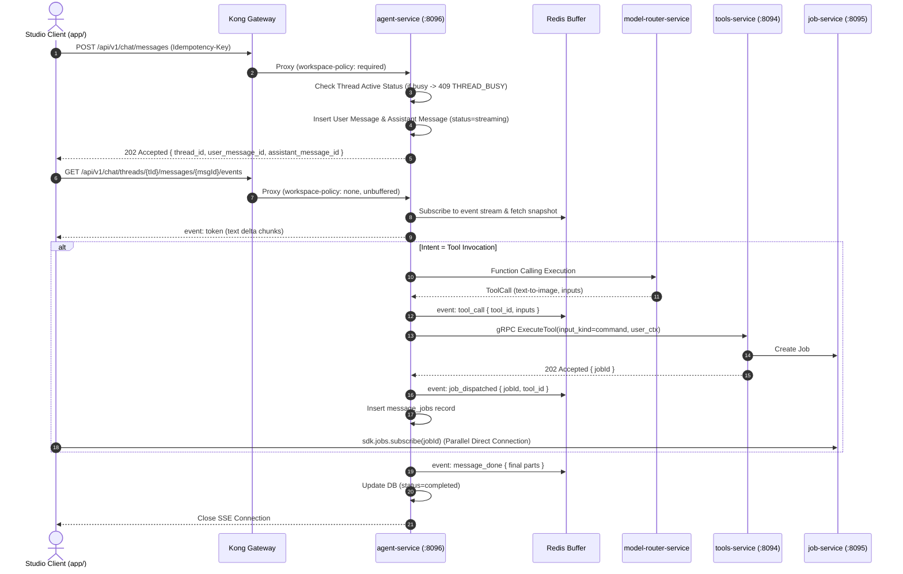

| فیلد / Field | مقدار / Value |
| :--- | :--- |
| **Title (EN)** | Studio Agent Chat Service & Streaming Pipeline Specification |
| **Title (FA)** | مشخصات فنی سرویس چت ایجنت استودیو و پایپ‌لاین استریم |
| **ID** | DOC-BE-012 |
| **Category** | `backend` |
| **Status** | `Approved` |
| **Owner** | تیم پلتفرم بک‌اند / @behroz |
| **Last Updated** | 2026-10-09 |
| **Summary (EN)** | Authoritative specification for Stage 16B following ADR-020: Defines agent-service Clean Architecture (DualServer HTTP 8096 + gRPC 50066, lemmo_agent DB), workspace/user-isolated immutable threads (404 on access mismatch, private to author), decoupled message lifecycle (POST /messages returning 202 Accepted, GET /messages/{id}/events per-message SSE stream with Last-Event-ID and THREAD_BUSY protection), typed parts schema with message_jobs mapping, client-driven job status observation via sdk.jobs.subscribe, deterministic containerized LLM emulator (lemmo-mock-llm) in dev/test with fail-fast in production, dual Kong routing, and decommission of lemmo-mock-chat. |
| **Summary (FA)** | سند منبع واحد حقیقت (SSOT) مرحله 16B پیرو مصوبه ADR-020: کدگذاری معماری تمیز سرویس agent-service (دوال‌سرور پورت HTTP 8096 و gRPC 50066، دیتابیس lemmo_agent)، رشته‌های تغییرناپذیر اسکوپ‌شده به کاربر و ورک‌اسپیس (خطای ۴۰۴ در عدم تطابق، حریم خصوصی مطلق پرامپت‌ها)، چرخه حیات تفکیک‌شده پیام (ارسال با ۲۰۲ و استریم مجزای هر پیام با رویدادهای تایپ‌دار، Last-Event-ID و خطای THREAD_BUSY)، ساختار parts تایپ‌دار با جدول message_jobs، اتصال مستقیم کلاینت به استریم جاب‌ها، شبیه‌ساز قطعی LLM در dev/test (کانتینر lemmo-mock-llm) با منع قطعی در پروداکشن، تفکیک دو روت چت در Kong و حذف کامل lemmo-mock-chat. |
| **Tags** | `doc-be-012`, `agent-service`, `adr-020`, `chat`, `sse`, `model-router`, `stage16b` |

---

## ۱. معرفی و اهداف معمارانه (Overview & Objectives)

این سند پیرو مصوبات رسمی **[ADR-020](../01-architecture/decisions/ADR-020-studio-agent-chat-service-architecture.md)**، پاسخ‌های مصوب سوالات معماری OQ-056 تا OQ-060 و تصمیمات کلان قبلی (ADR-016، ADR-018، ADR-019) تدوین شده و به عنوان **منبع واحد حقیقت (SSOT)** برای پیاده‌سازی مهندسی مرحله 16B عمل می‌کند.

### اهداف اصلی مرحله 16B:
1. **استقرار مایکروسرویس `agent-service`:** راه‌اندازی با معماری تمیز (Clean Architecture) در Go بر بستر سرور دوگانه (`core/bootstrap.DualServer`) بر پورت‌های HTTP `8096` و gRPC `50066`.
2. **پایگاه داده اختصاصی `lemmo_agent`:** نگهداری رشته‌ها و پیام‌ها با ایزولاسیون کامل حریم خصوصی کاربر و ورک‌اسپیس.
3. **تفکیک چرخه حیات پیام و پروتکل استریم SSE:** تفکیک ارسال پیام (`POST /messages` با پاسخ `202 Accepted`) از استریم بلادرنگ رویدادها (`GET .../messages/{id}/events`).
4. **پایپ‌لاین قطعی شبیه‌ساز مدل زبانی (`lemmo-mock-llm`):** کانتینر ایزوله برای محیط‌های تست محلی و CI، با ممنوعیت کامل منطق جعلی در کدهای پروداکشن.
5. **اتصال کلاینت استودیو و حذف ماک چت:** حذف ۱۰۰٪ کانتینر ماک `lemmo-mock-chat` و اتصال کامپوننت `AgentChatView.tsx` به سرویس زنده.

---

## ۲. مشخصات مایکروسرویس چت ایجنت (`agent-service`)

### ۲.۱. توپولوژی و پورت‌ها
- **نام کانتینر:** `lemmo-svc-agent`
- **پورت HTTP:** `8096` (سرویس‌دهی روت‌های REST و SSE چت به Kong Gateway)
- **پورت gRPC:** `50066` (رجیستری ارتباطات داخلی سرویس مش)
- **پایگاه داده اختصاصی:** PostgreSQL `lemmo_agent`
- **کش و بافر رویدادها:** Redis مشترک با پیشوند کلید `lemmo:chat:events:{message_id}`

### ۲.۲. پایگاه داده `lemmo_agent` (اسکیما DDL)

```sql
-- 000001_init_agent_schema.up.sql

CREATE TABLE IF NOT EXISTS chat_threads (
    id VARCHAR(64) PRIMARY KEY,
    workspace_id VARCHAR(64) NOT NULL,
    user_id VARCHAR(64) NOT NULL,
    title VARCHAR(255) NOT NULL DEFAULT 'New Conversation',
    active_message_id VARCHAR(64),
    created_at TIMESTAMPTZ NOT NULL DEFAULT NOW(),
    updated_at TIMESTAMPTZ NOT NULL DEFAULT NOW(),
    deleted_at TIMESTAMPTZ
);

CREATE INDEX IF NOT EXISTS idx_chat_threads_ws_user ON chat_threads(workspace_id, user_id) WHERE deleted_at IS NULL;

CREATE TABLE IF NOT EXISTS chat_messages (
    id VARCHAR(64) PRIMARY KEY,
    thread_id VARCHAR(64) NOT NULL REFERENCES chat_threads(id) ON DELETE CASCADE,
    workspace_id VARCHAR(64) NOT NULL,
    user_id VARCHAR(64) NOT NULL,
    role VARCHAR(32) NOT NULL, -- 'user', 'assistant', 'system'
    status VARCHAR(32) NOT NULL DEFAULT 'completed', -- 'pending', 'streaming', 'awaiting_confirmation', 'completed', 'failed', 'cancelled'
    sequence_number BIGINT NOT NULL,
    content TEXT NOT NULL DEFAULT '',
    parts JSONB NOT NULL DEFAULT '[]'::jsonb, -- typed blocks: text, tool_call, job_ref, asset_ref
    input_kind VARCHAR(32) NOT NULL DEFAULT 'natural_language', -- 'structured', 'command', 'natural_language'
    expected_cost INT,
    error_reason VARCHAR(64),
    idempotency_key VARCHAR(128),
    created_at TIMESTAMPTZ NOT NULL DEFAULT NOW(),
    updated_at TIMESTAMPTZ NOT NULL DEFAULT NOW()
);

CREATE UNIQUE INDEX IF NOT EXISTS idx_chat_messages_idemp ON chat_messages(workspace_id, user_id, idempotency_key) WHERE idempotency_key IS NOT NULL;
CREATE INDEX IF NOT EXISTS idx_chat_messages_thread_seq ON chat_messages(thread_id, sequence_number ASC);

CREATE TABLE IF NOT EXISTS message_jobs (
    message_id VARCHAR(64) NOT NULL REFERENCES chat_messages(id) ON DELETE CASCADE,
    job_id VARCHAR(64) NOT NULL,
    tool_id VARCHAR(64) NOT NULL,
    tool_version INT NOT NULL DEFAULT 1,
    created_at TIMESTAMPTZ NOT NULL DEFAULT NOW(),
    PRIMARY KEY (message_id, job_id)
);

CREATE INDEX IF NOT EXISTS idx_message_jobs_job ON message_jobs(job_id);
```

---

## ۳. چرخه حیات پیام و جریان استریم بلادرنگ (Message & SSE Pipeline)



---

## ۴. روت‌های Kong Gateway و حذف کانتینر ماک

```yaml
# پیکربندی روت‌های Kong
services:
  - name: agent-service
    url: http://lemmo-svc-agent:8096
    routes:
      - name: chat-events-route
        paths:
          - ~/api/v1/chat/threads/[^/]+/messages/[^/]+/events$
        tags:
          - "workspace-policy:none"
        strip_path: false
        response_buffering: false
        request_buffering: false

      - name: chat-standard-route
        paths:
          - /api/v1/chat
        tags:
          - "workspace-policy:required"
        strip_path: false
```

- **کانتینر `lemmo-mock-chat`:** پس از تایید تست‌های انطباق و آزمون‌های لایو، به طور کامل از `infra/compose/dev.yml` حذف می‌شود.


## الحاقیه تصمیم محصول: تکمیل تشخیص نیت با DeepSeek — 2026-10-13

### وضعیت واقعی و دامنه

مالک محصول اعلام کرده است تولید تصویر اکنون در سطح محصول کار می‌کند. این اعلام به عنوان وضعیت گزارش‌شده ثبت می‌شود؛ آزمون مالی، تاریخچه و پذیرش انتها‌به‌انتها مستقل باقی می‌مانند. در این بررسی هیچ تولید پولی انجام نشده است.

بررسی کد فعلی نشان می‌دهد پایه Intent وجود دارد ولی اتصال واقعی DeepSeek در مسیر بررسی‌شده تکمیل نیست:

- `api/services/agent-service/internal/app/service.go:341`: فراخوانی `llmClient.Generate`؛ در خطا یا نبود tool call، مسیر `handleDirectImageSynthesis` فعال می‌شود.
- `api/services/agent-service/internal/adapters/llm/client.go:19`: endpoint پیش‌فرض mock، timeout ثابت و قرارداد اختصاصی `POST /generate` با `reply_text/tool_calls`؛ این قرارداد مستقیماً API Chat Completions نیست.
- `api/services/agent-service/internal/config/config.go:52` و `deploy/compose.yaml:18`: آدرس `lemmo-mock-llm` در تنظیمات فعلی مسیر مذکور.

پس تسک آتی باید adapter و قرارداد موجود را تکمیل کند، نه اینکه نبود کامل Intent را فرض و سرویس جدیدی ایجاد کند. مسئولیت تشخیص نیت طبق ADR-019 در `agent-service` می‌ماند؛ جای adapter ارتباط با Provider باید با مسیرهای موجود مدل و قراردادهای پروژه تطبیق داده شود.

### تصمیم و رفتار هدف

- انتخاب اولیه پیشنهادی مالک محصول: `deepseek-flash` در حالت non-thinking، با هدف تأخیر کم و هزینه پایین. برتری کیفیت و پایداری باید با ارزیابی فارسی/انگلیسی و سنجش p50/p95 اثبات شود.
- دامنه فعلی تشخیص، تولید تصویر و تفکیک ورودی مبهم/پشتیبانی‌نشده است. طبقه‌های نمونه فروشگاهی مانند refund یا order_status متعلق به محصول نیستند و کپی نشوند.
- ورودی صریح تولید تصویر یا command معتبر از مسیر قطعی موجود عبور کند؛ نیاز نیست همه درخواست‌های ساخت‌یافته هزینه تشخیص نیت بپردازند. فرمان‌ها در آینده طبق قرارداد قابلیت‌ها توسعه یابند؛ مدل حق اختراع command یا tool_id ندارد.
- متن آزاد باید به خروجی معتبر و ابزار allowlist تبدیل شود. JSON قابل parse به‌تنهایی کافی نیست؛ schema، intent، آرگومان‌ها و دسترسی ابزار باید اعتبارسنجی شوند. confidence خوداظهاری مدل معیار قطعی صحت نیست.
- در ورودی آزاد، timeout، خروجی خالی، JSON ناقص یا نیت مبهم نباید خودکار تولید پولی تصویر را آغاز کند؛ پیام روشن یا درخواست رفع ابهام نمایش داده شود. رفتار خطای Intent از حالت صریح «تولید تصویر» جدا باشد.
- تولید فقط با اقدام کاربر انجام شود؛ انتقال پرامپت از صفحه نخست همچنان پیش‌نویس است. تشخیص نیت مجوز عبور از قیمت، رزرو، دسترسی، moderation یا idempotency نیست.
- fallback به مدل Pro یک گزینه آتی و پیش‌فرض خاموش است؛ فعال‌سازی آن نیازمند شواهد کیفیت، سقف هزینه و سیاست کانفیگ‌شده است، نه retry خودکار همه خطاها.

### تنظیمات پیشنهادی و منابع رسمی

در 2026-10-13 نام `deepseek-flash`، base URL و پشتیبانی JSON و non-thinking در [مستندات رسمی مدل‌ها](https://api-docs.deepseek.com/quick_start/pricing/) بررسی شد. پارامتر خام Chat Completions برای غیرفعال‌کردن thinking برابر `{"thinking":{"type":"disabled"}}` است؛ در OpenAI SDK در `extra_body` قرار می‌گیرد، طبق [راهنمای Thinking Mode](https://api-docs.deepseek.com/guides/thinking_mode/).

| تنظیم | مبنای طراحی کانفیگ؛ نه ثابت سورس |
| --- | --- |
| مدل / base URL | `deepseek-flash` / `https://api.deepseek.com` |
| حالت | non-thinking صریح؛ اتکا به پیش‌فرض Provider ممنوع |
| دما | نقطه شروع ارزیابی ۰ تا ۰٫۳؛ مقدار نهایی با eval |
| خروجی | `response_format: {"type":"json_object"}` همراه schema سمت سرور |
| حداکثر خروجی | بازه ۱۶ تا ۶۴ صرفاً پیشنهاد اولیه طبقه‌بندی کوچک؛ با schema واقعی و قطع‌نشدن JSON تعیین شود |
| پرامپت | کوتاه، نسخه‌دار و ثابت، با intentهای واقعی محصول و مثال JSON؛ few-shot در صورت نیاز ارزیابی |
| قابلیت اطمینان | timeout، سقف retry، backoff، concurrency محلی، محدودیت ورودی/تاریخچه و بودجه قابل تنظیم |

[راهنمای JSON](https://api-docs.deepseek.com/guides/json_mode/) احتمال پاسخ خالی و خطر قطع JSON با max_tokens کم را ذکر می‌کند؛ هر دو باید تست شوند. پرامپت ثابت امکان استفاده از cache را بهبود می‌دهد ولی cache hit تضمین‌شده نیست. سقف concurrency اعلامی Provider نیز تضمین latency یا پایداری نیست و سقف محلی نباید صرفاً برابر حداکثر Provider قرار گیرد.

قیمت‌ها و ظرفیت‌ها در سورس هاردکد نشوند؛ هنگام تدوین تسک نرخ روز با تاریخ منبع ثبت شود. برای بودجه‌بندی، cache miss و هزینه Retry لحاظ شوند. هزینه تشخیص نیت جزو سقف تجمعی ۲ دلاری آزمون پولی این دور است، نه بودجه اضافه بر تولید تصویر. درخواست تعاملی برای انتظار off-peak معطل نشود.

### کلید و آماده‌سازی تسک

وجود کلید API در محل خصوصی `DONT-TOUCH-ME` صرفاً طبق اعلام مالک محصول ثبت می‌شود؛ این فایل در این بررسی باز یا اعتبار کلید آزمایش نشده است. مقدار کلید نباید در سند، تسک، لاگ، فرانت یا فایل نسخه‌دار قرار گیرد. تزریق secret فقط از مسیر امن سمت سرور مطابق DOC-ARCH-009؛ در صورت فعال‌بودن adapter، نبود secret موردنیاز باید fail-fast باشد.

این الحاقیه ورودی مرحله بعد تدوین مشخصات و تسک است؛ اتصال Provider اکنون پیاده‌سازی یا فعال نشده است. در B01 قرارداد intent/schema، مسیر adapter و معیار کیفیت/تأخیر/هزینه تعیین شود؛ یک زیرتسک مشخص با مالک Agent و وابستگی به B04 کنترل هزینه و B07 تجربه خطا تدوین شود و پذیرش آن در B09 قرار گیرد. تعداد بسته‌های اصلی همچنان ۹ است.

### چک‌لیست پذیرش الحاقیه

- [ ] قرارداد intent و ابزارهای مجاز فعلی/آتی با ADR-019 سازگار و مصوب است.
- [ ] adapter واقعی، config و تزریق secret بدون وابستگی تولیدی به mock پیاده‌سازی شده‌اند.
- [ ] non-thinking صریح، JSON معتبر و مدیریت خروجی خالی/ناقص/ناشناخته تست شده‌اند.
- [ ] خطای تشخیص متن آزاد به تولید پولی ناخواسته منجر نمی‌شود؛ مسیر صریح تصویر رگرسیون ندارد.
- [ ] eval فارسی/انگلیسی، ورودی مبهم، command نامعتبر و تلاش برای انتخاب ابزار غیرمجاز ثبت شده است.
- [ ] p50/p95، نرخ خطا، هزینه واقعی و مصرف تجمعی بودجه با شواهد سنجیده شده‌اند.
- [ ] Retry و درخواست تکراری هزینه نامحدود یا اجرای ابزار تکراری نمی‌سازند؛ CI و بازبین مستقل تأیید کرده‌اند.

---

## ۷. الزامات مصوب D-04: مسیر پردازش متن آزاد و فرمان‌ها در MVP

پیرو تصمیم مصوب **[D-04 در ماتریس تصمیمات](../09-governance/decision-register.md#d-04)** و تاییدیه مالک محصول (۲۰۲۶-۱۰-۱۶):
1. **مسیر واحد ToolInvocation:** متن آزاد و فرمان‌ها (Commands) هر دو نهایتاً به مسیر مشترک `ToolInvocation` با قیمت‌گذاری، کنترل دسترسی و رزرو بودجه یکپارچه متصل می‌شوند.
2. **متن آزاد با مدل سبک (بدون سرویس مجزا):** پردازش متن آزاد توسط مدل سبک (`deepseek-flash` در حالت non-thinking، با کانفیگ نسخه‌دار) انجام شده و نیت به ابزار مجاز هدایت می‌شود. سرویس جداگانه‌ای به نام Intent Service ساخته نمی‌شود.
3. **فرمان‌ها بدون پردازش نیت:** دستورهای صریح (مانند `/imagine`) نیازی به نیت‌خوانی با LLM ندارند و به صورت مستقیم و بدون هزینه/تاخیر اضافی به ابزار مربوطه وصل می‌شوند.
4. **متن مبهم = پرسش رفع ابهام:** در صورت هرگونه ابهام در متن آزاد، سیستم موظف به بازگرداندن پرسش رفع ابهام به کاربر است و نباید هیچ‌گونه فراخوانی پولی ناخواسته انجام دهد.
5. **اجرای پولی فقط با کلیک کاربر:** تولید تصویر تنها پس از نمایش برآورد دقیق قیمت و با کلیک مستقیم کاربر آغاز می‌گردد؛ ارسال پرامپت یا نیت‌خوانی خودکار مجوزی برای اجرای پولی خودکار نیست.
