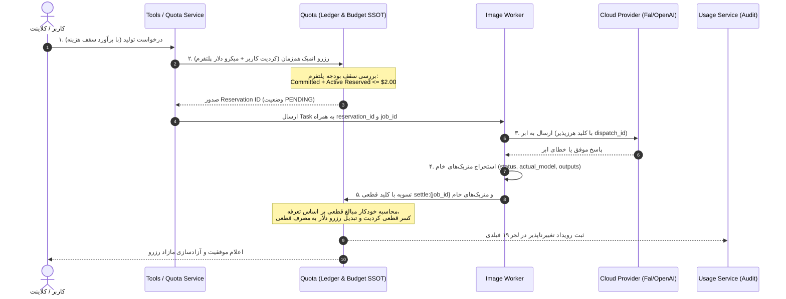

| فیلد / Field | مقدار / Value |
| :--- | :--- |
| **Title (EN)** | Credit Economy, Flat Pricing, Rate Card & Ledger Architecture |
| **Title (FA)** | معماری اقتصاد کردیت، مدل قیمت‌گذاری ثابت، نرخ‌نامه و دفترکل تغییرناپذیر |
| **ID** | DOC-BE-007 |
| **Category** | `backend` |
| **Status** | `Approved` |
| **Owner** | Backend, Platform & Finance Team |
| **Last Updated** | 2026-10-15 |
| **Summary (EN)** | Comprehensive specification for Flat pricing model, Rate Card, pre-execution cost estimation, 19-field immutable Credit Ledger, Bucket expiry model, Payer Policy, and service architecture. |
| **Summary (FA)** | مشخصات جامع مدل اقتصادی کردیت، فرمول قیمت‌گذاری ثابت (Flat)، پیش‌برآورد هزینه، دفترکل تغییرناپذیر ۱۹ فیلدی، مدل سطل‌های کردیت، سیاست پرداخت‌کننده و معماری سرویس‌ها. |
| **Tags** | `backend`, `credits`, `ledger`, `pricing`, `rate-card`, `billing`, `payer-policy`, `quota-service`, `usage-service` |

---

# معماری اقتصاد کردیت، نرخ‌نامه و دفترکل تغییرناپذیر (Credit & Ledger Architecture)

> **اصل بنیادین شفافیت مالی (Financial Transparency Invariant):**  
> در پلتفرم Lemmo، مدل قیمت‌گذاری عملیات به صورت **نرخ ثابت (Flat Pricing)** است. تفاوت هزینه‌های نوسانی ارائه‌دهندگان ابری ریسک تجاری پلتفرم است و کاربر نهایی همواره بر مبنای نرخ‌نامه مصوب، شفاف و از پیش‌تعیین‌شده شارژ می‌شود. هرگونه تغییر در اعتبار کاربر منحصراً از طریق یک ورودی تغییرناپذیر در دفترکل (Append-Only Ledger) ثبت می‌گردد.

---

## ۱. مدل قیمت‌گذاری ثابت و فرمول محاسبه (Flat Pricing & Formula - E1.1)

هزینه اجرای هر عملیات تولید یا ادیت بر مبنای فرمول زیر محاسبه می‌شود:

$$\text{Credits} = \left\lceil \text{Base}(\text{Tool}, \text{Model Tier}) \times \prod \text{Multipliers}(\text{Resolution}, \text{Steps}, \text{Duration}, \dots) \right\rceil$$

### اصول حاکم بر نرخ‌نامه (Rate Card):
1. **نرخ‌نامه نسخه‌دار ماشین‌خوان:** کلیه قیمت‌های پایه و ضرایب در یک فایل نرخ‌نامه نسخه‌دار در مسیر `services/quota-service/deploy/config/rate-card-v1.json` نگهداری می‌شوند. هیچ قیمتی در کدهای سرویس‌ها هاردکد نمی‌شود.
   - مدل‌های پیش‌فرض فاز ۱:
     - `fal-ai/flux/schnell`: پایه ۲ کردیت
     - `fal-ai/flux/dev`: پایه ۸ کردیت
     - `stabilityai/sdxl`: پایه ۴ کردیت
     - کارمزد پلتفرم روی کلید کاربر (`byo_fee`): ۱ کردیت ثابت
     - ضرایب رزولوشن: `1024x1024` برابر ۱.۰، ابعاد مستطیلی تا `1536` برابر ۱.۲۵، ابعاد بزرگتر برابر ۱.۵
2. **قانون فالبک عادلانه:** در صورت وقوع فالبک سطوح ۲ و ۳ (تغییر مدل به دلیل قطعی)، نرخ کسر کردیت بر مبنای فرمول زیر محاسبه می‌شود:
   $$\text{Final Rate} = \min(\text{Tier}_{\text{requested}}, \text{Tier}_{\text{actual}})$$
3. **کارمزد پراویدرهای کاربر (BYO Fee):** برای درخواست‌هایی که با کلید شخصی کاربر ارسال می‌شوند، نرخ مدل صفر بوده و صرفاً کارمزد ثابت پلتفرم (`byo_fee`) جهت پوشش هزینه‌های زیرساختی و صف کسر می‌گردد.
4. **هزینه صفر کش (Cache Hit):** نودهایی که خروجی آن‌ها از کش محتوایی واکشی می‌شود، هزینه صفر دارند (`Credits = 0`).

---

## ۲. برآورد پیش از اجرا و الگوی رزرو (`POST /estimate` - E1.2)

1. **اندپوینت دقیق پیش‌برآورد:** پیش از فشردن دکمه اجرای نود یا کل ورک‌فلو، کلاینت اندپوینت `POST /estimate` را فراخوانی می‌کند. چون قیمت‌گذاری Flat است، این عدد کاملاً دقیق و قطعی است.
2. **سقف محافظه‌کارانه:** در ورک‌فلوهای دارای شاخه‌های شرطی، بازه $\min$ و $\max$ هزینه نمایش داده می‌شود. احتمال برخورد به کش در برآورد اولیه لحاظ نمی‌شود.
3. **الگوی Two-Phase Reservation:**
   - **فاز ۱ (Reserve):** در ابتدای اجرا، مبلغی دقیقاً برابر با برآورد (`Estimate`) در کیف‌پول کاربر مسدود (بلوکه) می‌شود. هزینه نهایی هرگز از سقف رزرو بیشتر نخواهد شد.
   - **فاز ۲ (Settle):** پس از اتمام موفق تمام مراحل، مقدار واقعی قطعی تسویه شده و مازاد رزرو فوراً به کیف‌پول کاربر آزاد می‌شود.
   - **بازگشت وجه (Refund):** در صورت بروز هرگونه خطای سیستمی، تایم‌اوت یا لغو توسط کاربر، کل مبلغ رزرو بلافاصله با تراکنش معکوس بازگردانده می‌شود.

---

## ۳. ساختار رکورد دفترکل تغییرناپذیر (Credit Ledger Schema - A3.4)

دفترکل سیستم فقط ورودی جدید می‌پذیرد (Append-Only) و ویرایش یا حذف رکوردها در سطح پایگاه داده به صورت فیزیکی ممنوع است:

| فیلد | نوع داده | توضیح و هدف |
|---|---|---|
| `entry_id` | `string` (UUID v7) | شناسه مرتب‌پذیر زمانی یکتای تراکنش |
| `type` | `enum` | نوع تراکنش: `RESERVE`، `SETTLE`، `REFUND`، `ADJUST`، `GRANT`، `EXPIRE` |
| `amount` | `int64` | مقدار علامت‌دار تغییر کردیت (منفی برای کسر، مثبت برای شارژ) |
| `reservation_id` | `string` | کلید پیونددهنده تراکنش‌های Reserve، Settle و Refund به یکدیگر |
| `operation_id` | `string` | شناسه Job یا Task نود مجری |
| `correlation_id` | `string` | شناسه یکتای اجرای ورک‌فلو یا درخواست کاربر |
| `wallet_id` | `string` | شناسه کیف‌پول پرداخت‌کننده (Payer) |
| `actor_id` | `string` | شناسه کاربری که دستور اجرا را صادر کرده است |
| `actor_type` | `enum` | **(قلاب ۲ MVP)** نوع کنشگر: `USER`، `API_KEY`، `SYSTEM` |
| `workspace_id` | `string` | شناسه فضای کاری مربوطه |
| `project_id` | `string` | شناسه پروژه بوم |
| `node_id` | `string` | شناسه نود درون بوم |
| `tool_id` | `string` | شناسه ابزار فراخوانی‌شده طبق Tool Registry |
| `requested_model` | `string` | مدل انتخابی کاربر روی بوم |
| `actual_model` | `string` | مدل واقعی اجراشده توسط سیستم (شفافیت فالبک) |
| `provider_instance_id`| `string` | اینستنس پراویدر اجراکننده جهت ردیابی هزینه‌های ابری |
| `rate_card_version` | `string` | نسخه سند قیمت‌گذاری معتبر در لحظه ثبت تراکنش |
| `reason_code` | `string` | کد علت تراکنش: `generation`, `fallback_adjust`, `cache_hit`, `byo_fee`, `failure_refund` |
| `bucket_id` | `string` | شناسه سطل اعتباری کسرشده (جهت حسابرسی دقیق منشا اعتبار) |
| `idempotency_key` | `string` | ممانعت از کسر مجدد در تلاش‌های مجدد شبکه (Retry) |
| `provider_cost_micros`| `int64` | هزینه واقعی پرداختی به پراویدر ابری به میکرو دلار (جهت محاسبه حاشیه سود) |
| `created_at` | `timestamp` | زمان دقیق ثبت تراکنش |

---

## ۴. معماری سطل‌های اعتباری و انقضا (Bucket Model - E2.3)

اعتبار کاربران در قالب **سطل‌های مجزا (Buckets)** نگهداری می‌شود:
- هر بسته خریداری‌شده یا کردیت اشتراکی، سطلی با فیلدهای `amount`، `source` (`plan` / `addon` / `promo`) و `expires_at` دارد.
- جدول سطل‌های فعال (`wallet_buckets`) منحصراً در پایگاه داده مستقل `lemmo_ledger` مستقر است (مصوب D-80 و D-81).
- **تفکیک مالکیت (D-81):** قوانین محصول (مقدار هدیه و مدت اعتبار) در `quota-service` تعریف می‌شوند؛ اما وضعیت پول، بالانس سطل‌های تاریخ‌دار، انقضا و ترتیب مصرف FEFO منحصراً توسط `ledger-service` مدیریت می‌شود.
- **مانده کل قابل‌استفاده:** مجموع موجودی سطل‌های معتبر و منقضی‌نشده در `ledger-service`.
- **ترتیب اولویت کسر (FEFO):** مصرف همیشه از سطلی آغاز می‌شود که نزدیک‌ترین تاریخ انقضا را دارد (First-Expiring, First-Out) که توسط `ledger-service` اعمال می‌گردد.
- **استرداد منقضی‌شده:** در صورتی که تراکنشی نیاز به بازگشت وجه داشته باشد و سطل اولیه منقضی شده باشد، یک سطل کوتاه‌مدت جایگزین صادر می‌گردد.

---

## ۵. سیاست پرداخت‌کننده و مدیریت کیف‌پول خالی (Payer Policy - A3.4)

سیاست کسر هزینه بر اساس **ورک‌اسپیس محل استقرار پروژه** تعیین می‌شود، نه پلن فردی کاربر:

1. **حالت‌های قابل‌تنظیم (`payerPolicy`):**
   - `member_pays`: هزینه تولید توسط کیف‌پول شخصی عضو پرداخت می‌شود (پلن‌های فردی).
   - `workspace_pays`: هزینه مستقیماً از کیف‌پول مشترک سازمان کسر می‌شود (پلن‌های تیمی).
   - `hybrid`: هزینه تا سقف ماهانه مشخص از سازمان کسر شده و پس از آن متوقف می‌شود.
2. **قانون قطعی کیف‌پول خالی سازمان (`onWalletEmpty`):**
   - **پیش‌فرض سیستم: توقف با خطای `WORKSPACE_WALLET_EMPTY`.** برای محافظت از جیب کارمندان و عدم اصطکاک حسابداری، کسر خودکار از کیف‌پول شخصی عضو انجام نمی‌شود.
   - **پیام خطای واضح با اکشن:** خطا همراه با دکمه «درخواست شارژ از ادمین» نمایش داده شده و نوتیفیکیشن فوری به مدیران ارسال می‌شود.
   - **حالت انتخابی (`member_fallback`):** این حالت فقط زمانی فعال می‌شود که ادمین آن را مجاز کرده باشد **و** عضو مورد نظر قبلاً رضایت صریح خود را با تعیین یک سقف مجاز ثبت کرده باشد. کسر در این حالت با کد علت `org_empty_member_paid` در دفترکل ثبت می‌گردد.

---

## ۶. تفکیک معماری سرویس‌ها و زیرساخت اختصاصی (ADR-009 و DOC-ARCH-013)

1. **تفکیک مسئولیت‌های مالی و ممیزی (مصوب سند مرجع مسئولیت‌ها):**
   - **سرویس دفترکل مالی (`ledger-service` — [کارت](../01-architecture/service-responsibility-registry.md#۳۲۱-ledger-service-tigerbeetle-داخل-آن)):** تنها منبع حقیقت وضعیت مالی پلتفرم متصل به کانتینر اختصاصی `financial-ledger` (TigerBeetle) به عنوان Hot OLTP Engine برای نگهداری اتمیک بالانس‌ها، حساب‌ها و قفل‌های Two-Phase Transfer با مهلت داخلی بومی (بدون نیاز به sweeper خارجی).
   - **سرویس سهمیه (`quota-service` — [کارت](../01-architecture/service-responsibility-registry.md#۳۲۲-quota-service)):** موتور ارزیابی قوانین تجاری، پکیج‌ها و ریت‌لیمیت‌های تجاری؛ این سرویس بدون موجودی و دفترکل است؛ سطل‌های اعتباری در `lemmo_ledger` قرار دارند (D-80) و quota-service صرفاً به عنوان واسطه مالی، هزینه را محاسبه و درخواست رزرو/تسویه/آزادسازی را به `ledger-service` ارسال می‌کند (مصوب D-79).
   - **سرویس ثبت مصرف (`usage-service` — [کارت](../01-architecture/service-responsibility-registry.md#۳۱۹-usage-service)):** **Audit Trail (متریک خام مصرف)** — ثبت متریک خام (تعداد درخواست، توکن، تصویر) از رویدادهای ai-gateway؛ **نه** دفترکل مالی (تصمیم Q3).
2. **تعامل بین‌سرویسی رویدادمحور (Event-Driven Pipeline):**
   - پس از اجرای عملیات یا تولید مدیا، رویداد مصرف از طریق `ai-gateway` همراه با نسخه رجیستری مدل‌ها منتشر شده و به صورت ناهمگام توسط `usage-service` جهت ممیزی ذخیره می‌گردد تا جریان مسدود نشود.
3. **استقرار مستقل (Service-Owned Deployment):**
   - زیرساخت اختصاصی `financial-ledger` منحصراً در `services/ledger-service/deploy/compose.yaml` (و پیش‌تر در quota-service در مسیر گذار) تعریف شده و فایل کامپوز ریشه صرفاً با دستور `include:` آن را فراخوانی می‌کند.


### خواندن موجودی ورک‌اسپیس در Context — TASK-CTX-002

شناسه کیف پول مستقل از شناسه ورک‌اسپیس است. Context نباید workspace_id را در فیلد wallet_id ارسال کند. قرارداد داخلی `GetWalletBalanceRequest` فیلد اختیاری `workspace_id = 3` را برای خواندن کیف پول موجودِ مالک WORKSPACE دارد؛ ارسال همزمان wallet_id و workspace_id نامعتبر است. در مسیر workspace، tenant احرازشده و tenant_id درخواست باید برابر workspace_id باشند و owner_type/owner_id کیف پول دقیقاً WORKSPACE/همان ورک‌اسپیس باشند. برخی رکوردهای قدیمی در wallets.tenant_id شناسه کاربر ثبت‌نام‌کننده دارند؛ در selector جدید این مقدار قدیمی مبنای مجوز نیست و مالکیت ورک‌اسپیس با tenant احرازشده کنترل می‌شود.

این عملیات فقط‌خواندنی است: کیف پول، bucket یا اعتبار ایجاد نمی‌کند و در نبود رکورد خطا می‌دهد. Context پس از انتخاب ورک‌اسپیس از عضویت‌های کاربر، همان ورک‌اسپیس را در metadata احرازشده RPC منتقل می‌کند. مسیر قدیمی wallet_id برای مصرف‌کنندگان موجود حفظ می‌شود. Quota جدید باید پیش از Context جدید نصب شود. اصلاح از اشتباه‌گرفتن خطای lookup با اختلال اتصال جلوگیری می‌کند؛ جایگزین provisioning حساب‌های واقعاً ناقص نیست.


## تصمیم‌های محصول بتای تولید تصویر — 2026-10-13

مرجع تجمیعی، بسته‌های اجرایی و چک‌لیست پیگیری: [BASELINE_MVP_CONTENT_GENERATION.md](../../../../.task/active/BASELINE_MVP_CONTENT_GENERATION.md). این بخش تصمیم محصول و مرز کار آینده را ثبت می‌کند؛ ادعای تکمیل پیاده‌سازی یا تصویب جزئیات حل‌نشده نیست.

- شروع MVP با بتای محدود و کد دعوت کنترل‌شده در بک‌اند است. **مالک دائمی دعوت، ظرفیت و پروموی اعتباری از ۲۰۲۶-۱۰-۲۳ سرویس `access-promo-service` است (D-53، ADR-025).** مسئولیت موقت به Context، Auth یا Workspace تحمیل نمی‌شود. اثر مالی صرفاً از طریق Claim در Quota و Ledger ثبت می‌گردد.
- ثبت Wallet و تمام عملیات grant/reserve/settle/release در Quota و Ledger باقی می‌ماند؛ هدیه از کانفیگ نسخه‌دار خوانده و برای هویت واجد شرایط دقیقاً یک‌بار ثبت شود. مقدار و انقضای هدیه هنوز نیازمند تصمیم‌اند؛ ۱۰۰۰ کردیت Seed مقدار مصوب محصول نیست.
- پرامپت ورودی فقط پیش‌نویس است؛ تولید با کلیک کاربر پس از نمایش برآورد انجام شود. قیمت معتبر از نرخ‌نامه بک‌اند است، نه URL یا مقدار پیش‌فرض فرانت.
- اتمام اعتبار باید موجودی، هزینه موردنیاز و «درخواست شارژ آزمایشی» را نمایش دهد؛ درخواست قابل پیگیری و تأیید مسئول مجاز باشد و اعتبار فقط از Quota اضافه شود.
- اختلال مالی تولید جدید را متوقف کند؛ مشاهده تاریخچه و دارایی مجاز تا حد امکان برقرار باشد. موجودی نامعلوم به صفر یا اعتبار نامحدود تبدیل نشود.
- بودجه آزمون API پولی این دور ۲ دلار و قابل تنظیم است؛ مبنای برنامه‌ریزی سقف تجمعی شامل Retry با ثبت ماندگار و رزرو قبل از فراخوانی است. بودجه دلاری Provider از واحد کردیت و نرخ‌نامه کاربر جداست.
- Timeout معادل شکست قطعی Provider نیست؛ پیش از اجرای مجدد یا آزادسازی، وضعیت نامشخص تعیین تکلیف شود. تسویه و آزادسازی باید در برابر تکرار و رقابت مقاوم باشند (انقضای رزرو با مهلت داخلی بومی TigerBeetle مدیریت می‌شود و نیازی به فرآیند جاروب‌کننده/sweeper خارجی نیست)؛ UNIQUE(job_id) به‌تنهایی تضمین عدم اجرای مضاعف Provider نیست.

---

## ۷. معماری تعرفه دلاری Provider و چرخه هزینه (Provider Cost Management & Lifecycle)

### ۱. اصل مالکیت واحد تعرفه و حذف محاسبه از ورکرها (Single Ownership Invariants):
1. **مالک واحد و انحصاری تعرفه و نرخ‌نامه‌ها:**  
   سرویس `quota-service` تنها مرجع حقیقت (Single Source of Truth) برای هر دو سند مالی است:
   - `services/quota-service/deploy/config/rate-card-v1.json` برای نرخ کردیت کاربر (Customer Pricing).
   - `services/quota-service/deploy/config/provider-tariff-v1.json` برای تعرفه دلاری ارائه‌دهندگان ابری (Platform Dollar Tariff).  
   سرویس‌های دیگر (شامل `model-router-service`، `image-service` و ورکرها) به هیچ عنوان نسخه محلی، کپی یا فرمول نرخ‌گذاری درون‌برنامه‌ای نخواهند داشت.
2. **حذف قطعی محاسبه مالی از ورکرها (Zero Financial Calculation in Workers):**  
   ورکرها (`image-service` و غیره) صرفاً مجری عملیات و ناظر متریک‌های فنی هستند و **هیچ محاسبه مالی، تبدیل ارزی، یا حدس کردیت/دلار در ورکرها انجام نمی‌شود**. ورکر در پایان اجرا متد `SettleQuota` را صرفاً با پارامترهای خام اجرایی فراخوانی می‌کند:
   - `reservation_id`: شناسه رزرو اولیه
   - `job_id`: شناسه یکتای جاب ارکستراسیون
   - `execution_status`: `COMPLETED` یا `FAILED`
   - `actual_model_id`: مدل نهایی استفاده‌شده
   - `provider_instance_id`: اینستنس ارائه‌دهنده اجراکننده
   - `num_outputs`: تعداد تصاویر خروجی واقعی تولیدشده  
   محاسبه مبالغ نهایی تسویه کردیت (`settled_credits`) و هزینه دلاری ارائه‌دهنده (`provider_cost_micros`) منحصراً و درون‌سرویسی توسط `quota-service` بر مبنای تعرفه رسمی انجام می‌شود.

### ۲. منبع واحد حقیقت بودجه پلتفرم (Platform Budget SSOT):
کنترل سقف آزمون پلتفرم ($2.00 = 2,000,000 micros) در پایگاه‌داده پایدار PostgreSQL (`lemmo_quota`) در جدول `platform_budget_ledgers` با ردیف واحد و قفل ردیفی اتمیک (`SELECT ... FOR UPDATE`) نگهداری می‌شود:
- `budget_id`: کلید پایدار `platform_test_budget_v1`
- `total_limit_micros`: ۲,۰۰۰,۰۰۰ میکرو دلار ثابت
- `committed_micros`: مجموع هزینه‌های قطعی تسویه‌شده به ارائه‌دهندگان
- `active_reserved_micros`: مجموع هزینه‌های رزرو فعال در حال اجرا  
ری‌استارت کانتینرها، بازنشانی پادها و خطاهای گذرا وضعیت این جدول را ریست نمی‌کند و همواره در راه‌اندازی ملاک کنترل ظرفیت است.

### ۳. هماهنگی اتمیک دو رزرو (Dual-Reservation Atomic Coordination):
در زمان فراخوانی `CheckAndReserveQuota`، سیستم ملزم به هماهنگی اتمیک میان دو مخزن مالی است:
1. **گام اول (رزرو بودجه دلاری پلتفرم):** بررسی و افزایش اتمیک `active_reserved_micros` در جدول `platform_budget_ledgers`:
   $$\text{committed\_micros} + \text{active\_reserved\_micros} + \text{max\_provider\_cost\_micros} \le \text{total\_limit\_micros}$$
   در صورت عبور از سقف، درخواست فوراً با خطای `ERR_PLATFORM_BUDGET_EXCEEDED` متوقف می‌شود.
2. **گام دوم (رزرو کردیت کاربر):** ثبت Two-Phase Transfer در TigerBeetle و کسر FEFO از سطل‌های `wallet_buckets`.
3. **تراکنش جبرانی (Compensating Void Invariant):** چنانچه گام دوم به دلیل کسری موجودی یا خطای لجر با شکست مواجه شود، بلافاصله در همان تراکنش رزرو بودجه دلاری پلتفرم در گام اول رول‌بک (Void) می‌شود تا هیچ نشتی بودجه رخ ندهد. در صورت Crash میان دو رزرو، جاب آشتی‌دهنده سیستم در راه‌اندازی، رکوردهای رزرو یتیم (Orphan Reservations) را تطبیق داده و خنثی می‌کند.

### ۴. ساختار تعرفه نسخه‌دار Provider و قاعده Fail-Closed:
```json
{
  "tariff_version": "v1.0",
  "currency": "USD",
  "effective_from": "2026-10-13T00:00:00Z",
  "effective_to": "2026-12-31T23:59:59Z",
  "providers": {
    "fal-ai": {
      "official_source_url": "https://fal.ai/pricing",
      "models": {
        "fal-ai/flux/dev": {
          "unit": "per_image",
          "unit_cost_micros": 25000,
          "multipliers": {
            "megapixels": [
              { "max_mp": 1.0, "multiplier": 1.0 },
              { "max_mp": 2.0, "multiplier": 1.25 }
            ]
          }
        },
        "fal-ai/flux/schnell": {
          "unit": "per_image",
          "unit_cost_micros": 3000,
          "multipliers": {
            "megapixels": [{ "max_mp": 1.0, "multiplier": 1.0 }]
          }
        }
      }
    }
  }
}
```

> [!CRITICAL] **قاعده Fail-Closed در غیاب تعرفه یا سقف نامعلوم**  
> در صورتی که برای مدلی در تعرفه فعال ردیف قیمتی وجود نداشته باشد، یا به دلیل پارامترهای نامشخص تعیین سقف هزینه حداکثری ممکن نباشد، **ارسال درخواست پولی به ارائه‌دهنده ابری فوراً مسدود شده** و خطای استاندارد `ERR_PROVIDER_TARIFF_UNAVAILABLE` صادر می‌گردد.

### ۵. قرارداد چرخه پنج‌مرحله‌ای هزینه (Cost Lifecycle Contract):


### ۶. حفظ تعهد UNKNOWN و کلید قطعی تسویه:
1. **قانون تغییرناپذیر حفظ تعهد UNKNOWN (Preservation of UNKNOWN Commitment):**  
   در صورت دریافت ۵۰۴ یا قطع ارتباط با ارائه‌دهنده، وضعیت جاب به `UNKNOWN` تغییر می‌یابد. **گذر زمان هرگز مجوزی برای آزادسازی خودکار سهمیه یا ارسال مجدد نابینا نیست!** رزرو کاربر و سهمیه دلاری پلتفرم مسدود می‌مانند تا زمانی که:
   - پاسخ قطعی یا وب‌هوک ارائه‌دهنده دریافت شود، یا
   - مکانیزم تطبیق فعال لاگ ارائه‌دهنده را بررسی و قطعی کند، یا
   - مداخله رسمی اپراتور وضعیت را تعیین تکلیف کند.
2. **قالب قطعی و انحصاری کلید تسویه (Pinned Idempotency Key):**  
   هیچ انتخابی میان `job_id` و `task_id` وجود ندارد. کلید هرزپذیری تسویه اجباراً و منحصراً منطبق بر الگوی زیر است:
   $$\text{idempotency\_key} = \text{"settle:"} + \text{job\_id}$$
   ارسال چندباره این کلید اثر یکسان داشته و مانع از ثبت مضاعف در دفترکل یا کسر مکرر سهمیه می‌شود.

---

### ۷. جدول جامع قراردادهای مالی، انتقال حالات و رفتار Crash (Core Financial Contract Table):

| موجودیت و شناسه | وضعیت‌ها (States) | انتقال‌های مجاز (Valid Transitions) | متولی و منبع حقیقت (SSOT) | رفتار در خرابی، کرش و انزوا (Crash & Recovery Invariants) |
| :--- | :--- | :--- | :--- | :--- |
| **تعرفه و نرخ‌نامه‌ها**<br/>`rate_card_version`<br/>`tariff_version` | `ACTIVE`<br/>`DEPRECATED`<br/>`UNAVAILABLE` | `UNAVAILABLE -> ACTIVE -> DEPRECATED`<br/>(بارگذاری صرفاً در زمان بالا آمدن از فایل نسخه‌دار) | `quota-service`<br/>`rate-card-v1.json`<br/>`provider-tariff-v1.json` | **Fail-Fast & Fail-Closed:** غیاب فایل یا خطای Parse در startup منجر به خروج با کد ۱ می‌شود. در صورت نبود ردیف قیمت برای یک مدل، ارسال ابری ممنوع است (`ERR_PROVIDER_TARIFF_UNAVAILABLE`). |
| **سقف بودجه پلتفرم**<br/>`budget_id`<br/>(از کانفیگ معتبر) | `INITIALIZED`<br/>`ACTIVE`<br/>`EXHAUSTED` | • `ACTIVE -> ACTIVE` (رزرو/تسویه)<br/>• `ACTIVE -> EXHAUSTED` (سقف پر شد)<br/>• `EXHAUSTED -> ACTIVE` (آزادسازی رزرو یا افزایش سقف) | `quota-service`<br/>PostgreSQL: `lemmo_quota.platform_budget_ledgers`<br/>(قفل ردیفی اتمیک) | **پایداری قطعی (Persistence):** ری‌استارت کانتینر مقادیر `committed` و `reserved` را صفر نمی‌کند. شناسه و سقف مستقیماً از فایل کانفیگ نسخه‌دار خوانده شده و با متد `Validate()` تایید می‌شوند. |
| **رزرو دوگانه کردیت/دلار**<br/>`reservation_id`<br/>(کلید: `reserve:{ws}:{key}`) | `PENDING`<br/>`SETTLED`<br/>`VOIDED`<br/>`PENDING_UNKNOWN` | • `NULL -> PENDING` (رزرو اتمیک هم‌زمان دلار + کردیت)<br/>• `PENDING -> SETTLED` (تسویه قطعی با `settle:{job_id}`)<br/>• `PENDING -> VOIDED` (لغو یا شکست قطعی قبل از ابر)<br/>• `PENDING -> PENDING_UNKNOWN` (خطای ۵۰۴ یا قطع شبکه)<br/>• `PENDING_UNKNOWN -> SETTLED` (پاسخ دیرهنگام یا آشتی لاگ)<br/>• `PENDING_UNKNOWN -> VOIDED` (تایید قطعی عدم اجرا توسط ادمین) | `quota-service`<br/>TigerBeetle Transfer + PostgreSQL `lemmo_quota.credit_reservations` | **هماهنگی اتمیک و لغو جبرانی:** در صورت شکست رزرو کردیت، رزرو دلار بلافاصله رول‌بک می‌شود. در صورت Crash میان دو رزرو، جاب آشتی‌دهنده راه‌اندازی رکوردهای یتیم را خنثی می‌کند. **انقضای لجر در UNKNOWN هرگز مجوزی برای آزادسازی نیست.** |
| **گزارش خام ورکر**<br/>`job_id`<br/>(کلید: `settle:{job_id}`) | `DISPATCHED`<br/>`COMPLETED`<br/>`FAILED`<br/>`UNKNOWN` | • `DISPATCHED -> COMPLETED` (خروجی آماده شد)<br/>• `DISPATCHED -> FAILED` (خطای قطعی ابر)<br/>• `DISPATCHED -> UNKNOWN` (تایم‌اوت ۵۰۴ یا قطعی ارتباط) | ورکر (`image-service`) صرفاً گزارش‌دهنده متریک خام به `quota-service` | **حذف محاسبه از ورکر:** ورکر هیچ ضریب یا هزینه‌ای محاسبه نمی‌کند. در صورت Fallback پیش از مجوز بودجه یا چند تلاش پولی، هر ارسال جدید ابری نیازمند رزرو بودجه مستقل در Quota است. |

---

### ۸. سناریوهای بحرانی آزمون‌های پذیرش (Comprehensive Edge-Case Test Scenarios):

1. **پاسخ نامشخص Ledger (Ledger Timeout / Unknown Response):**  
   هنگام اجرای `ReserveQuota` یا `SettleQuota`، ارتباط شبکه با موتور دفترکل (TigerBeetle) قطع شده یا دچار تایم‌اوت می‌شود. سیستم وضعیت را نهایی فرض نمی‌کند؛ درخواست با کد موقت معلق شده و مکانیزم Retry اتمیک با استعلام شناسه انتقال (`TransferLookup`) وضعیت واقعی را بازیابی می‌کند تا از کسر یا استرداد مضاعف ممانعت شود.
2. **Crash میان دو رزرو (Crash Between the Two Reservations):**  
   تزریق خطای کرش دقیقاً پس از ثبت موفق رزرو بودجه دلاری پلتفرم و پیش از اتمام تراکنش رزرو کردیت کاربر در TigerBeetle. سیستم در راه‌اندازی بعدی (Startup Reconciler)، رزرو دلاری فاقد رزرو کردیت معتبر را به عنوان رکورد یتیم شناسایی کرده و با تراکنش جبرانی (Compensating Void) آزاد می‌سازد.
3. **پاسخ دیرهنگام ارائه‌دهنده (Late Provider Response):**  
   ارائه‌دهنده ابری پس از تایم‌اوت ۵۰۴ و رفتن جاب به وضعیت `UNKNOWN`، ۱۰ دقیقه بعد وب‌هوک موفقیت را ارسال می‌کند. ورکر با ارسال کلید قطعی `settle:{job_id}` درخواست تسویه می‌دهد. سیستم وضعیت `PENDING_UNKNOWN` را به `SETTLED` تبدیل کرده، هزینه واقعی را بر اساس تعرفه محاسبه و ثبت نموده و از هرگونه تناقض حسابداری یا ثبت تکراری جلوگیری می‌کند.
4. **Fallback پیش از مجوز بودجه (Fallback Before Budget Authorization):**  
   ارائه‌دهنده اول با خطای ۵۰۳ مواجه شده و روتر قصد سوییچ به ارائه‌دهنده/مدل جایگزین با تعرفه متفاوت را دارد. ورکر یا روتر حق ارسال درخواست جدید به ابر را تا زمان اخذ مجوز و به‌روزرسانی رزرو بودجه در `quota-service` ندارد؛ چنانچه بودجه ۲ دلاری کافی نباشد، سوییچ متوقف و کل عملیات با خطای بودجه Fail-Closed می‌شود.
5. **چند تلاش پولی برای یک Job (Multiple Paid Retries for Single Job):**  
   در صورتی که جاب به دلیل شکست مرحله اول مجدداً تلاش پولی انجام دهد (ارسال مجدد به یک سرویس ابری دیگر)، هر تماس ابری نیازمند ثبت و رزرو بودجه مستقل در چارچوب سقف ۲ دلار پلتفرم است. مجموع تعهدات تمام تلاش‌های یک جاب نباید سقف پلتفرم را دور بزند.
6. **انقضای Ledger هنگام وضعیت UNKNOWN (Native Expiry in TigerBeetle):**  
   مهلت زمانی پیش‌فرض رزرو معلق در TigerBeetle مستقیماً توسط موتور لجر مدیریت می‌شود و هیچ فرآیند دوره‌ای جاروب‌کننده (Sweeper یا Reaper) خارجی وجود ندارد. در صورتی که وضعیت ارائه‌دهنده ابری نامشخص باشد، تعیین تکلیف بر عهده استعلام وضعیت قطعی و آشتی لاگ‌هاست و آزادسازی پیش از اطمینان صورت نمی‌پذیرد.
7. **خواندن سقف بودجه و شناسه از پیکربندی معتبر (Validated Config Contract):**  
   سقف بودجه پلتفرم و شناسه آن مستقیماً از بخش پیکربندی معتبر سرویس خوانده می‌شوند:
   ```yaml
   platform_budget:
     budget_id: "platform_test_budget_v1"
     limit_micros: 2000000 # $2.00
     enabled: true
   ```
   متد `Validate()` سرویس در زمان بوت تضمین می‌کند که `budget_id` غیرخالی و `limit_micros > 0` باشند؛ در غیر این صورت سرویس Fail-Fast انجام می‌دهد.

---

## ۹. الحاقیهٔ اجرایی معماری چرخه مالی P04 (Executive Implementation Addendum — نسخه ۲ مصوب)

### ۱. هماهنگی پایدار دو رزرو و شرط قطعی Dispatch
- **شناسه ثابت عملیات:** `reservation_id` و `attempt_id` یک‌بار ساخته و در دیتابیس پایدار می‌شوند. برای هر عملیات مالی نوع‌دار (`reserve`, `void`, `post`, `reconcile`) یک `ledger_operation_id` یکتا پیش از تماس خارجی ذخیره می‌شود؛ استفاده از UUID تصادفی در retry اکیداً ممنوع است. نگاشت به شناسه عددی لجر با قید یکتایی و کنترل برخورد انجام می‌شود.
- **مراحل پایدار هماهنگی (بدون ادعای تراکنش توزیع‌شده ۲PC میان PostgreSQL و Ledger):**
  1. **گام ۱ (`PREPARING`):** در یک تراکنش PostgreSQL، کلید یکتای workspace/request، اثرانگشت payload، reservation، attempt اولیه، hold مقدارمحور کردیت با تخصیص دقیق FEFO در `wallet_buckets`، hold بودجه دلاری پلتفرم و رکورد عملیات Ledger ثبت می‌شوند. قفل کیف‌پول و بودجه با ترتیب ثابت گرفته می‌شود. در صورت ناکافی بودن مبلغ یا بودجه، کل تراکنش rollback می‌شود؛ هنوز dispatch مجاز نیست.
  2. **گام ۲ (`LEDGER_RESERVE_PENDING`):** تماس شبکه با Ledger (TigerBeetle) خارج از تراکنش طولانی PostgreSQL و با شناسه ثابت از قبل ذخیره‌شده ارسال می‌شود. هر retry از همان شناسه، مبلغ و حساب‌ها استفاده می‌کند.
  3. **گام ۳الف (`LEDGER_RESERVE_UNKNOWN`):** در صورت timeout یا مفقودی پاسخ، هیچ holdای آزاد نمی‌شود؛ reconciler با همان شناسه lookup انجام داده و در صورت نیاز همان عملیات را replay می‌کند. نیافتن رکورد در یک lookup به‌تنهایی اثبات شکست نیست.
  4. **گام ۳ب (`AUTHORIZED`):** فقط پس از تأیید قطعی اثر Ledger با تطبیق شناسه عملیات، حساب‌ها و مبلغ، وضعیت `AUTHORIZED` در PostgreSQL ثبت و مجوز تلاش صادر می‌شود.
  5. **گام ۳ج (`ABORTING → VOIDED`):** در شکست قطعی قبل از dispatch: اگر اثر Ledger موجود است، void با شناسه ثابت و تأیید نتیجه؛ در غیر این صورت بدون void، و سپس holdهای PostgreSQL دقیقاً یک‌بار آزاد می‌شوند.
  6. **گام ۴ (`DISPATCH_CLAIMED`):** مجری یک‌بار مجوز را claim کرده و پیش از تماس ابری ثبت پایدار انجام می‌دهد. کرش پس از claim وضعیت را نامشخص می‌کند؛ بازگشت پیام صف مجوز تماس تازه نیست.
- **شرط دقیق صدور مجوز Dispatch:** reservation مجاز و hold کردیتی مؤثر + hold بودجه همان attempt + تطبیق workspace/job/provider/model/parameters_hash و نسخه تعرفه + اعتبار زمانی مجوز + claim پایدار و یکتای اجرا. در غیاب هر شرط، هیچ فراخوانی پولی انجام نمی‌شود.

### ۲. موجودیت attempt و استقلال هزینه Provider از کردیت Job
- **جدول پایدار `provider_dispatch_attempts` در دیتابیس `lemmo_quota`:**  
  فیلدها: `attempt_id`, `job_id`, `reservation_id`, `workspace_id`, `budget_id`, `attempt_number`, `provider_id`, `provider_instance_id`, `model_id`, `parameters_hash`, `tariff_version`, `rate_card_version`, `max_cost_micros`, `currency`, `provider_request_id`, `authorization_expires_at`, `execution_status`, `cost_status`.
- **استقلال مالی تلاش از جاب:**
  - وضعیت اجرای تلاش: `PREPARED → AUTHORIZED → DISPATCH_CLAIMED → ACCEPTED/UNKNOWN → SUCCEEDED/FAILED_CONFIRMED/NOT_EXECUTED_CONFIRMED`.
  - حساب هزینه مستقل: `RESERVED → CALCULATED → VERIFIED` یا `RESERVED → VOIDED`.
  - ثبت هزینه تلاش با کلید `attempt-cost:{attempt_id}` و رویداد تعدیل append-only انجام می‌شود (بدون overwrite خاموش رکورد قبلی).
  - کردیت مشتری فقط یک‌بار در سطح Job با کلید قطعی `settle:{job_id}` و نسخه نرخ محصول تسویه می‌شود؛ چند تلاش ناموفق هرگز چند کسر از مشتری ایجاد نمی‌کند.
  - شکست یک attempt به‌تنهایی مجوز release رزرو کردیت کل Job نیست؛ تصمیم نهایی جاب ملاک است.

### ۳. انقضای واقعی Ledger هنگام UNKNOWN
- **طرح اجرایی: hold مقدارمحور از لحظه PREPARING:** مقدار و سهم هر bucket از لحظه شروع رزرو مسدود می‌شود (نه قرنطینه در ثانیه‌های پایانی). همه مسیرهای برداشت و نمایش موجودی قابل خرج باید این hold را رعایت کنند.
- **رفتار در انقضای Ledger:**
  1. در وضعیت `UNKNOWN`، hold کردیتی و hold بودجه حفظ می‌شوند. پس از تأیید انقضای pending transfer در لجر، وضعیت `LEDGER_EXPIRED_HELD` ثبت می‌شود.
  2. **پاسخ موفق دیرهنگام (Late Success):** زیر کنترل هم‌زمانی، با انتقال جدید دارای شناسه ثابت در TigerBeetle، مبلغ مجاز دوباره رزرو و سپس post می‌شود؛ pending منقضی‌شده دوباره post نمی‌شود.
  3. **کمبود مانده یا اختلاف لجر:** در صورت عدم امکان رزرو مجدد، وضعیت `RECONCILIATION_REQUIRED` ثبت شده، هشدار صادر می‌شود و از ایجاد اعتبار مصنوعی یا مانده منفی ممانعت می‌گردد. هزینه واقعی Provider مستقل ثبت و مغایرت برای رسیدگی باقی می‌ماند.

### ۴. متریک‌ها، نسخه تعرفه و واقعیت هزینه
- **متریک‌های خام تصویر:** تعداد درخواست‌شده، تولیدشده، قابل صورتحساب و تحویل‌شده به‌صورت مجزا؛ ابعاد هر خروجی، steps و duration.
- **متریک‌های خام Intent:** توکن‌های ورودی/خروجی، توکن‌های کش‌شده/عادی، توکن‌های استدلال و finish_reason.
- **محاسبه و تأیید:** `calculated_cost_micros` برآورد مصرف طبق نسخه تعرفه رزرو است؛ `verified_cost_micros` هزینه دارای شاهد معتبر فاکتور ارائه‌دهنده است.
- **قانون عدم قطع سقف (Overrun Reporting):** هزینه واقعی با `min(verified, reserved)` قطع نمی‌شود! اگر صورتحساب معتبر بیش از سقف رزرو بود، کل هزینه واقعی با تعدیل یکتا ثبت و overrun نمایان می‌شود؛ dispatch جدید در بودجه مربوط متوقف و تعرفه/مجوز بازبینی می‌گردد. مبلغ اضافه خودکار از مشتری کسر نمی‌شود.

### ۵. طبقه‌بندی خطا بر اساس شواهد قطعیت
| outcome | شاهد لازم | رفتار مالی و اجرایی |
| :--- | :--- | :--- |
| `NOT_EXECUTED_CONFIRMED` | اثبات عدم ارسال همین تلاش یا رد پیش از اجرا طبق قرارداد رسمی Provider | بودجه فقط در صورت اثبات عدم هزینه آزاد می‌شود؛ کلید تسویه کردیت Job فقط در پایان کل جاب تعیین تکلیف می‌شود. |
| `EXECUTED_FAILED_CONFIRMED` | پذیرش و نتیجه شکست قطعی مرتبط با provider_request_id | هزینه Provider طبق usage/شاهد ثبت می‌شود؛ کردیت کاربر بر اساس سیاست شکست جاب استرداد می‌گردد. |
| `EXECUTION_UNKNOWN` | احتمال ارسال/پذیرش و نبود نتیجه قطعی؛ timeout یا قطع پاسخ | حفظ کامل تعهدات و holdها؛ استعلام/وب‌هوک معتبر و reconciliation بدون retry/fallback کور. |
| `SUCCEEDED_CONFIRMED` | نتیجه معتبر مرتبط با همان attempt | ثبت هزینه تلاش؛ ذخیره خروجی در Storage؛ تسویه مشتری طبق خروجی نهایی معتبر تحویل‌شده. |


## دامنه جاری MVP — دستور مالک محصول 2026-10-15

توالی تحویل در [رودمپ اصلی](./roadmap.md) نسخه ۵ است: تشخیص‌پذیری → مالکیت دائمی و بک‌اند ورود/دعوت/اعتبار → چت و تولید تصویر با زبان طبیعی و command → آماده‌سازی فرانت بر اساس قرارداد → اتصال سرتاسری → عرضه محدود. هیچ سرویس مسئولیت دامنه دیگر را موقتاً نمی‌پذیرد. Quota مالک فعلی Wallet و اثر مالی است؛ نام Wallet به معنی تصویب سرویس تازه نیست. **مالک دائمی قواعد دعوت/ظرفیت/پروموی اعتباری از ۲۰۲۶-۱۰-۲۳ `access-promo-service` است (D-53، [ADR-025](../01-architecture/decisions/ADR-025-access-promo-service-ownership.md)).** سرویس جدید فقط با اثبات خلأ دامنه و ثبت قرارداد/استقرار/مالک داده ایجاد می‌شود. عبارت «مالک دعوت/Promo هنوز تصویب نشده» در نسخه‌های پیشین **سابقه** است و دیگر جاری نیست.

عبارت مالک Auth/Workspace در تسک تاریخی P06 با ابهام ثبت‌شده در سند مالکیت بتا سازگار نیست و اثبات تصویب نهایی مالکیت تلقی نمی‌شود؛ تعیین تکلیف آن ورودی مرحله ۲ است. تا آن زمان مسئولیت موقت اضافه نمی‌شود. متن قبلی این اسناد و گزارش‌ها شاهد تاریخی است، نه مجوز اجرای مالکیت مبهم.

---

## ۱۰. الزامات مصوب D-07 و وضعیت یافته F-4 در بودجه MVP

پیرو تصمیم مصوب **[D-07 در ماتریس تصمیمات](../09-governance/decision-register.md#d-07)** و تاییدیه مالک محصول (۲۰۲۶-۱۰-۱۶):
1. **شمول سقف ۲ دلار تجمعی:** سقف تجمعی ۲ دلار پلتفرم ($2.00 = 2,000,000 micros) با ردیف واحد و قفل اتمیک در `platform_budget_ledgers` در برگیرنده کلیه هزینه‌های پولی بیرونی اعم از تولید تصویر و مدل نیت‌خوان (Intent LLM) است.
2. **تفکیک هزینه محاسبه‌شده و تأییدشده:** در خروجی آزمون‌ها و گزارش‌های رهگیری مالی، فیلدهای `calculated_cost_micros` (برآورد بر مبنای نرخ‌نامه) و `verified_cost_micros` (هزینه قطعی مستند به فاکتور پراوایدر) باید به طور مجزا گزارش شوند و مازاد هزینه (Overrun) پنهان نگردد.
3. **وضعیت یافته F-4 (نیازمند راستی‌آزمایی):** ادعای عدم رزرو بودجه توسط فراخوانی‌های Intent در کدهای موجود، قطعی نیست و وضعیت آن رسماً **«نیازمند راستی‌آزمایی روی سورس و تست لایو»** ثبت می‌شود. این بررسی در بریف مرحله ۱ و ۳ انجام خواهد شد؛ در صورت اثبات عدم رزرو، به رده P0 ارتقا می‌یابد.

---

## ۱۱. الزامات مصوب D-06 (هدیه، شارژ و ظرفیت در MVP)

پیرو تصمیم مصوب **[D-06 در ماتریس تصمیمات](../09-governance/decision-register.md#d-06)** و تاییدیه مالک محصول (۲۰۲۶-۱۰-۱۶):
1. **حذف تأیید دستی ادمین:** هرگونه گردش کار تأیید دستی توسط ادمین برای اعمال شارژ اولیه یا هدیه ملغی شده و ورود کد هدیه/پرومو به عنوان مکانیزم خودکار جایگزین آن می‌شود.
2. **شارژ مستقیم با کد هدیه:** افزایش موجودی کیف‌پول در بتا منحصراً از طریق اعتبارسنجی و ابطال اتمیک (Claim) کدهای هدیه یک‌بارمصرف در `quota-service` صورت می‌پذیرد.
3. **پیکربندی نسخه‌دار و منع هاردکد:** مقادیر عددی هدیه، سقف ظرفیت کاربران و مدت اعتبار نباید در سورس کد یا متغیرهای ثابت هاردکد شوند؛ این مقادیر منحصراً از فایل‌های پیکربندی نسخه‌دار (`config/default.yaml` — موضوع اقدام باز P-4) تأمین خواهند شد.

## ۱۲. الزامات مصوب D-60 تا D-67 (قوانین مالی، قیمت‌گذاری، سهمیه و تطبیق)

پیرو تصمیمات مصوب حاکمیتی در دفتر تصمیمات پلتفرم ([D-60 تا D-67](../09-governance/decision-register.md)):

1. **واحد قیمت‌گذاری کاربر بر مبنای خروجی موفق تحویل‌شده (مصوب D-60):** واحد قیمت‌گذاری کاربر منحصراً بر مبنای خروجی موفق تحویل‌شده (Rate-Card مصوب در `quota-service`) محاسبه می‌شود و کاربر بابت خطاهای فنی زیرساخت، ارائه‌دهندگان، یا تلاش‌های ناموفق مجدد هزینه‌ای پرداخت نمی‌کند.
2. **مرجعیت انحصاری برآورد هزینه و منبع حقیقت لجر (مصوب D-61):** مرجع انحصاری برآورد هزینه و ایجاد رزرو سهمیه، `quota-service` است و `ledger-service` منبع نهایی حقیقت مالی با قفل اتمیک و بدون واسطه در لایه دفترکل مالی (مبتنی بر TigerBeetle) است.
3. **رزرو کامل و تسویه گام‌به‌گام گردش‌کارهای چندمرحله‌ای (مصوب D-62):** در گردش‌کارهای چندمرحله‌ای، هزینه کل گردش‌کار پیش از آغاز اجرا رزرو می‌شود؛ در صورت شکست یا توقف میانی، صرفاً مراحل تکمیل‌شده تسویه قطعی شده و مابقی مبلغ رزرو بلافاصله به حساب کاربر مسترد می‌گردد.
4. **سقف قطعی تسویه و منع تراز منفی (مصوب D-63):** تسویه قطعی هرگز نمی‌تواند از مبلغ سقف رزرو اولیه تجاوز کند (قاعده Fail-Closed) و هیچ‌گونه تراز منفی یا بدهی برای حساب کاربر مجاز نیست.
5. **هزینه مدل‌های تشخیص نیت به عنوان Platform COGS (مصوب D-64):** هزینه توکن‌های مصرفی مدل‌های زبانی پشت‌صحنه برای تشخیص نیت یا مسیریابی به عنوان هزینه‌های عملیاتی پلتفرم (Platform COGS) در نظر گرفته شده و در چارچوب سقف بودجه پلتفرم (مصوب D-07) جذب می‌شود و از سهمیه کاربر کسر نمی‌گردد.
6. **استرداد ۱۰۰٪ در شکست فنی یا تایم‌اوت ارائه‌دهنده (مصوب D-65):** در صورت بروز خطای فنی یا انقضای مهلت (Timeout) ارائه‌دهنده، استرداد ۱۰۰٪ به کاربر اعمال می‌شود و هرگونه هزینه تحمیل‌شده از سوی ارائه‌دهنده به عنوان هزینه عملیاتی پلتفرم ثبت می‌گردد.
7. **تعرفه ارائه‌دهندگان در رجیستری مدل‌ها و کنترل با PR (مصوب D-66):** تعرفه ارائه‌دهندگان در رجیستری مدل‌ها با واحد میکرو-دلار تعریف شده و به‌روزرسانی آن منحصراً از طریق Pull Request رسمی با بررسی و تأیید تیم مالی انجام می‌شود.
8. **حسابرسی ماهانه تطبیق لاگ‌های مصرف با صورت‌حساب ارائه‌دهنده (مصوب D-67):** فرایند حسابرسی تطبیقی ماهانه (Manual Reconciliation) میان لاگ‌های مصرف خام و صورت‌حساب‌های رسمی ارائه‌دهندگان الزامی بوده و مسئولیت آن بر عهده تیم مالی است.
9. **مسیر مستقیم چت و تولید تصویر در بتا (مصوب D-78):** تولید ساده تصویر در بتا مستقیماً از مسیر `agent -> quota -> ledger -> ai-gateway -> provider` انجام شده و خروجی در `storage-service` ثبت می‌گردد. تسویه در موفقیت و آزادسازی کامل در شکست فنی اعمال می‌شود؛ `orchestrator`، `job-service` و `image-service` در این مسیر نیستند.
10. **سرویس سهمیه به عنوان واسطه مالی (مصوب D-79):** سرویس `quota-service` واسطه انحصاری تعامل با دفترکل است؛ درخواست‌کننده فقط شناسه ابزار/مدل و پارامترها را ارسال می‌کند و هرگز مبلغ را تعیین نمی‌کند. `quota-service` مبلغ را محاسبه و درخواست رزرو، تسویه یا آزادسازی را به `ledger-service` ارسال می‌کند.
11. **پایگاه داده مستقل lemmo_ledger برای لجر (مصوب D-80):** سرویس `ledger-service` دارای پایگاه داده مستقل `lemmo_ledger` برای متادیتای رزروها، کلیدهای یکتاکاری و نگاشت حساب‌هاست (بالانس‌ها در TigerBeetle) و دیتابیس `lemmo_quota` منحصراً متعلق به `quota-service` است.
12. **مالکیت انقضای اعتبار و مصرف FEFO در لجر (مصوب D-81):** قوانین مقدار و مدت اعتبار متعلق به `quota-service` است؛ اما سطل‌های تاریخ‌دار، انقضا و اعمال اولویت مصرف FEFO وضعیت پول بوده و منحصراً متعلق به `ledger-service` است.
