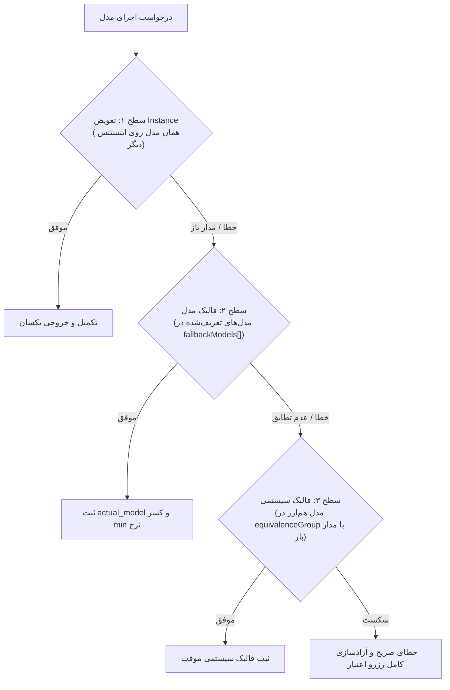
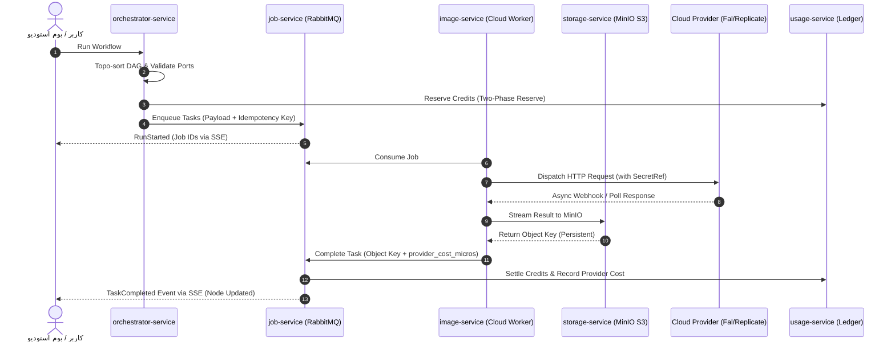

| فیلد / Field | مقدار / Value |
| :--- | :--- |
| **Title (EN)** | Multi-Provider Model Routing, Media Pipelines & Execution Architecture |
| **Title (FA)** | معماری مسیریابی مدل‌های چندپراویدری، پایپ‌لاین تولید مدیا و جریان اجرا |
| **ID** | DOC-BE-006 |
| **Category** | `backend` |
| **Status** | `Approved` |
| **Owner** | Backend & Platform Team |
| **Last Updated** | 2026-09-28 |
| **Summary (EN)** | Comprehensive architecture for cloud model routing, 4-layer provider registry, generic REST adapters, 3-level fallback, token bucket rate limiting, and async media pipeline. |
| **Summary (FA)** | معماری جامع نحوه اتصال نودها به مدل‌ها و پراویدرهای ۱۰۰٪ ابری، رجیستری ۴ لایه‌ای، آداپتورهای اعلانی REST، فالبک ۳ سطحی، ریت‌لیمیت توکن‌باکت و پایپ‌لاین ناهمگام مدیا. |
| **Tags** | `backend`, `model-routing`, `image-generation`, `cloud-providers`, `job-service`, `pipeline`, `byo` |

---

# معماری مسیریابی مدل‌های چندپراویدری، پایپ‌لاین تولید مدیا و جریان اجرا

> **اصل بنیادین هوش مصنوعی (100% Cloud Models Invariant):**  
> تمامی مدل‌های هوش مصنوعی در پلتفرم Lemmo به صورت **ابری (Cloud-Only)** هستند. هیچ مدل آفلاین یا خودمیزبان روی سرورهای ملکی اجرا نمی‌شود. ورکرهای مدیا صرفاً کلاینت‌های غیرهمگام Go برای ارتباط با API ارائه‌دهندگان ابری (مانند Fal.ai، Replicate، OpenAI و غیره) و استریم داده‌ها به فضای ذخیره‌سازی MinIO/S3 هستند.

---

## ۱. مدل چهارلایه‌ای رجیستری پراویدرها (Provider Registry Architecture)

برای به حداقل رساندن کدنویسی هنگام افزودن پراویدر یا مدل جدید و امکان اتصال کلیدهای اختصاصی کاربران (BYO)، رجیستری پراویدرها به ۴ لایه تفکیک شده است:

```
┌─────────────────────────────────────────────────────────────┐
│ 1. Provider (تعریف کلی، Modality، نگاشت I/O، نوع Auth)       │
└──────────────────────────────┬──────────────────────────────┘
                               │ ۱ به N
┌──────────────────────────────▼──────────────────────────────┐
│ 2. ProviderInstance (Base URL، secret_ref، سقف، Priority)   │
└──────────────────────────────┬──────────────────────────────┘
                               │ ۱ به N
┌──────────────────────────────▼──────────────────────────────┐
│ 3. Model (شناسه، قابلیت‌ها، Tier قیمت، fallbackModels[])     │
└──────────────────────────────┬──────────────────────────────┘
                               │ عضویت
┌──────────────────────────────▼──────────────────────────────┐
│ 4. RoutingGroup (گروه اینستنس‌های یک مدل با Circuit Breaker) │
└─────────────────────────────────────────────────────────────┘
```

1. **لایه Provider (تعریف عمومی):** مشخصات نام، پروتکل (`generic_rest` یا `custom_code`)، نگاشت ورودی/خروجی و روش دریافت نتیجه (sync، polling یا webhook). این لایه فاقد هرگونه Secret است.
2. **لایه ProviderInstance (نمونه عملیاتی):** اتصال به یک حساب خاص با `secret_ref` (ارجاع امن به SecretStore)، سقف‌های نرخ مصرف، اولویت و دامنه دسترسی (`platform`, `workspace`, `user`).
3. **لایه Model (کاتالوگ مدل‌ها):** شناسه یکتا، قابلیت‌ها، اسکیما پارامترها، نرخ پایه در Rate Card و آرایه مدل‌های فالبک (`fallbackModels[]`).
4. **لایه RoutingGroup (مسیریابی و سلامت):** توزیع بار، بررسی وضعیت سلامت (Health Check) و قطع‌کننده مدار (Circuit Breaker).

### ۱.۱. آداپتور اعلانی بدون کد (Generic REST Adapter)
افزودن پراویدرهای سازگار با استاندارد REST تنها با درج یک فایل کانفیگ اعلانی (JSON/YAML) در رجیستری و بدون کامپایل یا تغییر در کد سرویس صورت می‌گیرد. تنها پراویدرهای با پروتکل‌های نامتعارف نیازمند پیاده‌سازی کلاس `ProviderAdapter` در زبان Go هستند.

### ۱.۲. سیاست پراویدرهای اختصاصی کاربر (BYO Provider Policy)
- کاربران می‌توانند کلید اختصاصی خود را در قالب یک `ProviderInstance` با دامنه `user` یا `workspace` تعریف کنند.
- **کارمزد پلتفرم (`byo_fee`):** برای جبران هزینه صف، ارکستراسیون، پهنای باند و نگهداری فایل‌ها در S3، کارمزد ثابت مصوب در Rate Card به صورت کردیت کسر می‌شود.
- **کسر فقط روی اجرای موفق:** در صورت خطای کلید کاربر، کارمزدی اخذ نمی‌شود.
- **ممنوعیت فالبک بی‌صدا:** فالبک خودکار از کلید شخصی BYO به حساب پلتفرم ممنوع است مگر با تایید صریح کاربر.

### ۱.۳. اتصال مدل‌ها به تعاریف ابزار و واژگان پارامترها (Tool-Model UX Binding — مصوب ADR-021)
1. **تفکیک پرزنتیشن از رجیستری:** لیست مدل‌های قابل‌انتخاب در فرم، ترتیب و نشان‌های UX (`flagship`, `fast`, `live`) در آرایه `models[]` تعریف ابزار (`tools-service`) نگهداری می‌شود. مشخصات فنی مدل‌ها صرفاً در `model-router-service` متمرکز است و با `model_ref` ارجاع داده می‌شود.
2. **واژگان پارامترهای استاندارد (Canonical Parameters):** فرانت‌اند و کاتالوگ ابزارها منحصراً با واژگان یکپارچه (`prompt`, `aspect_ratio`, `num_outputs`, `seed`, `steps`, `cfg_scale`, `resolution`, `duration_sec`) تعامل دارند؛ نگاشت به پارامترهای اختصاصی هر پراویدر در آداپتورهای `model-router-service` انجام می‌شود.
3. **منبع انحصاری قیمت:** فیلد `base_credit_cost` در پروتو منسوخ شده و قیمت‌ها منحصراً از نرخ‌نامه نسخه‌دار `quota-service` و اندپوینت `POST /api/v1/quota/estimate` استعلام می‌گردند.
4. **توسعه مدالیته‌ها:** مدالیته‌های آینده پلتفرم شامل `VIDEO`, `AUDIO`, `THREE_D` و `TEXT_TO_TEXT` در پروتو رزرو شده و تب‌های فعال فرانت‌اند صرفاً از `output_type` ابزارهای با وضعیت `active` مشتق می‌شوند (Zero-Mock).

---

## ۲. ریت‌لیمیتینگ خروجی و کنترل سهمیه پلتفرم (Rate Limiting)

برای جلوگیری از مسدود شدن حساب پلتفرم یا خطای ۴۲۹ نزد پراویدرها:
1. **الگوریتم Token Bucket در Redis:** بر روی کلید هر `provider_instance` با استفاده از اسکریپت اتمیک Lua پیاده‌سازی می‌شود. سقف‌ها مستقیماً در کانفیگ اینستنس تعریف می‌شوند و مستقل از پلن کاربر هستند.
2. **صف‌بندی عادلانه (Fair Queuing):** در صورت رسیدن به سقف یا دریافت هدر `Retry-After` از پراویدر، درخواست‌ها در صف نگه داشته شده و بر اساس صف عادلانه مجدداً ارسال می‌شوند تا هیچ کاربری صف سایرین را مسدود نکند.

---

## ۳. سلسله‌مراتب فالبک سه‌سطحی (3-Level Fallback Strategy)

فالبک در لمو یک قانون صلب نیست، بلکه کاملاً کانفیگ‌محور و شفاف است:



### قواعد حاکم بر فالبک:
1. **تطابق دقیق قابلیت‌ها:** فالبک تنها به مدلی با Modality یکسان (مثلاً تصویر به تصویر) و قابلیت تبدیل پارامترها مجاز است.
2. **شفافیت کامل در لجر:** در صورت فالبک سطوح ۲ و ۳، هر دو مقدار `requested_model` و `actual_model` در فرانت‌اند و در رکورد Ledger ثبت می‌شوند.
3. **محاسبه عادلانه کردیت:** نرخ کسر اعتبار برابر با فرمول `min(tier درخواستی، tier واقعی)` است تا کاربر بابت فالبک سیستمی متضرر نشود.

---

## ۴. چرخه حیات و نحوه مدیریت پردازش مدیاها

فرآیند پردازش مدیا کاملاً ناهمگام و رویدادمحور است:



---

## ۵. ماندگاری لینک‌ها و متد تمدید امضا (Presigned URLs & Re-signing)

- **ذخیره انحصاری Object Key:** در پایگاه‌داده پروژه و متادیتای نودها صرفاً کلید شیء (`object_key`) و شناسه Asset نگهداری می‌شود و لینک‌های موقت هرگز در دیتابیس ذخیره نمی‌گردند.
- **تولید دسته‌ای لینک در زمان خواندن:** در زمان فراخوانی پروژه، لینک‌های دانلود با TTL کوتاه‌مدت (پیش‌فرض ۱۵ دقیقه) به صورت Batch تولید می‌شوند.
- **تمدید لینک در خطای ۴۰۳:** کلاینت در مواجهه با انقضای لینک، یک‌بار اندپوینت `POST /assets/{id}/sign` را جهت دریافت لینک تازه فراخوانی می‌کند. دسترسی کاربر به پروژه پیش از صدور امضای مجدد در لایه گیت‌وی بررسی می‌شود.

---

## ۶. الزامات کیفیت، ایمنی و پایش درگاه هوش مصنوعی (مصوب ADR-027)

پیرو تصمیم معماری **[ADR-027](../01-architecture/decisions/ADR-027-ai-gateway-quality-safety-observability.md)**، اصول زیر در اتصال و بهره‌برداری از مدل‌های هوش مصنوعی لازم‌الاجرا می‌باشند:

1. **اعتبارسنجی خروجی تشخیص نیت (C1 — پیش از بتا):** خروجی مدل نیت‌خوانی در `agent-service` باید دقیقاً با یکی از برچسب‌های مجاز کاتالوگ مطابقت داشته باشد؛ هر پاسخ مغایر رد می‌شود تا از حملات تزریق پرامپت (Prompt Injection) جلوگیری گردد.
2. **سقف اندازه‌ی ورودی به مدل‌ها (C2 — پیش از بتا):** سقف حجم ورودی به مدل‌ها به صورت داینامیک از فایل کانفیگ نسخه‌دار (`config/default.yaml`) خوانده شده و هاردکد کردن آن ممنوع است.
3. **فیلدهای پایش فراخوانی در قرارداد لاگ (C3 — پیش از بتا):** ثبت فیلدهای `model` (مستعار و واقعی)، `provider`، `tokens_in`، `tokens_out`، `cost`، `latency_ms` و `caller_service` در لاگ استاندارد رویدادها الزامی است.
4. **ممنوعیت ذخیره و لاگ پرامپت خام (C4 — پیش از بتا):** هرگونه ذخیره‌سازی، کش یا لاگ پرامپت خام کاربران ممنوع بوده و ابزارهای مانیتورینگ با رفتار پیش‌فرض ناسازگار رد شده‌اند.
5. **مجموعه آزمون طلایی و گیت تعویض پراویدر (C7 — بعد از بتا):** تغییر یا جایگزینی پراویدر/مدل تشخیص نیت منوط به قبولی در آزمون استاندارد Golden Test Set با حداقل دقت مصوب است.
6. **ماتریس مجوز «سرویس × دسته‌ی مدل» (C8 — بعد از بتا):** درگاه هوش مصنوعی دسترسی سرویس‌ها را بر مبنای ماتریس دوبعدی سرویس به دسته‌های مجاز مدل کنترل می‌کند.
7. **سقف بودجه و ریت‌لیمیت به‌ازای سرویس (C9 — بعد از بتا):** کنترل مصرف و نرخ فراخوانی در درگاه هوش مصنوعی به تفکیک سرویس فراخواننده اعمال می‌شود.
8. **آمادگی برای مدل محلی (C10 — هنگام نیاز):** موتورهای میزبانی محلی/خصوصی سازگار با APIهای استاندارد (نظیر vLLM) طبق معماری رجیستری صرفاً به عنوان یک فایل پراویدر جدید افزوده خواهند شد.
9. **گزینه‌های ردشده (C11):** ابزارهای LiteLLM، Kong AI، Envoy/Istio، Langfuse (در حالت پیش‌فرض) و Guardrails سنگین به دلایل مقیاس، حفاظت از پرامپت خام و کفایت گیت‌های سبک رد شده‌اند.
10. **سؤالات باز فعال:** پیگیری الزامات حفاظت داده و GDPR پراویدرهای خارجی (C5) در `OQ-066` و تدوین سیاست محتوای تولید تصویر (C6) در `OQ-067` با مالکیت «مالک محصول» انجام می‌پذیرد.

---

## ۷. الزامات معماری «ابزار و اجرا» و ویژگی‌های مدل (مصوب ADR-018 و ADR-027)

پیرو تصمیمات معماری **[ADR-018 §۲.۸ و §۲.۹](../01-architecture/decisions/ADR-018-tools-platform-architecture-unified-execution-and-domain-decoupling.md#۲۸-تکمیل-معماری-ابزار-و-اجرا-و-بازنشستگی-image-service-t1-تا-t7--مصوب-d-46)** و **[ADR-027 §۲.۹](../01-architecture/decisions/ADR-027-ai-gateway-quality-safety-observability.md#۲۹-قاعده-فالبک-سازگار-با-ویژگیها-و-سقف-هزینه-k7--بعد-از-بتا--الحاقیه-task_arch_06)**:

1. **تفکیک مسئولیت درگاه هوش مصنوعی و ذخیره فایل خام (T3 — بعد از بتا):** `ai-gateway` دارایی کاربر را در کتابخانه ثبت نمی‌کند؛ خروجی رسانه خام را مستقیماً با پیشوند تِنَنت فراخواننده در فضای ذخیره‌سازی ذخیره کرده و فقط شناسه فایل برمی‌گرداند. ثبت در کتابخانه با سرویس مالک دارایی است.
2. **عدم وابستگی ابزارها به پراویدرها (T4 — بعد از بتا):** ابزارها صرفاً با نام مستعار مدل (`model_alias`) با درگاه صحبت می‌کنند و از جزئیات پراویدر بی‌خبرند.
3. **بازنشستگی `image-service` (T7 — پیش از بتا و بعد از بتا):** در فاز پیش از بتا هیچ مسئولیت جدیدی به `image-service` افزوده نمی‌شود؛ پس از بتا سرویس حذف و وظایف ورکر به `tools-service` و `ai-gateway` منتقل می‌گردد.
4. **رجیستری ویژگی‌های مدل در پراویدر (K1، K3 و K4 — بعد از بتا):** ویژگی‌های هر مدل در فایل کانفیگ همان پراویدر در `ai-gateway` با تایپ مشخص (`boolean`, `enum`, `number`) اعلام می‌شود و سکوت به منزله عدم پشتیبانی است.
5. **تطبیق زمان اجرا و خطای Fail-Closed (K6 — بعد از بتا):** درگاه هوش مصنوعی تطبیق ویژگی‌های مورد نیاز ابزار را با مدل پشت آلیاس بررسی کرده و در صورت نقص با رفتار Fail-Closed مانع اجرا می‌شود.
6. **قاعده فالبک سازگار (K7 — بعد از بتا):** مدل جایگزین در فالبک باید کلیه ویژگی‌های ابزار را دارا بوده و گران‌تر از مدل مبدأ نباشد.


