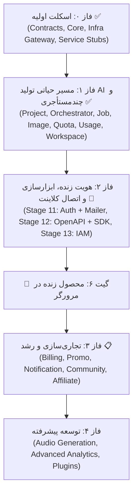

| فیلد / Field | مقدار / Value |
| :--- | :--- |
| **Title (EN)** | Microservices Catalog & Phased Delivery Roadmap |
| **Title (FA)** | شناسنامه میکروسرویس‌ها و نقشه فازبندی تحویل بک‌اند |
| **ID** | DOC-BE-002 |
| **Category** | `backend` |
| **Status** | `Approved` |
| **Owner** | Backend & Platform Team |
| **Last Updated** | 2026-10-23 |
| **Summary (EN)** | Complete breakdown of nons reused services, Lemmo specific microservices, service anatomy, and phased delivery roadmap, including the permanent `access-promo-service` ownership (ADR-025 / D-53). |
| **Summary (FA)** | فهرست کامل سرویس‌های اشتراکی، میکروسرویس‌های اختصاصی Lemmo، ساختار داخلی هر سرویس و نقشه فازبندی، شامل مالکیت دائمی `access-promo-service` (ADR-025 / D-53). |
| **Tags** | `backend`, `services`, `catalog`, `roadmap`, `microservices` |

---

# شناسنامه میکروسرویس‌ها و نقشه فازبندی تحویل (`services/`)

> ⚠️ **وضعیت پیاده‌سازی در کد (`api/`):**  
> وضعیت معماری این سند `Approved` است و بر پایه تصمیمات مصوب [ADR-004](../01-architecture/decisions/adr-004-backend-microservices.md)، [ADR-007](../01-architecture/decisions/ADR-007-backend-contracts-and-tooling-standards.md) و [ADR-009](../01-architecture/decisions/ADR-009-service-owned-deployment-and-financial-ledger.md) تدوین شده است. در راستای متدولوژی **Contract-First & Spine-First**، کلیه ۹ سرویس مسیر حیاتی فاز ۱ با ساختار استاندارد لایه‌ای Clean Architecture، فایل شناسنامه `service.md` و الگوهای مایگریشن در پوشه `services/` اسکافولد شده‌اند. همچنین پیاده‌سازی عملیاتی استاب اینترفیس هسته `QuotaChecker` در `orchestrator-service` و لایه مدیریت کانتکست هویت در پکیج `core/` مستقر گردیده است (میدل‌ور موک طبق D-35 حذف گردید). تکمیل منطق تجاری داخلی و تست‌های یکپارچگی گام‌به‌گام مطابق نقشه راه ([DOC-BE-005](./roadmap.md)) انجام خواهد شد.

این سند کاتالوگ جامع کلیه سرویس‌های فعال و رزروشده در مونوریپوی بک‌اند (`lemmo-api`) را به همراه ساختار داخلی استاندارد و زمان‌بندی پیاده‌سازی فازها تشریح می‌کند.

---

## ۱. سرویس‌های مشترک و بازاستفاده از پلتفرم Nons

به منظور کاهش چشمگیر زمان توسعه و بهره‌برداری از مؤلفه‌های استاندارد اثبات‌شده، سرویس‌های پایه‌ای هویت و زیرساخت از پلتفرم **nons** با حداقل تغییرات بازاستفاده می‌شوند:

| نام سرویس | نقش و مسئولیت در پلتفرم Lemmo | وضعیت |
| :--- | :--- | :--- |
| **`auth-service` (Ory Kratos)** | [کارت auth-service](../01-architecture/service-responsibility-registry.md#۳۳-auth-service) — احراز هویت، ثبت‌نام و مدیریت نشست‌ها | در حال توسعه (فاز ۲ — استیج ۱۱) |
| **`reference-data-registry`** | [کارت reference-data](../01-architecture/service-responsibility-registry.md#۳۲۰-reference-data) — رجیستری داده‌های مرجع عمومی، غیرمالی و کم‌تغییر | تکمیل شد (`Completed - Stage 10A`) |
| **`user-service`** | [کارت user-service](../01-architecture/service-responsibility-registry.md#۳۴-user-service) — پروفایل و اطلاعات کاربری و وضعیت آنبوردینگ | تکمیل شد (`Completed - Stage 10B`) |
| **`edge-gateway` (`infra/gateway`)** | [کارت Kong](../01-architecture/service-responsibility-registry.md#۳۱-kong) — درگاه لبه، مسیریابی و کنترل ترافیک کلاینت | تکمیل شد (`Completed - Stage 10.5`) |
| **`identity-proxy` (`infra/identity-proxy`)** | [کارت Oathkeeper](../01-architecture/service-responsibility-registry.md#۳۲-لایه-احراز-هویت-oathkeeper) — پروکسی تصمیم هویتی و تبدیل سشن به JWT | تکمیل شد (`Completed - Stage 10.5`) |
| **`context-service` (`services/context-service`)** | [کارت context-service](../01-architecture/service-responsibility-registry.md#۳۸-context-service) — تجمیع کانتکست کلاینت (BFF) | تکمیل‌شده / ارتقای تاب‌آوری (`Stage 10.5 & DEBT-CTX-01`) |
| **`iam-service`** | [کارت iam-service](../01-architecture/service-responsibility-registry.md#۳۷-iam-service) — موتور دسترسی‌های دانه‌ریز امنیتی | **مستقر نمی‌شود در بتا** (ارزیابی مجدد پس از بتا طبق D-54) |
| **`token-service` (Ory Hydra)** | [کارت token-service](../01-architecture/service-responsibility-registry.md#۳۲۶-token-service) — مدیریت توکن‌های OAuth2 و کلیدهای API | اسکلت `service.md` آماده / بازاستفاده |
| **`notification-service`** | [کارت notification-service](../01-architecture/service-responsibility-registry.md#۳۲۵-notification-service) — ارسال اعلان‌های سیستمی چندکاناله | در صف توسعه (فاز ۳ — استیج ۱۶) |
| **`storage-service`** | [کارت storage-service](../01-architecture/service-responsibility-registry.md#۳۱۴-storage-service) — تنها سرویس دارایی پلتفرم؛ ذخیره فایل‌ها و متادیتای دارایی‌ها | اسکلت `service.md` آماده / بازاستفاده |
| **`login-consent-app`** | رابط واسط میان Kratos و Hydra جهت اخذ تاییدیه ورود | آماده / بازاستفاده |

### مسیر گام‌به‌گام گذار به سیستم احراز هویت واقعی (Kratos Transition Roadmap)
1. **فاز ۰ (ستون فقرات محلی):** توسعه محلی بک‌اند و فرانت‌اند با داده‌های ساختگی انجام می‌شود (میدل‌ور `MockAuthMiddleware` طبق تصمیم D-35 حذف گردید).
2. **فاز ۱ (Milestone Gate 1 & 2):** با راه‌اندازی `project-service` و `orchestrator-service`، فرانت‌اند با تنظیم `NEXT_PUBLIC_API_MODE=live` مستقیماً به نشست‌های Kratos متصل می‌شود؛ کوکی‌های Session کلاینت از طریق متد `/sessions/whoami` در Kratos اعتبارسنجی شده و شناسه کاربری در کانتکست تزریق می‌گردد.
3. **فاز ۲ و ۳ (Milestone Gate 4 به بعد):** اتصال کلاینت‌های بیرونی و CLI از طریق Ory Hydra (`token-service`) و توکن‌های OAuth2/OIDC پیاده‌سازی می‌گردد.

---

## ۲. سرویس‌های اختصاصی اکوسیستم Lemmo

سرویس‌های تجاری زیر به‌طور اختصاصی برای موتور پردازش گراف و تولید هوش مصنوعی Lemmo طراحی شده و در فازهای زمان‌بندی‌شده مستقر می‌شوند:

| نام سرویس | مسئولیت و وظیفه اصلی | فاز تحویل | وضعیت پیاده‌سازی در مخزن |
| :--- | :--- | :---: | :---: |
| **`project-service`** | [کارت project-service](../01-architecture/service-responsibility-registry.md#۳۱۳-project-service) — نگهداری متادیتا و ساختار گراف پروژه‌ها | فاز ۱ | پیاده‌سازی لایه‌ای، مایگریشن و gRPC تکمیل شد (`Completed`) |
| **`workspace-service`** | [کارت workspace-service](../01-architecture/service-responsibility-registry.md#۳۵-workspace-service) — فضاهای کاری چندمستأجری، تیم‌ها، عضویت‌ها (تنها نویسنده پروجکشن ردیس) و دعوت تیم | فاز ۱ | پیاده‌سازی کامل و بستن گیت ۵ (`Completed - Stage 9`) |
| **`access-promo-service`** (Access/Promo) | [کارت Access/Promo](../01-architecture/service-responsibility-registry.md#۳۶-accesspromo) — دعوت پلتفرم (بتا)، ظرفیت و پروموی اعتباری (بدون موجودی/پول) | MVP (پیش از بتا) | `Planned` — مالکیت قطعی (D-53)؛ پیاده‌سازی پس از تصویب ADR-025 |
| **`orchestrator-service`** | [کارت orchestrator-service](../01-architecture/service-responsibility-registry.md#۳۱۱-orchestrator-service) — تنها موتور اجرای گراف و ابزارها (تفسیر DAG، هدایت ترتیبی، رزرو و تسویه اعتبار) | فاز ۱ | **از فریز خارج، در مسیر بتا (تصمیم T6)** |
| **`tools-service`** | [کارت tools-service](../01-architecture/service-responsibility-registry.md#۳۱۰-tools-service) — رجیستری و تعریف اعلانی ابزارها بر اساس YAMLهای `tools/<tool-name>/` (بدون اجرا یا رزرو) | فاز ۲ | در صف توسعه (مصوب D-46 و T1-T5) |
| **`agent-service`** | [کارت agent-service](../01-architecture/service-responsibility-registry.md#۳۹-agent-service) — ارکستراسیون گفتگو و تعامل با کاربر (فراخوانی مدل‌ها و تشخیص نیت فقط از راه ai-gateway) | فاز ۲ | در صف توسعه |
| **`ai-gateway`** | [کارت ai-gateway](../01-architecture/service-responsibility-registry.md#۳۱۶-ai-gateway) — تنها درگاه دسترسی به مدل‌های AI (کاملاً داخلی، بدون نقش مالی، با ریت‌لیمیت فنی و انتشار رویداد مصرف) | فاز ۱ / ۲ | تکمیل لایه‌ای / بازسازی کاتالوگ مدل‌ها (تکامل از model-router-service) |
| **`ledger-service`** | [کارت ledger-service](../01-architecture/service-responsibility-registry.md#۳۲۱-ledger-service-tigerbeetle-داخل-آن) — تنها منبع حقیقت وضعیت مالی و دفترکل پلتفرم بر بستر TigerBeetle (حساب‌ها، انتقال‌ها، رزرو pending با مهلت داخلی بدون sweeper) | فاز ۱ | استقرار مستقل `financial-ledger` طبق ADR-009 |
| **`quota-service`** | [کارت quota-service](../01-architecture/service-responsibility-registry.md#۳۲۲-quota-service) — ارزیابی قوانین تجاری سهمیه و محاسبه مقادیر (موتور قوانین بدون موجودی یا دفترکل) | فاز ۱ | پیاده‌سازی کامل و بستن گیت ۴ (`Completed - Stage 8`) |
| **`usage-service`** | [کارت usage-service](../01-architecture/service-responsibility-registry.md#۳۱۹-usage-service) — زیرساختی؛ ثبت متریک خام و رویدادهای ممیزی مصرف (Audit Trail)، بدون مسئولیت دفترکل مالی | فاز ۱ | پیاده‌سازی کامل و بستن گیت ۴ (`Completed - Stage 8`) |
| **`job-service`** | [کارت job-service](../01-architecture/service-responsibility-registry.md#۳۱۲-job-service) — نمای خواندنی وضعیت اجرای کارهای ناهمگام | فاز ۱ | پیاده‌سازی لایه‌ای، صف RabbitMQ و ورکر تکمیل شد (`Completed - Stage 6`) |
| **`node-service`** (امروز node-registry-service) | [کارت node-service](../01-architecture/service-responsibility-registry.md#۳۲۴-node-service-امروز-node-registry) — چیدمان و توپولوژی بوم گراف | فاز ۱ | پیاده‌سازی لایه‌ای تکمیل شد — **فریز تا فاز بوم (کد فعلی بدهی)** |
| **`storage-service`** | [کارت storage-service](../01-architecture/service-responsibility-registry.md#۳۱۴-storage-service) — تنها سرویس دارایی پلتفرم؛ ذخیره‌سازی پایدار فایل‌ها در S3/MinIO و نگهداری متادیتای دارایی کاربر (`asset_id`) | فاز ۱ | پیاده‌سازی لایه‌ای و درایور MinIO تکمیل شد (`Completed - Stage 6`) |
| **`image-service`** | [کارت image-service](../01-architecture/service-responsibility-registry.md#۳۲۳-image-service) — ورکر ناهمگام سبک APIهای Fal/Replicate | فاز ۱ | **در حال بازنشستگی (Retiring)** — بدون مسئولیت جدید، بدون نقش مالی یا اجرایی در هدف (واگذاری اجرا به orchestrator و مدل به ai-gateway) |
| **`feed-service`** | [کارت feed-service](../01-architecture/service-responsibility-registry.md#۳۱۵-feed-service) — فید عمومی و انتشار خروجی‌ها برای جامعه کاربری | فاز ۲.۵ | در صف توسعه (همگام با گالری) |
| **`subscription-service`** | پلن‌های ماهانه/سالانه، بسته‌های اعتبار اشتراکی، ارتقا و تنزل بسته‌ها | فاز ۲ | در صف توسعه (`Planned - Phase 2`) |
| **`billing-service`** | صدور فاکتور، درگاه پرداخت آنلاین ریالی و ارزی و موتور جامع پرومو کد و تخفیف چک‌اوت طبق ADR-011 | فاز ۲ | در صف توسعه (`Planned - Phase 2`) |
| **`community-service`** | گالری عمومی بوم، فید اجتماعی، سیستم لایک‌ها و بوک‌مارک‌ها و کش محبوب‌ترین‌ها در Redis بر بستر MinIO S3 (مصوب ADR-011) | فاز ۲.۵ | در صف توسعه (`Planned - Phase 2.5`) |
| **`affiliate-service`** | پلتفرم افیلیت مارکتینگ تجاری، رهگیری لینک و کوکی‌های بازاریابی، پنجره انتساب ۳۰/۶۰/۹۰ روزه، کمیسیون و مقابله با تقلب (مصوب ADR-011) | فاز ۳ | در صف توسعه (`Planned - Phase 3`) |
| **`version-service`** | نسخه‌بندی تاریخچه تغییرات گراف پروژه، مقایسه نسخه‌ها (Diff) و بازگردانی | فاز ۲ | در صف توسعه (`Planned - Phase 2`) |
| **`collaboration-service`** | همگام‌سازی لحظه‌ای بوم و نمایش نشانگر اعضای آنلاین از طریق WebSocket | فاز ۲ | در صف توسعه (`Planned - Phase 2`) |
| **`video-service`** | تولید، تغییر فریم و تدوین ویدیو با مدل‌های تولید ویدیوی هوش مصنوعی | فاز ۲ | در صف توسعه (`Planned - Phase 2`) |
| **`media-service`** | بهینه‌سازی مدیا، فشرده‌سازی، تغییر فرمت، تولید بندانگشتی و افزودن واترمارک | فاز ۲ | در صف توسعه (`Planned - Phase 2`) |
| **`prompt-service`** | کتابخانه پرامپت‌ها، قالب‌های مهندسی پرامپت و پیشنهادهای هوشمند | فاز ۲ | در صف توسعه (`Planned - Phase 2`) |
| **`audit-service`** | ثبت ماندگار و تغییرناپذیر لاگ رخدادهای حساس و تغییرات دسترسی تیم | فاز ۲ | در صف توسعه (`Planned - Phase 2`) |
| **`publish-service`** | انتشار نسخه‌های ثابت ورک‌فلوها به شکل REST Endpoint جهت مصرف خارجی | فاز ۳ | در صف توسعه (`Planned - Phase 3`) |
| **`plugin-registry-service`**| رجیستری مرکزی، اعتبارسنجی مانیفست و فهرست‌نویسی پلاگین‌های رسمی و ثالث | فاز ۳ | در صف توسعه (`Planned - Phase 3`) |
| **`plugin-runtime-service`** | اجرای ایزوله و سندباکس پلاگین‌ها با محدودیت سقف پردازنده و رم | فاز ۳ | در صف توسعه (`Planned - Phase 3`) |
| **`integration-service`** | مدیریت Webhookها و اتصال با پلتفرم‌های بیرونی (Shopify، Discord و ...) | فاز ۳ | در صف توسعه (`Planned - Phase 3`) |
| **`audio-service`** | تولید صوت، گویندگی هوش مصنوعی (TTS) و تولید موسیقی متناسب | فاز ۴ | در صف توسعه (`Planned - Phase 4`) |

---

## ۳. مؤلفه‌هایی که سرویس مستقل نیستند و کتابخانه‌های هسته (`core/`)

برخی اجزا نباید به صورت سرویس جداگانه ساخته شوند و جایگاه آن‌ها در پوشه‌های هسته (`core/`) یا زیرساخت (`infra/`) است:
- **Event Bus / Message Broker:** زیرساخت است (`infra/messaging`)، نه سرویس بیزینسی.
- **Observability:** سیستم متریک و تریس در `infra/observability` و میدل‌ورهای `core/` تعبیه می‌شود.
- **Secrets Management:** توسط Vault / External Secrets در سطح زیرساخت مدیریت می‌گردد.
- **Contract Generator:** اسکریپت‌های تبدیل در پوشه `contracts/` قرار دارند، نه یک سرویس اجرایی.
- **Project Clone:** کلون‌های پروژه به عنوان نمای اختصاصی هر عضو در همان `project-service` باقی می‌مانند.

### ۱. میدل‌ور موک احراز هویت (`core/middleware/MockAuthMiddleware` — حذف‌شده طبق D-35)
این میدل‌ور پیش‌تر برای محیط توسعه محلی تعریف شده بود، اما طبق تصمیم مالک محصول (D-35، مورخ ۲۰۲۶-۱۰-۱۹) و اصل حذف کدهای غیرفعال (D-36) به طور کامل از کدبیس حذف گردید و کانتکست احراز هویت مستقیماً از طریق `auth_context.go` مدیریت می‌شود.

### ۲. مشخصات اینترفیس سهمیه در ارکستریتور (`orchestrator-service/domain/QuotaChecker`)
ارکستریتور برای بررسی اعتبار پیش از آغاز اجرای گره‌های سنگین DAG از اینترفیس انتزاعی زیر در لایه Domain خود استفاده می‌کند:

```go
package domain

import "context"

// QuotaChecker checks credit/token sufficiency before DAG execution.
type QuotaChecker interface {
    CheckQuota(ctx context.Context, tenantID string, estimatedCost int64) error
}
```
- **پیاده‌سازی فاز ۰ و ۱:** یک پیاده‌سازی خنثی (`NoopQuotaChecker`) که بدون مسدودسازی اجازه پیشروی می‌دهد.
- **پیاده‌سازی نهایی فاز ۱ (Stage 8):** پیاده‌سازی کلاینت gRPC متصل به `quota-service` جهت رزرو اتمیک اعتبار دوفازی پیش از ثبت جاب‌ها در DAG.

### ۳. تفکیک معماری سرویس‌های مالی و ممیزی (`ledger-service`، `quota-service` و `usage-service`)
مطابق با [سند مرجع مسئولیت سرویس‌ها (DOC-ARCH-013)](../01-architecture/service-responsibility-registry.md#۳۲۱-ledger-service-tigerbeetle-داخل-آن)، [DOC-BE-007](./credit-and-ledger.md) و [ADR-009](../01-architecture/decisions/ADR-009-service-owned-deployment-and-financial-ledger.md)، مرزهای مالی و مصرفی به تفکیک قطعی رسیده‌اند:
1. **سرویس دفترکل مالی (`ledger-service` — [کارت](../01-architecture/service-responsibility-registry.md#۳۲۱-ledger-service-tigerbeetle-داخل-آن)):**
   - **نقش:** تنها منبع حقیقت وضعیت مالی، مانده حساب‌ها و انتقالات در پلتفرم بر بستر کانتینر اختصاصی TigerBeetle (`financial-ledger`).
   - **وظایف:** مدیریت حساب‌ها و ترانسفرها، رزرو دوفازی (Pending Reservation) با انقضای مهلت داخلی در خود دیتابیس (بدون نیاز به ورکر جاروب‌کننده/sweeper خارجی)، و تسویه (Settle) با مبلغ نهایی دریافتی بدون پیش‌فرض صفر.
2. **سرویس سهمیه و قوانین تجاری (`quota-service` — [کارت](../01-architecture/service-responsibility-registry.md#۳۲۲-quota-service)):**
   - **نقش:** موتور ارزیابی قوانین تجاری، پکیج‌ها، سهمیه‌ها و ریت‌لیمیت‌های تجاری؛ این سرویس فاقد موجودی یا دفترکل مالی است.
   - **وظایف:** اعتبارسنجی مجاز بودن عملیات بر اساس قوانین، ارزیابی سیاست سطل‌های زمانی (FEFO) در دیتابیس خود (`lemmo_quota`)، محاسبه مبلغ واقعی رزرو و تسویه، و صدور درخواست به `ledger-service` جهت جابجایی وجه.
3. **سرویس ثبت و ممیزی مصرف (`usage-service` — [کارت](../01-architecture/service-responsibility-registry.md#۳۱۹-usage-service)):**
   - **نقش:** سرویس زیرساختی جهت ثبت متمرکز متریک‌های خام مصرف (Audit Trail)، نه دفترکل مالی.
   - **ورودی رویدادمحور:** مصرف رویدادهای ناهمگام مصرف منتشرشده توسط `ai-gateway` همراه با شناسه نسخه رجیستری مدل‌ها، جهت گزارش‌گیری، مانیتورینگ و لاگ حسابرسی.

### ۴. معماری سرویس فضاهای کاری و چندمستأجری (`workspace-service` — مصوب ADR-010)
مطابق با [ADR-010](../01-architecture/decisions/ADR-010-workspace-service-and-phase1-completion.md) و [DOC-BE-008](./entitlements-and-iam.md)، سرویس دهم با مشخصات فنی زیر مستقر می‌گردد:
- **پورت‌ها:** gRPC `50060` / HTTP Gateway `8089` (کانتینر `lemmo-svc-workspace`).
- **پایگاه داده اختصاصی (`lemmo_workspace`):** شامل ۴ جدول رابطه‌ای `workspaces` (با ستون رسمی `on_wallet_empty VARCHAR NOT NULL DEFAULT 'block'`)، `workspace_memberships`، `workspace_invitations` و `workspace_settings`.
- **الگوی تاب‌آوری Provisioning والت:** فضای کاری ابتدا در وضعیت `provisioning` ثبت شده و پس از هماهنگی همگام gRPC با `quota-service` جهت ساخت والت، وضعیت به `active` ارتقا می‌یابد. همزمان رویداد `workspace.created` به صف RabbitMQ منتشر می‌شود. در وضعیت `provisioning` اجرای گراف مسدود است.
- **تجرید دسترسی با آداپتور دوگانه (`PermissionManager`):** جداسازی لایه دامنه از زیرساخت IAM با آداپتور محلی پیش‌فرض (`LocalMembershipAdapter`) و آداپتور ریموت Ory Keto (`KetoPermissionAdapter`).
- **انقضای کانفیگ‌پذیر دعوت‌نامه‌ها:** نگهداری هش SHA-256 و خواندن مدت‌زمان انقضا از کانفیگ `invitation_expiry_duration` (بدون هاردکد constant).

### ۵. معماری قابلیت‌های تجاری، پروموشن و تعاملات اجتماعی (مصوب ADR-011)
مطابق با [ADR-011](../01-architecture/decisions/ADR-011-business-capabilities-and-phase2-roadmap.md)، قابلیت‌های کلیدی کسب‌وکار به شرح زیر در معماری مستقر می‌شوند:
1. **موتور جامع پروموشن و پرومو کد:**  
   - *پرومو کدهای اعتباری (Credit Promo — دامنه MVP):* صدور، اعتبارسنجی، شرایط دریافت و مصرف یک‌باره در `access-promo-service` (مالک قواعد) انجام می‌شود. **اثر مالی افزودن اعتبار فقط در `quota-service` و از مسیر موتور Claim (D-03)** اعمال می‌شود؛ Access/Promo موجودی یا ledger ندارد. جزئیات در [`ADR-025`](../01-architecture/decisions/ADR-025-access-promo-service-ownership.md).
   - *پرومو کدهای تخفیف درگاه (Checkout Discounts — فاز بعد):* کسر درصدی یا ثابت در زمان صدور پیش‌فاکتور خرید پلن در `billing-service`؛ این دامنه با پروموی اعتباری یکی نیست.
   - *قواعد کنترلی:* زمان‌بندی UTC، سقف کل مصرف، سقف هر کاربر، حداقل مبلغ سفارش و عدم امکان ترکیب با سایر تخفیف‌ها به صورت پیش‌فرض (`is_stackable = false`).
2. **زیرساخت چندکاناله نوتیفیکیشن با Novu (`notification-service`):**  
   - استقرار هسته پلتفرم پیام‌رسانی Novu (Self-Hosted) و اتصال به صف ناهمگام RabbitMQ (`lemmo.events`).
   - پشتیبانی از صندوق پیام درون‌برنامه‌ای (In-App Inbox در استودیو)، ایمیل (Resend/SMTP)، پیامک و وب‌پوش بدون نیاز به پیاده‌سازی دستی مجدد.
3. **تفکیک رفرال از افیلیت مارکتینگ:**  
   - *سیستم رفرال کاربری (P2P Referral):* درون `user-service`؛ اختصاص کد دعوت به هر کاربر و اعطای پاداش دوطرفه با کردیت هدیه.
   - *سیستم افیلیت تجاری (`affiliate-service`):* تفکیک به عنوان سرویس مستقل به دلیل بار بالای ثبت کلیک‌های وب، پنجره انتساب کوکی (Attribution Window: ۳۰، ۶۰ یا ۹۰ روزه)، ردیابی تبدیل، الگوریتم‌های مقابله با تقلب (Fraud Detection)، و تسویه حساب مالی.
4. **فید اجتماعی و گالری بوم (`community-service`):**  
   - ممانعت از ایجاد ۴ میکروسرویس غیرضروری و تجمیع قابلیت‌های انتشار عمومی بوم، متادیتای پرامپت/مدل، لایک‌ها، بوک‌مارک‌ها و کش محبوب‌ترین‌ها (Trending) در Redis درون سرویس واحد `community-service`.
   - کلیه فایل‌های رسانه و تصاویر منحصراً توسط `storage-service` (MinIO S3) سرویس‌دهی می‌شوند.
5. **مدل هویت، پروفایل و آنبوردینگ تدریجی (`user-service`):**  
   - تفکیک قطعی شناسه داخلی سیستم (`user_id` بر مبنای UUIDv4 محرمانه) از شناسه عمومی قابل اشتراک (`username` / `handle` مانند `@artist`).
   - ذخیره ترجیحات کاربر (زبان `fa`/`en`، تم، تنظیمات اعلان) و ماشین حالت آنبوردینگ (`onboarding_step` و لیست `features_seen`) در جدول پروفایل دیتابیس.

### ۸. معماری یکپارچه هویت، جریان ورود بدون رمز و چرخه حیات نشست (`auth-service` — مصوب ADR-015)
مطابق با [ADR-015](../01-architecture/decisions/ADR-015-unified-identity-auth-flow-and-session-lifecycle.md) و تجربیات اثبات‌شده پروژه NONS:
1. **روش ورود انحصاری (Magic Code):** فقط ورود با ایمیل و کد ۶ رقمی OTP با طول عمر ۱۰ دقیقه. حذف قطعی Password، Passkey، TOTP و Magic Link جهت دستیابی به اصطکاک صفر در فرآیند ورود.
2. **اسکیمای مینیمال Kratos:** Kratos منحصراً دو فیلد `email` (الزامی) و `onboarded` (پیش‌فرض false) را نگه می‌دارد. سایر مشخصات (نام، هندل یکتا، کد معرف) توسط تابع `SyncKratosUser` در `user-service` پس از دریافت وب‌هوک Post-Registration ایجاد می‌شوند.
3. **جریان ورودی خودکار (`/api/v1/auth/entry`):** اندپوینت ورودی با استعلام از Kratos Admin API، وجود کاربر را بررسی می‌کند: در صورت وجود، Login Flow و در صورت عدم وجود، Registration Flow فعال می‌شود؛ بدین ترتیب از بروز خطای فاجعه‌بار `duplicate identifier` در مرحله تایید کد جلوگیری می‌گردد. پاسخ‌ها به هر دو صورت Form و Native JSON برای مصرف کلاینت ارسال می‌شوند.
4. **توپولوژی لبه و تفکیک روت‌ها در Kong:** روت‌های `/auth/kratos/*` مستقیماً و بدون اعمال فیلتر Forward-Auth به Kratos فوروارد می‌شوند. تنظیمات صریح CORS در Kong با `Access-Control-Allow-Credentials: true` امکان برقراری ارتباط ایمن کلاینت با پورت ۸۰۰۰ را فراهم می‌سازد.
5. **ابطال آنی نشست در خروج (Real-Time Logout Revocation):** در لحظه خروج، نشست Kratos لغو شده و کلید `lemmo:user:logout_at:{user_id}` با برچسب زمانی فعلی در ردیس (TTL ۲۰ دقیقه) ثبت می‌گردد. پلاگین `lemmo-access-enforcer` در گیت‌وی با یک دستور `MGET` تعلیق کاربر، زمان لاگ‌اوت (`iat < logout_at`) و نسخه عضویت را هم‌زمان ارزیابی می‌کند.
6. **سرور ایمیل توسعه محلی:** استقرار کانتینر `axllent/mailpit` در `services/auth-service/deploy/` جهت تست خودکار دریافت کد OTP از طریق REST API بدون نیاز به پارس کردن لاگ کانتینر.

---

## ۴. ساختار داخلی استاندارد هر سرویس

کلیه سرویس‌های موجود در پوشه `services/` ملزم به رعایت ساختار تمیز و لایه‌ای یکسان هستند:

```text
services/<service-name>/
├── cmd/                     ← نقطه ورود برنامه و تابع main (فقط راه‌اندازی و تزریق وابستگی)
├── api/                     ← فایل‌های Proto یا OpenAPI مربوط به همین سرویس
├── internal/                ← منطق محافظت‌شده سرویس (غیرقابل ایمپورت توسط دیگران)
│   ├── domain/              ← موجودیت‌ها (Entities) و قواعد کسب‌وکار خالص (بدون وابستگی)
│   ├── app/                 ← سناریوهای کاربردی (Use Cases) و هماهنگ‌کننده منطق
│   ├── ports/               ← اینترفیس‌های ورودی (API/gRPC) و خروجی (Database/Broker)
│   └── adapters/            ← پیاده‌سازی عینی دیتابیس، کلاینت صف و کالک‌های بیرونی
├── migrations/              ← فایل‌های مایگریشن اختصاصی دیتابیس همین سرویس (000001_...)
├── test/                    ← آزمون‌های یکپارچگی (Integration Tests)
├── Dockerfile               ← دستورالعمل بیلد ایمیج سبک کانتینر
└── service.md               ← شناسنامه مستند سرویس (مسئولیت‌ها، قراردادها و وابستگی‌ها)
```

> **الزام فایل `service.md` و تولید خودکار با CLI:**  
> پیش از نوشتن کدهای هر سرویس، فایل `service.md` باید در ریشه پوشه همان سرویس ایجاد شده و مسئولیت دقیق، رویدادهای تولیدی و جدول تعاملات آن مستند شود. تولید خودکار این ساختار لایه‌ای و فایل `service.md` توسط باینری رسمی اسکافولدر Go در `tools/lemmo-cli` (مصوب طبق [ADR-007](../01-architecture/decisions/ADR-007-backend-contracts-and-tooling-standards.md) و [ADR-008](../01-architecture/decisions/ADR-008-internal-tooling-and-versioning-governance.md)) انجام می‌شود.

---

## ۵. نقشه فازبندی پیاده‌سازی و راه‌اندازی (Implementation Roadmap)



### فاز ۰ — استقرار فونداسیون ✅
- پیاده‌سازی قراردادهای پایه در `contracts/platform/` و تنظیمات کامپایل Proto با `buf`.
- توسعه هسته مشترک `core/` (بوت‌استرپ سرور، متغیرهای پیکربندی، لاگر و میدل‌ورها).
- راه‌اندازی درگاه اولیه ورودی `infra/gateway` و ایجاد اسکلت پوشه‌های سرویس‌ها با `service.md`.

### فاز ۱ — مسیر اصلی و چندمستأجری (Core MVP Completed) ✅
- تکمیل ۱۰ میکروسرویس اصلی: `project-service` ← `node-registry-service` ← `orchestrator-service` ← `job-service` ← `storage-service` ← `model-router-service` + `image-service` ← `quota-service` + `usage-service` ← `workspace-service`.
- استقرار دیتابیس‌های مجزا، لجر اتمیک، خطای `WORKSPACE_WALLET_EMPTY`، و بسته شدن رسمی گیت‌های ۱ تا ۵.

### فاز ۲ — هویت زنده، اتصال فرانت‌اند و موتور دسترسی (Core Client Foundation — مصوب ADR-014 و ADR-015) 🎯
- **استیج ۱۰ (۱۰A و ۱۰B) ✅:** پیاده‌سازی `reference-data-registry` و `user-service` (پروفایل، هندل، ارزیابی ریسک ایمیل موقت و تعلیق).
- **استیج ۱۰.۵ ✅:** استقرار درگاه سه‌لایه `infra/gateway` (Kong 3.6)، `identity-proxy` (Oathkeeper) و BFF کانتکست (`context-service`).
- **استیج ۱۱ 🎯:** استقرار کامل `auth-service` (Ory Kratos + Mailpit)، اندپوینت ورود یکپارچه بدون رمز (`/api/v1/auth/entry`)، وب‌هوک Kratos به `user-service`، اتصال فرانت‌اند `auth/` و آزمون E2E با Mailpit.
- **استیج ۱۲ 📋:** ابزار تولید خودکار OpenAPI و آداپتور زنده شبکه در `@/sdk` استودیو (`app/`).
- **استیج ۱۳ 📋:** سرویس مدیریت دسترسی و مجوزها `iam-service` (سرویس Day-1 با RBAC محلی در بتا؛ ارجاع به [کارت §۳.۷ سند مرجع مسئولیت‌ها](../01-architecture/service-responsibility-registry.md#۳۷-iam-service)).
- **پیش از بتا — `access-promo-service` 🎯:** سرویس دائمی دعوت/ظرفیت/پروموی اعتباری (D-53، ADR-025)؛ پیش‌نیاز مسیر طلایی بتا.
- **🏁 گیت ۶:** اعتبارسنجی کامل ورود کاربر در مرورگر، ریدایرکت به استودیو، اجرای زنده گراف و کسر کردیت.

### فاز ۳ — تجاری‌سازی، تعاملات اجتماعی و رشد پلتفرم 📋
- **استیج ۱۴:** استقرار سرویس صورت‌حساب و اشتراک‌ها (`billing-service`).
- **استیج ۱۵:** موتور تخفیف‌های Checkout و کمپین‌های فروش (`promo-engine` در `billing-service`؛ متمایز از پروموی اعتباری Access/Promo).
- **استیج ۱۶:** پلتفرم اعلانات چندکاناله Novu و پیاده‌سازی `notification-service`.
- **استیج ۱۷:** فید اجتماعی و گالری بوم (`community-service`).
- **استیج ۱۸:** پلتفرم حرفه‌ای افیلیت مارکتینگ (`affiliate-service`).
- **استیج ۱۹ به بعد:** استقرار `collaboration-service`، `version-service`، انتشار خارجی (`publish-service`) و اکوسیستم پلاگین‌ها.

### فاز ۴ — قابلیت‌های پیشرفته
- پیاده‌سازی موتور پردازش و تولید صوت (`audio-service`).
- جستجوی پیشرفته برداری روی پروژه‌ها و پایش بلادرنگ هوشمند (Analytics).
- راه‌اندازی اکوسیستم پلاگین: `plugin-registry-service` و سندباکس امنیتی `plugin-runtime-service`.


### سیاست اجرایی تاب‌آوری Context — TASK-CTX-001

کلاینت‌های User، Workspace، Quota و Project با `grpc.NewClient` به صورت غیرمسدودکننده ساخته می‌شوند؛ اتصال با `Connect()` آغاز و بازیابی توسط gRPC انجام می‌شود. مهلت هر RPC و Backoff از `services/context-service/config/default.yaml` خوانده می‌شود؛ نبود فایل، مقادیر نامعتبر یا خطای ساخت کلاینت راه‌اندازی را متوقف می‌کند، ولی آفلاین بودن مقصد مانع ساخت کلاینت نیست.

`/livez` و `/healthz` زنده‌بودن پردازش را نشان می‌دهند. `/readyz` فقط وقتی ۲۰۰ است که اتصال User و Workspace در وضعیت `Ready` باشد؛ Project اختیاری است و وضعیت آن در فیلد `degraded` و لاگ پروب ثبت می‌شود. قطعی Project شمارش پروژه را صفر نگه می‌دارد. Quota برای محاسبه سهمیه هنگام وجود ورک‌اسپیس لازم است، اما شکست درخواست آن **دیگر پاسخ Context را ۵۰۳ نمی‌کند**؛ به‌جای آن تخریب‌پذیری سهمیه با `entitlements.status = "degraded"` اعلام می‌شود (بخش «تخریب‌پذیری سهمیه در Context» را ببینید). مطابق تسک، در شرط پروب آمادگی لحاظ نشده است. این پروب تشخیص سلامت اتصال است، نه تضمین سلامت داده‌های حساب یا قطع خودکار ترافیک در Kong.

در مسیر `/api/v1/me/context` خطای زیرساخت **خارج از دامنهٔ سهمیه** (نظیر User/Workspace) با HTTP 503 و `ERROR_REASON_SERVICE_UNAVAILABLE` بازگردانده می‌شود. نبود رکورد کاربر نیز HTTP 503 با `ERROR_REASON_USER_RECORD_NOT_FOUND` است و هرگز ۴۰۴ نیست. هر دو مورد در gRPC کد `Unavailable` دارند. Kong پاسخ HTTP هندلر REST روی 8092 را عبور می‌دهد. استودیو خطای ۵۰۳ را با متن بومی‌سازی‌شده و دکمه تلاش مجدد نمایش می‌دهد و نشست را باطل نمی‌کند.

### تخریب‌پذیری سهمیه در Context — TASK-CTX-003

اختلال سرویس سهمیه/دفتر مالی (`quota-service` / `financial-ledger`) دیگر کل پاسخ Context را ناموفق نمی‌کند. در `/api/v1/me/context`، فیلد `entitlements` دارای `status` اجباری با مقادیر `available` یا `degraded` است:

- `available`: سرویس سهمیه پاسخ داده و فیلدهای `tier`، `wallet_balance` و `features` مطابق قرارداد پر می‌شوند.
- `degraded`: سرویس سهمیه/دفتر مالی در دسترس نیست (یا ورک‌اسپیس فعال وجود ندارد). در این حالت `tier`، `wallet_balance` و `features` **کاملاً غایب** هستند و هرگز با مقادیر ساختگی (`FREE`، `0`، `[]`، `v1.0`) پر نمی‌شوند. تنها کلید موجود `status` است.

این رفتار عمداً «معنادار-ناشناخته» است: موجودی نامعلوم نه صفر و نه نامحدود است. کلاینت استودیو بر اساس `status` تصمیم می‌گیرد:

1. سطوح **فقط‌خواندنی** (تاریخچهٔ گفتگو، مرور پروژه) در حالت `degraded` باز می‌مانند و کاربر به صفحهٔ خطا هدایت نمی‌شود.
2. **تولید پرداختی** (دکمهٔ Generate) در حالت `degraded` غیرفعال می‌شود.
3. نمایش موجودی/پلن به‌جای عدد ساختگی مقدار `—` (نامعلوم) نشان می‌دهد.
4. تخمین هزینه (`/api/v1/quota/estimate`) در این حالت ناموفق است و به‌جای مقدار پیش‌فرض جعلی مانند `20c` مقدار «نامعلوم/N/A» نشان داده می‌شود.

قرارداد REST متناظر در `contracts/openapi/context/v1/openapi.yaml` و قرارداد gRPC در `contracts/lemmo/v1/context.proto` (`EntitlementContext.status = 4`) نگه داشته می‌شود. آزمون `TestContextService_EntitlementDegradation` در `services/context-service/internal/app/context_service_test.go` سه حالت (outage → degraded بدون مقدار ساختگی، موفق → available، نبود ورک‌اسپیس → degraded) را پوشش می‌دهد. پیاده‌سازی محلی انجام شده؛ بسته‌شدن منوط به CI و بازبینی مستقل است.

آزمون `tests/live/downstream_resilience_live_test.go` اتصال دیرهنگام، قطع و بازیابی همان کلاینت و وابستگی اختیاری را با سرورهای محلی آزمایشی بررسی می‌کند. پیاده‌سازی محلی انجام شده؛ بسته‌شدن بدهی منوط به CI و بازبینی مستقل است. ترمیم ورک‌اسپیس و کیف پول خارج از این اصلاح است.


### خواندن موجودی ورک‌اسپیس در Context — TASK-CTX-002

شناسه کیف پول مستقل از شناسه ورک‌اسپیس است. Context نباید workspace_id را در فیلد wallet_id ارسال کند. قرارداد داخلی `GetWalletBalanceRequest` فیلد اختیاری `workspace_id = 3` را برای خواندن کیف پول موجودِ مالک WORKSPACE دارد؛ ارسال همزمان wallet_id و workspace_id نامعتبر است. در مسیر workspace، tenant احرازشده و tenant_id درخواست باید برابر workspace_id باشند و owner_type/owner_id کیف پول دقیقاً WORKSPACE/همان ورک‌اسپیس باشند. برخی رکوردهای قدیمی در wallets.tenant_id شناسه کاربر ثبت‌نام‌کننده دارند؛ در selector جدید این مقدار قدیمی مبنای مجوز نیست و مالکیت ورک‌اسپیس با tenant احرازشده کنترل می‌شود.

این عملیات فقط‌خواندنی است: کیف پول، bucket یا اعتبار ایجاد نمی‌کند و در نبود رکورد خطا می‌دهد. Context پس از انتخاب ورک‌اسپیس از عضویت‌های کاربر، همان ورک‌اسپیس را در metadata احرازشده RPC منتقل می‌کند. مسیر قدیمی wallet_id برای مصرف‌کنندگان موجود حفظ می‌شود. Quota جدید باید پیش از Context جدید نصب شود. اصلاح از اشتباه‌گرفتن خطای lookup با اختلال اتصال جلوگیری می‌کند؛ جایگزین provisioning حساب‌های واقعاً ناقص نیست.


## تصمیم‌های محصول بتای تولید تصویر — 2026-10-13

مرجع تجمیعی، بسته‌های اجرایی و چک‌لیست پیگیری: [BASELINE_MVP_CONTENT_GENERATION.md](../../../../.task/active/BASELINE_MVP_CONTENT_GENERATION.md). این بخش تصمیم محصول و مرز کار آینده را ثبت می‌کند؛ ادعای تکمیل پیاده‌سازی یا تصویب جزئیات حل‌نشده نیست.

- شروع MVP با بتای محدود و کد دعوت کنترل‌شده در بک‌اند است. **مالک دائمی دعوت، ظرفیت و پروموی اعتباری از ۲۰۲۶-۱۰-۲۳ سرویس `access-promo-service` است (D-53، [`ADR-025`](../01-architecture/decisions/ADR-025-access-promo-service-ownership.md)).** مسئولیت موقت به Context، Auth یا Workspace تحمیل نمی‌شود.
- ثبت Wallet و تمام عملیات grant/reserve/settle/release در Quota باقی می‌ماند؛ هدیه از کانفیگ نسخه‌دار خوانده و برای هویت واجد شرایط دقیقاً یک‌بار ثبت شود. مقدار و انقضای هدیه هنوز نیازمند تصمیم‌اند؛ ۱۰۰۰ کردیت Seed مقدار مصوب محصول نیست.
- پرامپت ورودی فقط پیش‌نویس است؛ تولید با کلیک کاربر پس از نمایش برآورد انجام شود. قیمت معتبر از نرخ‌نامه بک‌اند است، نه URL یا مقدار پیش‌فرض فرانت.
- اتمام اعتبار باید موجودی، هزینه موردنیاز و «درخواست شارژ آزمایشی» را نمایش دهد؛ درخواست قابل پیگیری و تأیید مسئول مجاز باشد و اعتبار فقط از Quota اضافه شود.
- اختلال مالی تولید جدید را متوقف کند؛ مشاهده تاریخچه و دارایی مجاز تا حد امکان برقرار باشد. موجودی نامعلوم به صفر یا اعتبار نامحدود تبدیل نشود.
- بودجه آزمون API پولی این دور ۲ دلار و قابل تنظیم است؛ مبنای برنامه‌ریزی سقف تجمعی شامل Retry با ثبت ماندگار و رزرو قبل از فراخوانی است. بودجه دلاری Provider از واحد کردیت و نرخ‌نامه کاربر جداست.
- Timeout معادل شکست قطعی Provider نیست؛ پیش از اجرای مجدد یا آزادسازی، وضعیت نامشخص تعیین تکلیف شود. تسویه، آزادسازی و Reaper باید در برابر تکرار و رقابت مقاوم باشند؛ UNIQUE(job_id) به‌تنهایی تضمین عدم اجرای مضاعف Provider نیست.


## دامنه جاری MVP — دستور مالک محصول 2026-10-15

توالی تحویل در [رودمپ اصلی](./roadmap.md) نسخه ۵ است: تشخیص‌پذیری → مالکیت دائمی و بک‌اند ورود/دعوت/اعتبار → چت و تولید تصویر با زبان طبیعی و command → آماده‌سازی فرانت بر اساس قرارداد → اتصال سرتاسری → عرضه محدود. هیچ سرویس مسئولیت دامنه دیگر را موقتاً نمی‌پذیرد. Quota مالک فعلی Wallet و اثر مالی است؛ نام Wallet به معنی تصویب سرویس تازه نیست. **مالک دائمی قواعد دعوت/ظرفیت/پروموی اعتباری از ۲۰۲۶-۱۰-۲۳ `access-promo-service` است (D-53، ADR-025).** ایجاد سرویس جدید فقط با اثبات خلأ دامنه و ثبت قرارداد/استقرار/مالک داده انجام می‌شود.

عبارت مالک Auth/Workspace در تسک تاریخی P06 با ابهام ثبت‌شده در سند مالکیت بتا سازگار نیست و اثبات تصویب نهایی مالکیت تلقی نمی‌شود؛ تعیین تکلیف آن ورودی مرحله ۲ است. تا آن زمان مسئولیت موقت اضافه نمی‌شود. متن قبلی این اسناد و گزارش‌ها شاهد تاریخی است، نه مجوز اجرای مالکیت مبهم.

> **به‌روزرسانی ۲۰۲۶-۱۰-۲۳ (D-53 / ADR-025):** عبارت‌های «مالک دعوت/Promo هنوز تصویب نشده» و «مالک دائمی باید تعیین شود» در نسخه‌های پیشین این سند و رودمپ، **سابقه** هستند و دیگر جاری نیستند. تصمیم قطعی: `access-promo-service` مالک دائمی دعوت/ظرفیت/پروموی اعتباری در MVP است؛ اثر مالی همچنان فقط در Quota.
