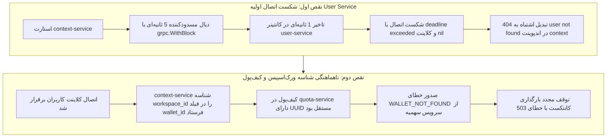

| فیلد / Field | مقدار / Value |
| :--- | :--- |
| **Title (EN)** | Incident Post-Mortem: Studio Access Outage via Initial Connection Failure & Workspace-Wallet Identifier Misalignment |
| **Title (FA)** | گزارش کالبدشکافی رخداد: اختلال ورود به استودیو بر اثر اتصال اولیهٔ ناموفق و جست‌وجوی نادرست کیف پول |
| **ID** | DOC-OPS-INC-002 |
| **Category** | `devops` |
| **Status** | `Resolved & Deployed` |
| **Owner** | Core Engineering / SRE & Platform Team |
| **Last Updated** | 2026-10-13 |
| **Summary (EN)** | Authoritative post-mortem for the 2026-10-13 SEV-1 incident blocking studio access due to context-service 5s startup timeout, false 404 user mapping, and subsequent workspace-vs-wallet UUID confusion in quota-service; resolved via non-blocking gRPC reconnect, 503 error contract compliance, explicit workspace_id balance lookup in quota-service, and container rebuild across 12 verified accounts. |
| **Summary (FA)** | گزارش کالبدشکافی رخداد بحرانی ۱۳ اکتبر ۲۰۲۶ پیرامون مسدود شدن ورود به استودیو بر اثر شکست اتصال ۵ ثانیه‌ای context-service به user-service، نگاشت کاذب ۴۰۴، و اشتباه گرفتن شناسه ورک‌اسپیس با کیف‌پول در quota-service؛ برطرف‌شده از طریق اتصال غیرمسدودکننده، قرارداد خطای ۵۰۳، افزودن workspace_id به کوئری موجودی و بازسازی کانتینرها با تایید ۱۲ حساب کاربری. |
| **Tags** | `incident`, `post-mortem`, `context-service`, `quota-service`, `user-service`, `wallet`, `resilience`, `reconnect`, `sev-1` |

---

# گزارش کالبدشکافی رخداد: اختلال ورود به استودیو بر اثر اتصال اولیهٔ ناموفق و جست‌وجوی نادرست کیف پول (DOC-OPS-INC-002)

> **شناسه رخداد:** `INC-2026-10-13-CONTEXT-01`  
> **شدت رخداد:** `SEV-1` (مسدودسازی کامل ورود به محیط استودیو برای تمامی کاربران پلتفرم)  
> **تاریخ وقوع و مهار:** ۲۰۲۶-۱۰-۱۳  
> **وضعیت نهایی:** برطرف‌شده، مستقر در کانتینرها و تاییدشده برای ۱۲ حساب کاربری (`Resolved, Deployed & Verified`)  
> **ران‌بوک و راهنمای عملیاتی مرتبط:** [راهنمای عیب‌یابی و حل مشکلات پلتفرم (DOC-OPS-002)](../troubleshooting.md)

---

## ۱. خلاصه اجرایی رخداد (Executive Summary)

در تاریخ ۱۳ اکتبر ۲۰۲۶، کاربران پس از ورود موفق از طریق سرویس هویت، هنگام ورود به محیط استودیو با خطاهای متوالی مواجه می‌شدند:
ابتدا پیام `Connection Error — user not found` و سپس پیام `Service temporarily unavailable` نمایش داده می‌شد و محیط کار استودیو بارگذاری نمی‌گردید.

تحلیل فارنزیک و کالبدشکافی لاگ‌ها اثبات کرد که این رخداد محصول **دو نقص متوالی و مستقل** در لایه ارتباطات و تطبیق داده‌ها بود:
1. **علت اول:** عدم تاب‌آوری اتصال `context-service` به `user-service` در راه‌اندازی اولیه و تبدیل غیرواقعی خطای شبکه به `404 user not found`.
2. **علت دوم:** اشتباه گرفتن شناسه ورک‌اسپیس با شناسه کیف‌پول توسط `context-service` هنگام استعلام از `quota-service` و صدور خطای `WALLET_NOT_FOUND`.

با اعمال اصلاحات در هر دو سرویس، بازسازی کانتینرهای داکر و استقرار مجدد، هر ۱۲ حسابی که قبلاً دچار اختلال بودند با موفقیت کامل و وضعیت `200 OK` وارد استودیو شدند.

---

## ۲. نشانه‌ها و شواهد ظاهری (Symptoms & Observation)

1. کاربر پس از ورود با کد یکبارمصرف یا سشن معتبر، به آدرس استودیو (`http://localhost:3000/app`) ریدایرکت می‌شد.
2. کامپوننت گارد استودیو (`StudioAuthGuard`) ابتدا خطای `Connection Error — user not found` را نشان می‌داد (به دلیل پاسخ ۴۰۴ از `/api/v1/me/context`).
3. پس از رفع اولیه اتصال کاربران، پیام خطا به `Service temporarily unavailable` تغییر می‌کرد و بارگذاری کانتکست با کد `503` متوقف می‌شد (به دلیل خطای کیف‌پول).
4. محیط استودیو قفل شده و بدون مداخله مهندسی قابل استفاده نبود.

---

## ۳. کالبدشکافی ریشه‌ای و اقدامات اصلاحی (Root Cause Analysis & Remediations)

### ۳.۱. علت اول — بازیابی‌نشدن اتصال سرویس کاربران
سرویس Context هنگام راه‌اندازی فقط ۵ ثانیه برای اتصال به User Service منتظر می‌ماند (`grpc.WithBlock`). اگر سرویس کاربران دیرتر آماده می‌شد، کلاینت اتصال خالی (`nil`) باقی می‌ماند و هیچ تلاش مجددی در پس‌زمینه صورت نمی‌گرفت. کد نیز این وضعیت را اشتباهاً به `404 user not found` تبدیل می‌کرد؛ بنابراین خطای زیرساخت شبیه حذف حساب نمایش داده می‌شد.

- **اقدامات اصلاحی اعمال‌شده:**
  1. اتصالات پایین‌دستی به صورت غیرمسدودکننده (`grpc.NewClient`) بازنویسی شدند.
  2. بازیابی خودکار اتصال در پس‌زمینه (gRPC Background Reconnect Loop)، مهلت هر درخواست (`default_rpc_timeout`) و تنظیمات Exponential Backoff به پیکربندی نسخه‌بندی‌شده اضافه شدند.
  3. خطاهای دسترس‌ناپذیری صریحاً به کد HTTP `503` با دلیل استاندارد `ERROR_REASON_SERVICE_UNAVAILABLE` مپ شدند و کد کاذب ۴۰۴ کاملاً ریشه‌کن شد.
  4. پروب‌های سلامت زنده بودن (`/livez`) و آمادگی سرویس (`/readyz`) از یکدیگر تفکیک شدند.

### ۳.۲. علت دوم — اشتباه گرفتن شناسهٔ ورک‌اسپیس با کیف پول
پس از برقراری اتصال با سرویس کاربران، سرویس Context همچنان شناسه فضای کاری (`workspace_id`) را در فیلد `wallet_id` به `quota-service` ارسال می‌کرد. کیف پول در دیتابیس دارای یک UUID مستقل بود؛ بنابراین با وجود موجود بودن کیف پول برای آن ورک‌اسپیس، سرویس سهمیه خطای `WALLET_NOT_FOUND` صادر می‌کرد و بارگذاری Context با کد `503` متوقف می‌شد. این مشکل با گذشت زمان یا فشردن دکمه Retry حل‌شدنی نبود.

- **اقدامات اصلاحی اعمال‌شده:**
  1. فیلد صریح `workspace_id` به قرارداد خواندن موجودی و اعتبارات در `quota-service` اضافه شد.
  2. سرویس `quota-service` اکنون کیف پول موجودِ متعلق به همان ورک‌اسپیس را در دیتابیس جستجو کرده و تطابق فضای کاری احرازشده و مالکیت کیف پول را بررسی می‌کند.
  3. مسیر سازگاری پیشین با `wallet_id` حفظ شد تا اتصالات دیگر نشکنند.
  4. هیچ کیف پول یا اعتبار ساختگی جدیدی برای دور زدن خطا ایجاد نشد.

---

## ۴. استقرار، جایگزینی کانتینرها و اعتبارسنجی زنده (Deployment & Verification)

صرف باز کردن مجدد مرورگر یا رفرش تب کافی نبود، زیرا کانتینرهای داکر هنوز باینری قدیمی و اصلاح‌نشده را اجرا می‌کردند:
1. ابتدا کانتینر `quota-service` و سپس کانتینر `context-service` با سوییچ `--build` بازسازی و جایگزین شدند.
2. پس از استقرار، هر ۱۲ حسابی که قبلاً با خطای ۵۰۳ متوقف می‌شدند، از مسیر واقعی برنامه شامل:
   `Client Browser / Studio (Port 3000) → Edge Gateway (Kong Port 8000) → context-service (:8092)`  
   مورد آزمون قرار گرفتند و پاسخ موفق **`200 OK`** همراه با اطلاعات کامل ورک‌اسپیس دریافت کردند.
3. آزمون‌های اتصال مجدد خودکار، نگاشت خطا و کنترل دسترسی چندمستاجری در محیط واقعی تایید شدند.

---

## ۵. اقدامات پیشگیرانه (Prevention Guidelines)

1. **تست‌های رگرسیون جامع:** تست‌های پلتفرم باید تاخیر در راه‌اندازی کانتینرها، قطع و وصل موقت شبکه، و تفاوت در مدل شناسه‌های منابع مرتبط (مانند `workspace_id` در برابر `wallet_id`) را پوشش دهند.
2. **اعتبارسنجی استقرار در محیط واقعی:** نتیجه هر اصلاح مهندسی باید پس از بازسازی کانتینرها از مسیر واقعی درخواست بررسی شود؛ موفقیت تست در محیط ایزوله Go به تنهایی اثبات‌کننده اصلاح نسخه در حال اجرا در شبکه داکر نیست.

---

## ۶. محدودیت‌های شناخته‌شده (Known Limitations)

- این اصلاح بارگذاری کامل کانتکست را برای تمامی حساب‌های دارای ورک‌اسپیس بازیابی کرد.
- یک حساب فاقد ورک‌اسپیس همچنان نیازمند تکمیل فرآیند راه‌اندازی اولیه و آنبوردینگ است.
- موفقیت مراحل بعدی استودیو (نظیر اجرای چت، سنتز تصویر با ورکرها و مصرف سهمیه) خارج از دامنه این اصلاحیه بوده و در اسپرینت‌های مستقل مربوطه ممیزی می‌شود.

---

## ۷. اسناد مرتبط
- [راهنمای جامع عیب‌یابی و مشکلات و راه‌حل‌ها (DOC-OPS-002)](../troubleshooting.md)
- [نمایه مرکزی کالبدشکافی رخدادها (DOC-OPS-INC-000)](./index.md)
- [نقشه راه جامع بک‌اند پلتفرم (DOC-BE-005)](../../03-backend/roadmap.md)
- [گزارش اجرای تسک تاب‌آوری کانتکست (REPORT_CTX_001)](../../../../.task/REPORT_CTX_001_DOWNSTREAM_RESILIENCE_AND_RECONNECT.md)
