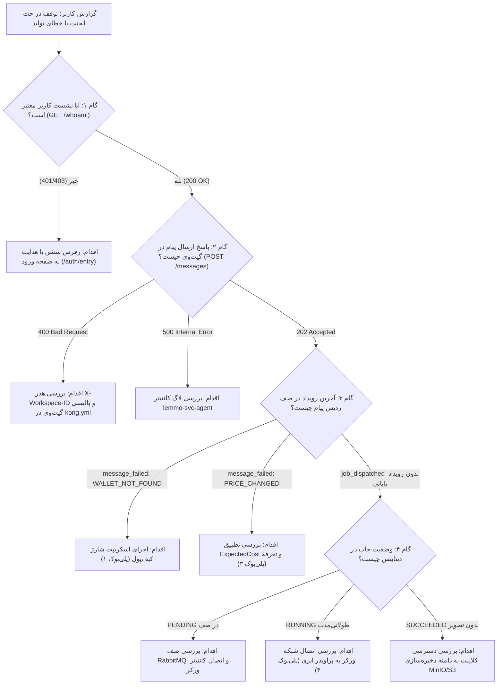

| فیلد / Field | مقدار / Value |
| :--- | :--- |
| **Title (EN)** | Operational Runbook: Studio Agent Execution & Tool Synthesis Diagnostics |
| **Title (FA)** | ران‌بوک عملیاتی: عیب‌یابی چرخه اجرای ایجنت و سنتز ابزارها در استودیو |
| **ID** | DOC-OPS-RB-001 |
| **Category** | `devops` |
| **Status** | `Active` |
| **Owner** | DevOps / SRE & Support Team |
| **Last Updated** | 2026-10-12 |
| **Summary (EN)** | Authoritative operational runbook and decision tree for diagnosing, tracing, and resolving agent tool execution hangs, wallet reservation failures, and SSE streaming stalls across Studio and backend microservices. |
| **Summary (FA)** | ران‌بوک عملیاتی و درخت تصمیم‌گیری جامع برای تریاژ سریع، رهگیری درخواست، و حل مشکلات گیر کردن اجرای ایجنت، خطاهای رزرو سهمیه/کیف‌پول، و اختلال در استریم SSE از مرورگر تا ورکر. |
| **Tags** | `devops`, `runbook`, `troubleshooting`, `agent`, `sse`, `tools`, `quota`, `operations` |

---

# ران‌بوک عملیاتی: عیب‌یابی چرخه اجرای ایجنت و سنتز ابزارها (DOC-OPS-RB-001)

> **دامنه کاربرد:** این سند ران‌بوک رسمی عملیات و پشتیبانی برای حل سریع اختلالات در بخش چت ایجنت استودیو (`/app/agent`) و خط لوله سنتز ابزارها است.  
> **اصول عدم تکثیر SSOT:** مشخصات کلاینت در [سند ماشین وضعیت فرانت‌اند (DOC-FE-004)](../../02-frontend/agent-chat-state-and-sse-lifecycle.md) و مشخصات پایپ‌لاین مدیا در [مشخصات پایپ‌لاین مدل و رسانه (DOC-BE-006)](../../03-backend/media-and-model-pipeline.md) تعریف شده‌اند و این سند صرفاً راهنمای تریاژ و واکنش عملیاتی است.

---

## ۱. درخت تصمیم‌گیری عیب‌یابی گام‌به‌گام (Diagnostic Decision Tree)

در صورت گزارش هرگونه اختلال (توقف در لودینگ، عدم تولید تصویر، یا دریافت خطای ناشناخته)، مهندس پشتیبانی یا SRE مراحل زیر را به ترتیب طی می‌کند:



---

## ۲. ماتریس تشخیصی کدهای خطا (Diagnostic Error Matrix)

| کد خطا (AIP-193 / RFC-7807) | لایه بروز | نشانه ظاهری در استودیو | دستور بررسی سریع (CLI One-Liner) | اقدام فوری برای رفع |
|---|---|---|---|---|
| `WALLET_NOT_FOUND` | `quota-service` | توست خطا: «کیف‌پول یافت نشد» | `docker exec lemmo-infra-postgres psql -U postgres -d lemmo_quota -c "SELECT * FROM wallets WHERE owner_id='<ws_id>';"` | در محیط dev: اجرای `make dev-seed`. در prod: بررسی ثبت‌نام سازمان در دیتابیس ورک‌اسپیس. |
| `INSUFFICIENT_CREDITS` | `quota-service` / لجر | توست خطا: «اعتبار ناکافی» | `docker exec lemmo-infra-postgres psql -U postgres -d lemmo_quota -c "SELECT * FROM wallet_buckets WHERE wallet_id='<w_id>';"` | شارژ اعتبار هدیه یا خرید بسته اعتباری در پنل تنظیمات. |
| `PRICE_CHANGED` | `tools-service` | پیام خطای تغییر هزینه | `curl -s -X POST http://localhost:8087/api/v1/quota/estimate -d '{"tool_id":"image_generation"}'` | بررسی عدم ارسال مقادیر هاردکد در کلاینت؛ به‌روزرسانی مانیفست ابزارها. |
| `DISPATCH_FAILED` | `image-service` | خطا در برقراری ارتباط با مدل | `docker logs lemmo-svc-image --tail 50 \| grep -i error` | بررسی سلامت اتصال اینترنت کانتینر به سرور ابری هوش مصنوعی و کلید API. |
| `STORAGE_UPLOAD_ERROR` | `image-service` | پردازش موفق اما بدون خروجی | `docker logs lemmo-svc-image --tail 30 \| grep -i minio` | بررسی سلامت باکت `lemmo-artifacts` و آدرس MinIO در داکر. |
| `DEADLINE_EXCEEDED` | Gateway / SSE | لودر پس از ۶۰ ثانیه به خطا می‌رود | `docker logs lemmo-edge-gateway --tail 40` | افزایش تایم‌اوت ارتباط با پراویدر یا لغو تسک معلق. |

---

## ۳. دستورات یک‌خطی سنجش سلامت سرویس‌ها (CLI Health Probes)

برای بررسی سریع زیرساخت بدون ورود دستی به کانتینرها:

```bash
# ۱. وضعیت سلامت کانتینرهای اصلی هسته
docker ps --filter "name=lemmo-" --format "table {{.Names}}\t{{.Status}}\t{{.Ports}}"

# ۲. تست فوری درگاه گیت‌وی Kong
curl -s -o /dev/null -w "%{http_code}\n" http://localhost:8000/healthz

# ۳. بررسی صف رویدادهای چت یک پیام در ردیس
docker exec lemmo-infra-redis redis-cli lrange "lemmo:chat:events:<message_id>" 0 -1

# ۴. بررسی وضعیت صف جاب‌های آماده‌به‌کار در RabbitMQ
docker exec lemmo-infra-rabbitmq rabbitmqctl list_queues name messages consumers

# ۵. تست اندپوینت تخمین هزینه سرویس سهمیه
curl -s -X POST http://localhost:8087/api/v1/quota/estimate \
  -H "Content-Type: application/json" \
  -d '{"tool_id":"image_generation"}'

# ۶. بررسی موجودی کیف‌پول کاربر در لجر دیتابیس
docker exec lemmo-infra-postgres psql -U postgres -d lemmo_quota \
  -c "SELECT wallet_id, owner_type, owner_id, payer_policy FROM wallets;"
```

---

## ۴. روش رهگیری سرتاسری درخواست (End-to-End Request Tracing)

هر درخواست ارسال‌شده از کلاینت با شناسه یکتا در سراسر لاگ‌ها قابل ردیابی است:

1. **یافتن Request ID در مرورگر:**  
   در تب Network مرورگر روی درخواست `POST /api/v1/chat/messages` کلیک کرده و هدر پاسخی `kong-request-id` را کپی کنید.
2. **ردیابی در گیت‌وی:**  
   ```bash
   docker logs lemmo-edge-gateway | grep "<kong_request_id>"
   ```
3. **یافتن پیام و جاب در ایجنت:**  
   شناسه پیام (`msg-...`) در لاگ گیت‌وی ظاهر می‌شود. با این شناسه لاگ‌های ایجنت را فیلتر کنید:
   ```bash
   docker logs lemmo-svc-agent | grep "<msg_id>"
   ```
4. **ردیابی جاب در سرویس تصویرساز:**  
   شناسه جاب (`job-...`) تولیدشده در لاگ‌های بالا را در ورکر رسانه جستجو کنید:
   ```bash
   docker logs lemmo-svc-image | grep "<job_id>"
   ```

---

## ۵. سناریوهای بازیابی عملیاتی (Remediation Playbooks)

### پلی‌بوک ۱: رفع خطای `WALLET_NOT_FOUND` در محیط توسعه
* **علت:** ثبت‌نام کاربر بدون گذر از زنجیره سنکرون ساخت فضای کاری یا ورود با حساب کاربری شبیه‌سازی‌شده.
* **راهکار فوری:**
  ```bash
  cd api && make dev-seed
  ```
  این دستور تمامی کاربران ثبت‌شده در پایگاه‌داده را شناسایی کرده و برای هرکدام یک فضای کاری شخصی و یک کیف‌پول شارژشده با ۱,۰۰۰ کردیت هدیه در دیتابیس و لجر TigerBeetle فعال می‌کند.

### پلی‌بوک ۲: رفع گیر کردن جاب در وضعیت ۹۹٪ (Stuck at 99%)
* **علت:** جاب به صف فرستاده شده اما ورکر یا خاموش است یا به دلیل قطع ارتباط اینترنت با پراویدر ابری متوقف شده است.
* **بررسی:**
  ```bash
  docker logs lemmo-svc-image --tail 30
  ```
* **راهکار فوری:**  
  اگر خطای `dial tcp: lookup api.fal.ai: Temporary failure in name resolution` یا DNS دیده شد، تنظیمات شبکه و DNS در `infra/compose/dev.yml` را بررسی و کانتینر را ری‌استارت کنید:
  ```bash
  docker restart lemmo-svc-image
  ```

### پلی‌بوک ۳: خطای تفاوت هزینه یا عدم پاسخ ۴۰۴ اندپوینت تخمین
* **علت:** کانتینر `quota-service` نسخه قدیمی را اجرا می‌کند یا مانیفست ابزار با جدول تعرفه (`rate-card-v1.json`) ناهمگام است.
* **راهکار فوری:**
  ```bash
  docker compose -p infra -f api/infra/compose/dev.yml up -d --build --no-deps quota-service
  ```

---

## ۶. تفکیک رفتار محیط‌های اجرایی (Dev vs. Production)

| مؤلفه | رفتار در محیط توسعه (Development) | رفتار در محیط عملیات (Production) |
|---|---|---|
| **احراز هویت** | گیت‌وی با کوکی شبیه‌ساز یا هدر دیباگ کار می‌کند | Ory Kratos + Oathkeeper با بررسی نشست رمزنگاری‌شده |
| **تامین کیف‌پول** | اسکریپت خودکار `make dev-seed` برای شارژ اولیه | رویداد قطعی `user.registered` و درگاه پرداخت رسمی |
| **ارکستراسیون لجر** | لجر محلی با حساب‌های تست یا حالت هیبرید | کلاستر تاییدشده TigerBeetle با مانیتورینگ بلادرنگ |
| **سیاست گیت‌وی** | `workspace-policy: optional` در مسیر چت برای تست آسان | `workspace-policy: required` جهت ایزولاسیون سازمانی |

---

## ۷. معیارهای تایید رفع مشکل (Verification Checklist)

پیش از بستن گزارش تیکت پشتیبانی یا تایید سلامت سیستم، موارد زیر باید چک شوند:
- [ ] اجرای پروب `/api/v1/quota/estimate` کد `200 OK` با عدد معتبر برمی‌گرداند.
- [ ] در چت استودیو، پیام ارسالی ظرف کمتر از ۲ ثانیه پاسخ استریم دریافت می‌کند.
- [ ] با پایان تولید، فایل تصویر در MinIO ذخیره شده و لینک آن در استودیو قابل مشاهده است.
- [ ] تسویه سهمیه (`SettleQuota`) در لاگ سرویس سهمیه با موفقیت ثبت می‌شود.
