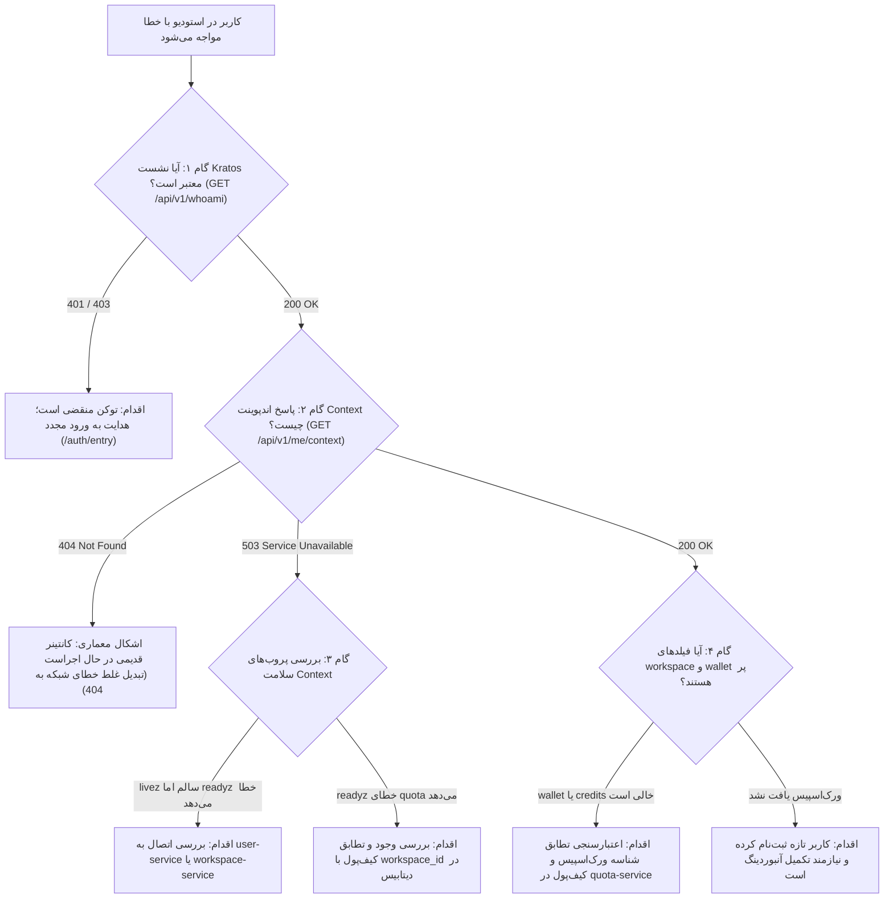

| فیلد / Field | مقدار / Value |
| :--- | :--- |
| **Title (EN)** | Operational Runbook: Studio Context Loading & Wallet Resolution |
| **Title (FA)** | ران‌بوک عملیاتی: تریاژ بارگذاری کانتکست استودیو و تطبیق کیف‌پول |
| **ID** | DOC-OPS-RB-002 |
| **Category** | `devops` |
| **Status** | `Active` |
| **Owner** | DevOps / SRE & Core Platform Team |
| **Last Updated** | 2026-10-13 |
| **Summary (EN)** | Authoritative operational runbook, diagnostic decision tree, and problems-and-solutions catalog for studio context loading failures, downstream resilience, and workspace-to-wallet resolution. |
| **Summary (FA)** | ران‌بوک عملیاتی مرجع، درخت تصمیم‌گیری و راهنمای تفصیلی مشکلات و راه‌حل‌ها برای رفع اختلالات بارگذاری اولیه کانتکست استودیو، بازیابی اتصال سرویس‌ها و تطبیق کیف‌پول و ورک‌اسپیس. |
| **Tags** | `devops`, `runbook`, `troubleshooting`, `context-service`, `quota-service`, `wallet`, `operations` |

---

# ران‌بوک عملیاتی: تریاژ بارگذاری کانتکست استودیو و تطبیق کیف‌پول (DOC-OPS-RB-002)

> **دامنه کاربرد:** این ران‌بوک مرجع عملیاتی پشتیبانی و مهندسان SRE برای تشخیص، تریاژ و حل قطعی اختلالات ورود به استودیو، خطاهای اندپوینت `/api/v1/me/context`، قطع اتصال کلاینت‌های gRPC و ناهماهنگی شناسه کیف‌پول و فضای کاری است.

---

## ۱. درخت تصمیم‌گیری عیب‌یابی ورود به استودیو (Diagnostic Decision Tree)

در صورت گزارش خطای بارگذاری استودیو (`Connection Error` یا `Service temporarily unavailable`)، مراحل زیر به ترتیب طی می‌شود:



---

## ۲. ماتریس تشخیصی کدهای خطا (Diagnostic Error Matrix)

| کد خطا / پیام کلاینت | لایه بروز | نشانه ظاهری در استودیو | دستور بررسی سریع (CLI One-Liner) | اقدام فوری برای رفع |
|---|---|---|---|---|
| `Connection Error — user not found` | `context-service` (نسخه قدیمی) | صفحه مسدود می‌شود و خطای کاربر یافت نشد می‌دهد | `docker logs lemmo-svc-context --tail 50 \| grep -i "user-service"` | کانتینر با نسخه اصلاح‌شده بازسازی شود (`docker compose up -d --build context-service`). |
| `503 Service Unavailable` (`DOWNSTREAM_UNAVAILABLE`) | Gateway / `context-service` | پیام تلاش مجدد یا خطای موقت در استودیو | `curl -s http://localhost:8092/readyz` | بررسی پایداری کانتینرهای `user-service:50062` و `workspace-service:50060`. |
| `WALLET_NOT_FOUND` | `quota-service` | خطای ۵۰۳ در بارگذاری کانتکست استودیو | `docker logs lemmo-svc-quota --tail 50 \| grep -i "wallet"` | بررسی کوئری سهمیه با `workspace_id`؛ بازسازی ایمیج `quota-service`. |
| `401 Unauthorized` | Kong / Kratos | ریدایرکت مکرر به صفحه لاگین | `curl -s -H "Cookie: ory_kratos_session=..." http://localhost:8000/api/v1/whoami` | پاک کردن کوکی مرورگر و ورود مجدد در `/auth/entry`. |

---

## ۳. پروب‌های سلامت و خط فرمان ارزیابی سریع (CLI Health Probes)

### ۳.۱. بررسی پروب‌های زنده بودن و آمادگی سرویس کانتکست
```bash
# پروب Liveness (زنده بودن پروسه)
curl -s -i http://localhost:8092/livez

# پروب Readiness (آمادگی اتصالات حیاتی gRPC)
curl -s -i http://localhost:8092/readyz
```

### ۳.۲. بررسی مستقیم اندپوینت کانتکست از طریق درگاه لبه
```bash
# تست مستقیم از طریق Kong (پورت ۸۰۰۰)
curl -s -i -H "Cookie: ory_kratos_session=<SESSION_TOKEN>" http://localhost:8000/api/v1/me/context
```

### ۳.۳. استعلام تطابق کیف‌پول با ورک‌اسپیس در پایگاه داده
```bash
# جستجوی کیف‌پول بر اساس شناسه ورک‌اسپیس
docker exec lemmo-infra-postgres psql -U postgres -d lemmo_quota -c \
  "SELECT id, owner_id, status, created_at FROM wallets WHERE owner_id = '<WORKSPACE_ID>';"
```

---

## ۴. بخش مشکلات و راه‌حل‌ها (Problems & Solutions)

این بخش کاتالوگ دقیق رخدادهای عملیاتی رخ‌داده، علل ریشه‌ای، راه‌حل‌های اعمال‌شده و درس‌های آموخته‌شده پلتفرم است.

---

### ۴.۱. اختلال ورود به استودیو بر اثر اتصال اولیهٔ ناموفق و جست‌وجوی نادرست کیف پول

- **شناسه رخداد:** `ISSUE-OPS-2026-10-13-CTX-01` (مرتبط با گزارش کالبدشکافی [DOC-OPS-INC-002](../incidents/INC-2026-10-13-context-service-startup-failure.md))
- **سرویس‌های درگیر:** `context-service`، `user-service`، `quota-service`، درگاه Kong و استودیو (`app/`)
- **سطح اولویت:** `SEV-1` (مسدودسازی کامل ورود به استودیو)
- **وضعیت:** حل قطعی و استقرار روی کانتینرها (Resolved & Deployed)

#### ۴.۱.۱. نشانه‌ها (Symptoms)
پس از ورود موفق کاربر (احراز هویت در Kratos)، استودیو ابتدا پیام `Connection Error — user not found` و سپس `Service temporarily unavailable` نمایش می‌داد و محیط کار بارگذاری نمی‌شد.

#### ۴.۱.۲. علت اول — بازیابی‌نشدن اتصال سرویس کاربران
سرویس Context هنگام راه‌اندازی فقط پنج ثانیه برای اتصال به User Service منتظر می‌ماند (`grpc.WithBlock`). اگر سرویس کاربران دیرتر آماده می‌شد، کلاینت اتصال خالی (`nil`) باقی می‌ماند و هیچ تلاش مجددی انجام نمی‌شد. کد نیز این وضعیت را اشتباهاً به `404 user not found` تبدیل می‌کرد؛ بنابراین خطای زیرساخت شبیه حذف حساب نمایش داده می‌شد.

**اصلاح فنی اعمال‌شده:**
1. اتصال‌های پایین‌دستی غیرمسدودکننده شدند (`grpc.NewClient` بدون بلاک شدن پروسه استارت).
2. بازیابی خودکار اتصال (gRPC Reconnect Backoff)، مهلت هر درخواست (`default_rpc_timeout`) و تنظیمات Retry در فایل پیکربندی (`config/default.yaml`) اضافه شد.
3. خطاهای دسترس‌ناپذیری سرویس‌ها به کد استاندارد `503 Service Unavailable` با جزئیات واضح تبدیل شدند و کد `404` کاذب حذف گردید.
4. پروب‌های زنده‌بودن (`/livez`) و آمادگی سرویس (`/readyz`) از هم جدا شدند تا Kubernetes/Docker سرویس را پیش از اتصال اشتباهاً ریسک ندانند.

#### ۴.۱.۳. علت دوم — اشتباه‌گرفتن شناسهٔ ورک‌اسپیس با کیف پول
پس از رفع اتصال، Context همچنان شناسهٔ ورک‌اسپیس (`workspace_id`) را در فیلد `wallet_id` به سرویس سهمیه ارسال می‌کرد. کیف پول در دیتابیس UUID مستقلی داشت؛ بنابراین با وجود موجودبودن آن، Quota خطای `WALLET_NOT_FOUND` می‌داد و بارگذاری Context با `503` متوقف می‌شد. این مشکل با صبرکردن یا Retry برطرف نمی‌شد.

**اصلاح فنی اعمال‌شده:**
1. فیلد صریح `workspace_id = 3` به قرارداد خواندن موجودی (`GetWalletBalanceRequest`) اضافه شد.
2. سرویس Quota اکنون کیف پول موجودِ متعلق به همان ورک‌اسپیس را پیدا می‌کند و تطابق فضای کاری احرازشده و مالکیت کیف پول را بررسی می‌کند.
3. مسیر قبلی `wallet_id` نیز برای حفظ سازگاری عقب‌رو حفظ شد.
4. هیچ کیف پول، اعتبار یا موجودی ساختگی برای رفع خطا ایجاد نشد و یکپارچگی دفاتر مالی لجر حفظ گردید.

#### ۴.۱.۴. استقرار و تأیید عملیاتی (Deployment & Verification)
بازکردن مجدد مرورگر کافی نبود، چون کانتینرها هنوز باینری قدیمی را اجرا می‌کردند:
1. ابتدا کانتینر `quota-service` و سپس `context-service` با سوییچ `--build` بازسازی و جایگزین شدند.
2. پس از استقرار، هر ۱۲ حسابی که قبلاً `503` می‌گرفتند، از مسیر Context، Kong و پروکسی برنامه روی پورت ۳۰۰۰ پاسخ `200` همراه ورک‌اسپیس دریافت کردند.
3. تست‌های اتصال مجدد، نگاشت خطا و کنترل دسترسی نیز در محیط واقعی پاس شدند.

#### ۴.۱.۵. پیشگیری از تکرار (Prevention)
1. تست‌ها باید تأخیر راه‌اندازی، قطع‌و‌وصل وابستگی‌ها و متفاوت‌بودن شناسهٔ منابع مرتبط را پوشش دهند.
2. نتیجهٔ اصلاح نیز باید پس از بازسازی کانتینر، از مسیر واقعی برنامه بررسی شود؛ موفقیت تست کد به‌تنهایی به معنی اصلاح نسخهٔ در حال اجرا نیست.

#### ۴.۱.۶. محدودیت‌های شناخته‌شده (Known Limitations)
این اصلاح بارگذاری Context را بازیابی کرد. با این حال:
- یک حساب فاقد ورک‌اسپیس همچنان نیازمند تکمیل راه‌اندازی و مراحل اولیه است.
- موفقیت تولید محتوا (سنتز مدیا و هوش مصنوعی) در این بررسی تأیید نشده است و در فازهای اختصاصی خود اعتبارسنجی می‌شود.

---

## ۵. چک‌لیست اعتبارسنجی خروجی (Verification Checklist)

پیش از اعلام رفع هر اختلال مشابه در محیط عملیاتی، بررسی موارد زیر الزامی است:
- [x] پروب `/livez` وضعیت `HTTP 200` برمی‌گرداند.
- [x] پروب `/readyz` وضعیت `HTTP 200` و آمادگی کامل کلاینت‌های حیاتی را گزارش می‌دهد.
- [x] درخواست به `/api/v1/me/context` برای کاربر معتبر کد `200 OK` بازمی‌گرداند و فیلدهای `workspace` و `wallet` پر هستند.
- [x] در صورت قطع موقت یک سرویس پشتیبان، کد بازگشتی `503` است و هیچ خطای `404` کاذب صادر نمی‌شود.
- [x] پس از بازگشت سرویس پشتیبان، کلاینت بدون نیاز به ری‌استارت به طور خودکار اتصال را بازیابی می‌کند.

---

## ۶. اسناد مرتبط
- [نمایه مرکزی ران‌بوک‌های عملیاتی (DOC-OPS-RB-000)](./index.md)
- [گزارش کالبدشکافی رخداد INC-2026-10-13 (DOC-OPS-INC-002)](../incidents/INC-2026-10-13-context-service-startup-failure.md)
- [ران‌بوک عیب‌یابی ایجنت و ابزارها (DOC-OPS-RB-001)](./RB-AGENT-001-execution-and-tool-lifecycle.md)
- [دستورالعمل داکر و انضباط کانتینرها (DOC-OPS-001)](../docker-spec.md)
- [قراردادهای مالی و سیستم اعتبارات (DOC-BE-004)](../../03-backend/credit-and-ledger.md)
