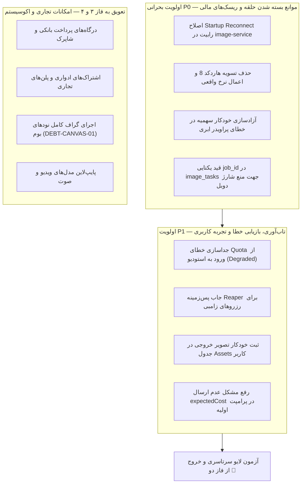

| فیلد / Field | مقدار / Value |
| :--- | :--- |
| **Title (EN)** | Phase 2 MVP Content Generation Loop Completion & Phased Roadmap Revision |
| **Title (FA)** | تکمیل حلقه تولید محتوای MVP در فاز دو و بازنگری نقشه راه مهندسی پلتفرم |
| **ID** | DOC-ROAD-007 |
| **Category** | `roadmap` |
| **Status** | `Draft` |
| **Owner** | Core Architecture & Platform Lead / @platform |
| **Last Updated** | 2026-10-13 |
| **Summary (EN)** | Authoritative technical proposal and phased roadmap revision for completing the end-to-end MVP content generation loop across existing microservices without adding redundant services. Categorizes workstreams into P0 (blockers, financial risk), P1 (resilience, triage), and deferred commercial capabilities. |
| **Summary (FA)** | پیشنهاد فنی مرجع و بازنگری نقشه راه فاز دو جهت تکمیل حلقه سرتاسری تولید محتوا در MVP با تکیه بر ۱۱ میکروسرویس موجود و بدون ایجاد سرویس جدید. تفکیک اقدامات به اولویت P0 (موانع خط تولید و خطرات مالی)، P1 (تاب‌آوری و تریاژ) و تعویق قابلیت‌های تجاری غیرضروری. |
| **Tags** | `roadmap`, `phase2`, `content-generation`, `mvp`, `gap-analysis`, `cost-control`, `services` |

---

# تکمیل حلقه تولید محتوای MVP و بازنگری نقشه راه فاز دو (DOC-ROAD-007)

> **هدف این سند:** ارائه پیشنهاد جامع، مستند و مبتنی بر شواهد میدانی برای تکمیل حلقه تولید محتوای هوش مصنوعی در استودیوی لِمو با کمترین سربار توسعه، حداکثر پایداری و کنترل دقیق هزینه‌های دلاری، بر پایه گزارش ممیزی رسمی [REPORT-MVP-GEN-001](../../../.task/REPORT_CONTENT_GENERATION_MVP_GAP_AUDIT.md).  
> **اصل عدم تکثیر سرویس‌ها (Zero New Services Invariant):** تمام ۱۱ میکروسرویس مورد نیاز هم‌اکنون در سیستم موجود هستند. هیچ سرویس جدیدی نباید ساخته شود.

---

## ۱. فهرست سرویس‌های ضروری فاز دو و وضعیت واقعی آن‌ها

| نام سرویس | مسئولیت و دلیل ضرورت در فاز دو | وضعیت واقعی فعلی | وابستگی‌ها | حداقل تغییر لازم برای تکمیل حلقه |
|---|---|---|---|---|
| **`auth-service` / Kratos** | احراز هویت بدون رمز و صدور نشست امن؛ ورود به پلتفرم غیرممکن خواهد بود. | موجود و تأییدشده ✅ | Kratos, Mailpit, Redis | بدون تغییر (آماده) |
| **`user-service`** | نمایه کاربر، ترجیحات و ردیابی ریسک (SEC-02). | موجود و تأییدشده ✅ | PostgreSQL, Kratos | بدون تغییر (آماده) |
| **`workspace-service`** | مرزبندی مستاجران و اعتبارسنجی مالکیت سازمان. | موجود و تأییدشده ✅ | PostgreSQL, Redis | بدون تغییر (آماده) |
| **`context-service`** | آماده‌سازی کانتکست استودیو و تفکیک فضای کاری و کیف‌پول. | موجود و تأییدشده ✅ | User, Workspace, Quota | جداسازی شکست کوئری سهمیه از مسدودسازی ورود به استودیو (Degraded Mode). |
| **`quota-service`** | منبع واحد قیمت (Rate-Card) و رزرو و تسویه اتمیک در دفترکل. | موجود و تأییدشده ✅ | TigerBeetle, PostgreSQL, Redis | افزودن جاب دوره‌ای Reaper برای آزادسازی خودکار رزروهای منقضی‌شده (> ۳۰۰ ثانیه). |
| **`agent-service`** | مدیریت مکالمات استودیو، تفکیک استریم SSE و دیسپچ فرامین تولید. | موجود و تأییدشده ✅ | PostgreSQL, Redis, Tools | ارسال صریح سقف قیمت (`expected_cost`) در فراخوانی ابزارها. |
| **`tools-service`** | مسیر اجرای واحد پلتفرم (`ExecuteTool`) و ولیدیشن ورودی‌ها. | موجود و تأییدشده ✅ | PostgreSQL, Redis, Quota, Job | استعلام داینامیک قیمت از Rate-Card و رد با خطای ۴۰۹ در صورت عدم تطابق نرخ. |
| **`job-service`** | مدیریت صف‌های اولویت‌دار و برودکست رویدادهای زنده SSE. | موجود و تأییدشده ✅ | PostgreSQL, RabbitMQ, Redis | بدون تغییر اساسی (آماده) |
| **`model-router-service`** | مسیریابی مدل‌های هوش مصنوعی (Fal, ScienceEdu) و ریت‌لیمیت. | موجود و تأییدشده ✅ | PostgreSQL, Redis | بدون تغییر اساسی (آماده) |
| **`image-service`** | ورکر ناهمگام ابری، دانلود و آپلود خروجی و تسویه مالی. | پیاده‌سازی‌شده ولی نیازمند اصلاح ⚠️ | RabbitMQ, ModelRouter, Storage, Quota | ۱) حلقه Reconnect با RabbitMQ. ۲) حذف عدد ۸ هاردکد در تسویه. ۳) آزادسازی سهمیه در خطای پراویدر. ۴) قید Unique روی `job_id`. |
| **`storage-service`** | مدیریت باکت‌های S3 MinIO و تولید لینک‌های دانلود امن. | موجود و تأییدشده ✅ | MinIO, PostgreSQL | اتصال خودکار ثبت رکورد در جدول `assets` کاربر در زمان ذخیره تصویر. |

---

## ۲. بازنگری و اولویت‌بندی رودمپ فاز دو (Roadmap Re-alignment)

### ۲.۱. اقلام اولویت P0 (Blockers & Financial Safety)

1. **تاب‌آوری مصرف صف در `image-service`:**  
   - *مسئله:* در حال حاضر اگر رابیت‌ام‌کیو چند ثانیه دیرتر آماده شود، مصرف‌کننده صف در ورکر تصویر متوقف می‌ماند و جاب‌ها هرگز پردازش نمی‌شوند.  
   - *اقدام:* افزودن حلقه تلاش مجدد با بازگشت نمایی (`Exponential Backoff Reconnect Loop`) در `startRabbitConsumer`.

2. **انضباط تسویه مالی در ورکر:**  
   - *مسئله:* تسویه روی عدد ۸ هاردکد شده و شناسه با `uuid.NewString()` تصادفی صادر می‌شود که موجب تناقض مالی و عدم امکان Retry ایمن است.  
   - *اقدام:* خواندن مبلغ واقعی از پارامترهای تسک و تنظیم کلید `settle:{job_id}`.

3. **آزادسازی سهمیه در شکست پراویدر:**  
   - *مسئله:* در صورت بروز خطای ۵۰۰ یا تایم‌اوت در Fal/ScienceEdu، کردیت کاربر در حالت معلق می‌ماند و کسر می‌شود.  
   - *اقدام:* فراخوانی متد `ReleaseQuota` در تمام مسیرهای خطای دیسپچ.

4. **قید یکتایی جاب در دیتابیس ورکر:**  
   - *مسئله:* تحویل مجدد پیام صف در خطای موقت شبکه، موجب ساخت تسک دوم و فراخوانی مجدد مدل پولی می‌شود.  
   - *اقدام:* افزودن قید `UNIQUE (job_id)` در دیتابیس `image_tasks` و اعمال رفتار Idempotent در درج.

---

### ۲.۲. اقلام اولویت P1 (Resilience & User Experience)

1. **تفکیک پایداری کانتکست از کیف‌پول:**  
   قطعی موقت `quota-service` نباید موجب خطای ۵۰۳ در ورود و مسدودسازی دسترسی به تاریخچه و چت‌های قبلی شود. استودیو باید در وضعیت `degraded` بالا آمده و فقط اجرای پولی مسدود شود.

2. **جاب Reaper برای پاک‌سازی رزروهای معلق:**  
   یک تسک دوره‌ای سبک در `quota-service` برای شناسایی رزروهای معلق بیش از ۵ دقیقه و بازگرداندن خودکار کردیت‌ها به کیف‌پول کاربر.

3. **ثبت خودکار در جدول `assets` کاربر:**  
   تصاویر تولیدشده علاوه بر ذخیره در باکت MinIO، باید به عنوان یک دارایی رسمی در جدول دارایی‌های کاربر ثبت شوند تا در تب Assets و گالری قابل مشاهده باشند.

4. **ارسال قیمت محافظ برای پرامپت‌های انتقالی از صفحه اصلی:**  
   اطمینان از دریافت سقف محافظ قیمت در فرم ایجنت پیش از ارسال خودکار پرامپت‌های لندینگ.

---

### ۲.۳. اقلام موکول‌شده به فازهای بعدی (Deferred Items)

- **درگاه‌های پرداخت بانکی و خرید بسته اعتباری:** برای MVP، یک بسته اعتباری هدیه (مثلاً ۱۰۰۰ کردیت) به ازای هر ورک‌اسپیس جدید تخصیص داده می‌شود و شارژ از طریق پنل ادمین کفایت می‌کند.
- **اجرای گراف‌های پیچیده در بوم (DEBT-CANVAS-01):** محیط بوم می‌تواند در وضعیت طراحی باقی بماند، اما اجرای زنده و واقعی موتور هوش مصنوعی منحصراً از مسیر استودیو چت ایجنت و نوار ابزارها انجام می‌شود.
- **مدل‌های چندرسانه‌ای تکمیلی (ویدیو، صدا و آموزش مدل):** در این فاز منحصراً بر روی مدل‌های متنی-به-تصویر تمرکز خواهد شد.

---

## ۳. سناریوهای پذیرش فاز دو (Phase 2 Acceptance Gates)

تکمیل فاز دو و بسته شدن گیت کیفیت مستلزم قبولی قطعی ۸ سناریوی زیر در محیط واقعی است:

1. **ورود و راه‌اندازی:** ورود کاربر جدید، ایجاد ورک‌اسپیس و کیف‌پول اولیه، دریافت کد ۲۰۰ از اندپوینت `/api/v1/me/context`.
2. **تولید سرتاسری موفق:** ارسال پرامپت، استریم پیشرفت SSE، تولید تصویر، تسویه دقیق و مشاهده نتیجه پایدار پس از رفرش صفحه.
3. **کنترل اعتبار تهی:** ممانعت از ایجاد جاب و عدم ارسال درخواست به پراویدر ابری در صورت موجودی ناکافی همراه با پیام واضح در UI.
4. **حفاظت از ارسال تکراری:** مقاومت در برابر دابل کلیک و تحویل مجدد پیام‌های RabbitMQ بدون هزینه و رزرو مضاعف.
5. **تاب‌آوری در قطعی مالی:** امکان مشاهده چت‌ها و گالری در زمان خاموش بودن سرویس سهمیه.
6. **تعیین تکلیف شکست پراویدر:** بازگشت آنی کردیت‌های قفل‌شده به کیف‌پول در صورت تایم‌اوت یا خطای مدل ابری.
7. **بازیابی از ری‌استارت:** بازگشت خودکار اتصال مصرف‌کننده صف و کلاینت استریم پس از راه‌اندازی مجدد کانتینرها.
8. **امنیت چندمستاجری:** عدم دسترسی کاربر به پرامپت‌ها، گفتگوها، تصاویر یا کیف‌پول ورک‌اسپیس دیگر (خطای قطعی ۴۰۴).

---

## ۴. اسناد مرتبط
- [گزارش ممیزی تفصیلی شکاف‌های حلقه تولید محتوا (REPORT-MVP-GEN-001)](../../../.task/REPORT_CONTENT_GENERATION_MVP_GAP_AUDIT.md)
- [نقشه راه جامع بک‌اند پلتفرم (DOC-BE-005)](../03-backend/roadmap.md)
- [معماری اجرای قابلیت‌های واحد (ADR-019)](../01-architecture/decisions/ADR-019-unified-capability-invocation-and-agent-boundaries.md)
- [معماری چت ایجنت استودیو (ADR-020)](../01-architecture/decisions/ADR-020-studio-agent-chat-service-architecture.md)
- [معماری فرم داده‌محور تولید محتوا (ADR-021)](../01-architecture/decisions/ADR-021-dynamic-generation-form-and-tool-model-binding.md)
- [ران‌بوک عملیاتی بارگذاری کانتکست و کیف‌پول (DOC-OPS-RB-002)](../07-devops/runbooks/RB-STUDIO-002-context-and-wallet-resolution.md)
