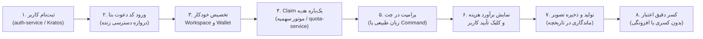

| فیلد / Field | مقدار / Value |
| :--- | :--- |
| **Title (EN)** | Current MVP Execution Path & Golden Journey |
| **Title (FA)** | مسیر جاری اجرای MVP و زنجیره طلایی پلتفرم لیمو |
| **ID** | DOC-GOV-003 |
| **Category** | `governance` |
| **Status** | `Active` |
| **Owner** | Senior Architect / Core Platform Team |
| **Last Updated** | 2026-10-16 |
| **Summary (EN)** | Authoritative executive overview of active MVP delivery path, golden user journey, priority sequence (D-15), 4-tier capability statuses, concise glossary, and comprehensive priority matrix across all open engineering items. |
| **Summary (FA)** | نمای کلان و رسمی از مسیر فعال تحویل MVP، زنجیره طلایی تجربه کاربر، اولویت‌بندی اجرایی (D-15)، ماتریس وضعیت ۴ سطحی، واژه‌نامه فنی و ماتریس جامع اولویت‌بندی کلیه آیتم‌های باز. |
| **Tags** | `governance`, `mvp`, `golden-path`, `delivery`, `priority`, `roadmap`, `matrix`, `glossary` |

---

# مسیر جاری اجرای MVP و زنجیره طلایی (Current Path)

> ⚠️ **سلب مسئولیت و وضعیت اعتبارسنجی:**  
> ارزیابی‌های ثبت‌شده در این سند، **حاصل ممیزی و مطالعه مستندات فنی و سورس‌کد موجود است و تا این لحظه هنوز با شواهد مستقل Runtime بر روی محیط زنده تأیید نشده است.** اعتبار نهایی هر قابلیت منوط به گذر موفق از گیت‌های نظارتی خواهد بود.

---

## ۱. زنجیره طلایی تجربه کاربری (Golden User Journey)

نتیجه ملموس و قابل‌ارائه در نسخه MVP، اجرای موفق و بی‌نقص زنجیره زیر بدون دخالت دستی اپراتور یا فرانت شبیه‌سازی‌شده است:

---

## ۲. اولویت‌بندی توالی اجرا (مطابق تصمیم D-15)

پیشرفت پروژه صرفاً بر پایه گذر از گیت‌های کیفی زیر سنجیده می‌شود، نه وعده‌های زمانی:

1. **گام اول — ساماندهی مستندات و رفع تعارض‌ها (D-10 / DOC-ORG-01):** همگام‌سازی اسناد با تصمیمات مصوب، ثبت ۵ گزارش تعارض (C-1 تا C-5) و استقرار استانداردهای تسک‌نویسی.
2. **گام دوم — استاندارد لاگ، رهگیری، کاتالوگ خطا و Doctor (مرحله ۱):** یکسان‌سازی لاگ JSON، نرمال‌سازی traceparent استاندارد W3C در گیت‌وی (D-02) و ابزارهای تشخیصی `make trace` و `make doctor` (D-11 / ADR-022 M0).
3. **گام سوم — ابزارهای بررسی واقعی فرایند (D-13):** استقرار اسکریپت‌های خواندنی بدون عوارض جانبی مالی جهت تست وضعیت زنده سرویس‌ها در محیط لوکال و استیجینگ.
4. **گام چهارم — سرویس دائمی Access/Promo و رفع موانع بک‌اند (مراحل ۲ و ۳):** پیاده‌سازی سرویس دائمی مدیریت چرخه عمر کد دعوت/پرومو (D-03) و رفع موانع F-1 (کلید سشن ردیس) و F-3 (مسیرهای Claim و گیت ورودی).
5. **گام پنجم — یکپارچه‌سازی فرانت، قراردادهای OpenAPI و استیجینگ (D-14):** اتصال استودیو به سرویس‌های واقعی، لغو دائمی هرگونه شبیه‌سازی کلاینت (ADR-016)، و استقرار نسخه Staging با دامنه معتبر (D-08).

### مسیرهای موازی (بدون تغییر کد):
* تدوین و تصویب ADR معماری و تفکیک مالکیت سرویس Access/Promo پیش از آغاز کدنویسی مرحله ۲ (تصمیم P-3 / D-03).
* آماده‌سازی بریف زیرساخت، دامنه و متغیرهای محیطی Staging (D-08 / P-5).

---

## ۳. ماتریس وضعیت چهارسطحی قابلیت‌های کلیدی

وضعیت پلتفرم بر اساس چرخه حیات ۴ سطحی نظارت می‌شود:
* **دارای کد (Coded):** در مخزن پیاده‌سازی شده اما راستی‌آزمایی نشده است.
* **بررسی‌شده روی سورس (Inspected in Source):** انطباق منطق آن توسط ارشد روی کد منبع تأیید شده است.
* **بررسی‌شده روی نسخه مستقر (Verified on Deployment):** روی محیط مستقر تست شده است.
* **پذیرفته‌شده (Accepted):** شواهد جامع Runtime بدون نقض الزامات کیفی توسط ناظر مستقل تأیید شده است.

| قابلیت / دامنه | وضعیت فعلی | مرجع تصمیم / ADR | ملاحظات و موانع باز |
| :--- | :---: | :--- | :--- |
| **ثبت‌نام و سشن Kratos** | `Verified on Deployment` | ADR-004 | احراز هویت اولیه پایدار است. |
| **بررسی دسترسی و کد دعوت بتا** | `فاقد کد` | D-03 / DOC-BE-014 | وابستگی به تصویب ADR مالکیت (P-3) و ایجاد سرویس. |
| **تخصیص Workspace و عضویت** | `Coded` | DOC-BE-014 / F-1 | مانع F-1: عدم ثبت کلید پروجکشن ردیس در مسیر پروداکشن. |
| **موتور Claim هدیه اولیه** | `Inspected in Source` | D-06 / DOC-BE-014 | لاجیک داخلی Quota موجود است؛ فاقد RPC شبکه بیرونی است. |
| **مدیریت بودجه ۲ دلار پلتفرم** | `Inspected in Source` | D-07 / DOC-BE-004 | پیاده‌سازی شده؛ نیاز به شمول هزینه LLM تبدیل نیت کاربر. |
| **تولید تصویر در چت با کلیک** | `Coded` | D-04 / ADR-016 | نیازمند اتصال کلاینت به قرارداد نهایی و منع اجرای ناخواسته. |
| **محیط بوم (Canvas)** | `تعویق به فاز بعد` | D-05 / C-1 | ماک‌های موقت مسدود و ارائه قابلیت به پس از MVP موکول شد. |
| **محیط استیجینگ زنده** | `در انتظار بریف` | D-08 / C-5 | نیازمند آماده‌سازی سرور و گواهی SSL با پورت ۸۰/۴۴۳. |

---

## ۴. واژه‌نامه‌ی کوتاه مفاهیم حاکمیتی (Glossary)

1. **[MVP (کمینه محصول پذیرفتنی)](./current-path.md#۱-زنجیره-طلایی-تجربه-کاربری-golden-user-journey):** دامنه پایدار و حداقلی شامل ثبت‌نام، ورود کد بتا، کیف‌پول، تولید تصویر در چت و کسر صحیح اعتبار بر روی سرور واقعی.
2. **[مسیر طلایی (Golden Journey)](./current-path.md#۱-زنجیره-طلایی-تجربه-کاربری-golden-user-journey):** توالی بی‌نقص تجربه کاربر بدون خطا، بدون بن‌بست و بدون دخالت دستی اپراتور یا شبیه‌سازی در فرانت‌اند.
3. **[Staging و Production](./current-path.md#۲-اولویت‌بندی-توالی-اجرا-مطابق-تصمیم-d-15):** محیط پیش‌تولید زنده با دامنه واقعی جهت تست یکپارچه، پیش از انتشار تغییرات به محیط نهایی پروداکشن ([D-08](./decision-register.md#d-08)).
4. **[سطوح چهارگانه وضعیت](./current-path.md#۳-ماتریس-وضعیت-چهارسطحی-قابلیت‌های-کلیدی):** تفکیک شفاف قابلیت به `Coded`، `Inspected in Source`، `Verified on Deployment` و `Accepted`.
5. **[`request_id` و `traceparent`](../03-backend/mvp-operational-readiness.md#۱۱۲-قرارداد-شناسه-رهگیری-و-درگاه-لبه-تصمیم-d-02):** `traceparent` (استاندارد W3C) شناسه داخلی شبکه برای اتصال سرویس‌هاست؛ `request_id` کدی است که به کاربر جهت پیگیری اعلام می‌شود ([D-02](./decision-register.md#d-02)).
6. **[مانع لانچ (Launch Blocker)](./task-template-and-review-rules.md#الف-تعریف-مانع-لانچ-launch-blocker---d-12):** هر نقصی که مانع ورود، دریافت فضا، خطای مالی، شکست در تولید یا کوری مانیتورینگ در مسیر اصلی شود ([D-12](./decision-register.md#d-12)).
7. **[بدهی فنی و DEFERRED](./task-template-and-review-rules.md#ب-قالب-استاندارد-ثبت-ورودی-دفتر-بدهی-debt-registry-entry):** نقص غیرمسدودکننده که با اثر، مالک و موعد بازبینی ثبت می‌شود؛ تعویق هرگز به معنی قبولی (`PASS`) نیست.
8. **[تشخیص نیت و فرمان‌ها](../03-backend/agent-service-spec.md#۷-الزامات-مصوب-d-04-مسیر-پردازش-متن-آزاد-و-فرمان‌ها-در-mvp):** تبدیل زبان طبیعی با مدل سبک به ابزار، در برابر فرمان‌های ساخت‌یافته مستقیم بدون تاخیر و هزینه مدل ([D-04](./decision-register.md#d-04)).
9. **[کد دعوت و هدیه یک‌باره](../03-backend/beta-invitation-and-gift-ownership.md):** ورود کد دسترسی سرورمحور و شارژ هدیه اتمیک صرفاً از طریق موتور Claim در `quota-service` ([D-03](./decision-register.md#d-03)).
10. **[بتای بسته (Limited Beta Access Gate)](../03-backend/beta-invitation-and-gift-ownership.md):** اعتبارسنجی سرورمحور و کنترل دسترسی در لبه گیت‌وی به منظور جلوگیری از نفوذ یا ورود کاربران فاقد کد فعال.

---

## ۵. ماتریس جامع اولویت‌بندی کلیه آیتم‌های باز مهندسی

### تعاریف کلاس‌های اولویت:
* **P0 (مانع لانچ / Blocker):** نقایص دارای اثر بازتولیدشده بر ثبت‌نام، ورود، عضویت فضا، انضباط مالی، تولید تصویر یا مشاهده‌پذیری مسیر اصلی طبق [D-12](./task-template-and-review-rules.md#الف-تعریف-مانع-لانچ-launch-blocker---d-12).
* **P1 (ضروری برای MVP پایدار):** آیتم‌های لازم برای پایداری و لانچ که می‌توانند به صورت موازی با مسیر طلایی پیش بروند.
* **P2 (پس از MVP / فاز نزدیک):** قابلیت‌های معوق مانند بوم نودی، اندپوینت‌های ترکیبی و پنل راهنما.
* **P3 (فاز ۳ و ۴ یا ایده‌های آتی):** قابلیت‌های تجاری‌سازی، پرداخت، شبکه‌های اجتماعی و اشتراک ادواری.

| شناسه آیتم | عنوان و شرح فنی | کلاس | نقش مسئول | گام بعدی و پیوند مرجع | وضعیت تصمیم PM |
| :---: | :--- | :---: | :---: | :--- | :---: |
| **F-1 / G-G** | **مانع عضویت در Redis:** خطای ۴۰۳ کاربر تازه به دلیل عدم درج پروجکشن نسخه عضویت در ردیس. | `P0` | مجری بک‌اند | اولین آیتم اجرایی بریف مرحله ۲ در [`TASK_STB_03`](../../../../.task/active/TASK_STB_03_LEDGER_CONSISTENCY_SCOPED.md) | تصویب شد (تصمیم ۲) |
| **F-2 / G-H** | **تداخل Onboarding با خطای مالی:** کاربر بدون ورک‌اسپیس نباید خطای degraded مالی بگیرد. | `P0` | مجری فرانت/BFF | اصلاح قرارداد کانتکست در [`TASK_MVP_08`](../../../../.task/backlog/TASK_MVP_08_STUDIO_GENERATION_UX.md) | تصویب شد (P0) |
| **F-3 / G-A..F** | **فقدان اندپوینت و RPC بتای محدود:** پیاده‌سازی گیت لبه، اندپوینت دعوت و RPC کلیم هدیه. | `P0` | ارشد / مجری | تدوین ADR مالکیت (P-3) و سپس پیاده‌سازی سرویس در مرحله ۲ | در انتظار ADR |
| **F-4** | **رزرو بودجه پلتفرم برای Intent LLM:** اطمینان از شمول هزینه مدل در سقف ۲ دلار. | `P1` | مجری ایجنت | راستی‌آزمایی در بریف مرحله ۱ و ۳ در [`agent-service-spec.md`](../03-backend/agent-service-spec.md#۷-الزامات-مصوب-d-04-مسیر-پردازش-متن-آزاد-و-فرمان‌ها-در-mvp) | نیازمند راستی‌آزمایی سورس |
| **F-5** | **اصلاح هلث‌چک‌های کاذب (Fake UP):** پیاده‌سازی پروب‌های واقعی readyz و اصلاح dev-verify. | `P1` | مجری زیرساخت | تدوین ابزار تشخیصی فقط‌خواندنی در مرحله ۱ طبق [D-13](./decision-register.md#d-13) | تأیید مسیر مرحله ۱ |
| **F-6** | **خطاهای ساختاری گیت مستندات:** رفع خطاهای `content:check` در مخزن lemmo. | `P1` | ارشد مستندات | در تسک DOC-ORG-01 حل شد؛ خطاهای مخزن مجاور به عنوان بدهی مستقل ثبت شد. | بسته شد در lemmo |
| **F-7** | **انتقال trace در صف و جلوگیری از نشت پیام:** انتقال W3C traceparent در outbox و هدر ناشر. | `P1` | مجری core | اعمال در پکیج مشترک پیام‌رسانی در مرحله ۱ ([ADR-022 M0](../01-architecture/decisions/ADR-022-platform-reliability-and-observability.md)) | تایید در M0 |
| **F-8** | **بررسی شناسه کپی‌شده در UI:** تطبیق کد کپی‌شده در فرانت با `request_id` لبه. | `P1` | ارشد / فرانت | بررسی سورس کامپوننت دیالوگ پشتیبانی در مرحله ۴ فرانت | بررسی در فاز فرانت |
| **F-9** | **اتصال رخدادهای پیشین به تسک‌های اصلاحی:** ردیابی رخدادهای ۱۰/۱۲، ۱۰/۱۳ و ۱۰/۱۵. | `P1` | ارشد معماری | صدور تسک‌های اصلاحی اختصاصی در بک‌لاگ طبق [D-12](./decision-register.md#d-12) | تایید اتصال به تسک‌ها |
| **P-3** | **تدوین ADR مالکیت Access/Promo:** سند معماری سرویس دائمی چرخه عمر کد پیش از مرحله ۲. | `P1` | ارشد معماری | صدور تسک اختصاصی تدوین ADR توسط PM پیش از کدنویسی مرحله ۲ | نیازمند صدور تسک PM |
| **P-4** | **تعیین سقف ظرفیت و مقدار هدیه در کانفیگ:** نهایی‌سازی مقادیر عددی بدون هاردکد. | `P1` | PM / تیم مالی | درج در فایل‌های `config/default.yaml` قبل از استقرار Staging | در انتظار تعیین مقادیر |
| **P-5** | **آماده‌سازی مشخصات سرور Staging:** تامین سرور ابری، دامنه اینترنتی و گواهی TLS. | `P1` | تیم DevOps | تدوین بریف استقرار سرور در مرحله 18A تا 18C طبق [D-08](./decision-register.md#d-08) | نیازمند مشخصات سرور |
| **P-6** | **تعیین تاریخ لانچ بتای محدود:** تعیین زمان‌بندی تقویمی عرضه محصول. | `P1` | مالک محصول | پایش گذر موفقیت‌آمیز از گیت‌های کیفی مرحله ۵ | هدایت با کیفیت |
| **INC-2026-10-12** | **لودینگ بی‌پایان ایجنت:** خطای گیر افتادن در وضعیت Generating. | `P1` | مجری ایجنت | اصلاح ماشین حالت در [`agent-service-spec.md`](../03-backend/agent-service-spec.md) | متصل به مرحله ۳ |
| **INC-2026-10-13** | **شکست راه‌اندازی کانتکست (`DEBT-CTX-01`):** دیال مسدودکننده gRPC. | `P0` | مجری کانتکست | پیاده‌سازی اتصال غیرمسدودکننده با Exponential Backoff در مرحله ۱۷D | رفع‌شده / در انتظار تست |
| **INC-2026-10-15** | **موفقیت کاذب ابزار تشخیصی:** خروجی اشتباه سبز در `trace.sh`. | `P1` | مجری ابزار | بازنویسی ابزار با exit code سه‌حالته در مرحله ۱ (D-13) | متصل به مرحله ۱ |
| **DEBT-CANVAS-01** | **شبیه‌سازی ماک بوم نودی (`setTimeout`):** کدهای موقت کانواس در فرانت و ارکستریتور. | `P2` | مجری کانواس | انتقال به پس از لانچ MVP طبق تصمیم مصوب [D-05](./decision-register.md#d-05) (تعارض C-1) | تعویق مصوب |
| **مرحله 17C** | **بوم طراحی نامحدود و DAG Pipeline:** پیاده‌سازی گراف و ارکستراسیون بوم. | `P2` | تیم کانواس | انتقال به فاز پس از MVP در نقشه راه بک‌اند ([C-1](./decision-register.md#c-1)) | تعویق مصوب |
| **D-14 (Bundle)** | **اندپوینت ترکیبی (BFF Bundle):** تجمیع درخواست‌های چندگانه استودیو. | `P2` | مجری BFF | بررسی پس از تثبیت مسیر طلایی بر بستر `context-service` ([D-14](./decision-register.md#d-14)) | تعویق مصوب |
| **D-14 (Help)** | **پنل کناری راهنما در استودیو:** اتصال `help_key` به مستندات در فرانت. | `P2` | تیم فرانت | پیاده‌سازی پنل اسناد پس از لانچ MVP ([D-14](./decision-register.md#d-14)) | تعویق مصوب |
| **QF-CONFIG-INERT** | **عدم بارگذاری فایل YAML در Quota:** خواندن کانفیگ صرفاً از env. | `P1` | مجری Quota | اتصال لودر YAML در بیلد سرور مرحله ۱ یا انتقال کامل کلیدها به ENV | در انتظار تسک اصلاحی |
| **QF-BUILD-REG** | **شکست بیلد داکر در غیاب پراکسی و کش:** خطر بالا آمدن ایمیج قدیمی. | `P1` | تیم دوآپس | افزودن گیت بررسی خروجی build در اسکریپت‌های استقرار Compose | نیازمند گارد بیلد |
| **مراحل ۱۹ تا ۲۴** | **فاز ۳ و ۴ رودمپ:** صورت‌حساب، شاپرک، نوتیفیکیشن، کامیونیتی و افیلیت. | `P3` | تیم پلتفرم | اجرای گام‌به‌گام پس از قبولی در Gate 6 مطابق [رودمپ بک‌اند](../03-backend/roadmap.md) | فازهای آتی |

---

## ۶. پیوندهای مرجع یگانه حقیقت (SSOT)
- **نقشه راه بک‌اند:** [Backend Roadmap v5 (DOC-BE-005)](../03-backend/roadmap.md)
- **ماتریس رسمی تصمیمات:** [MVP Decision Register (DOC-GOV-004)](./decision-register.md)
- **مالکیت دعوت بتا و هدیه:** [Beta Invitation & Gift Ownership (DOC-BE-014)](../03-backend/beta-invitation-and-gift-ownership.md)
- **قواعد حاکمیتی تسک‌ها:** [Task & Review Rules (DOC-GOV-005)](./task-template-and-review-rules.md)
- **نمایه یافته‌های بک‌لاگ:** [Findings Registry (F-1 to F-9)](../../../../.task/backlog/FINDINGS_F1_TO_F9_REGISTRY.md)
