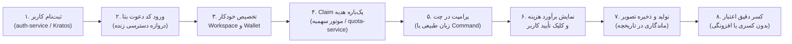

| فیلد / Field | مقدار / Value |
| :--- | :--- |
| **Title (EN)** | Current MVP Execution Path & Golden Journey |
| **Title (FA)** | مسیر جاری اجرای MVP و زنجیره طلایی پلتفرم لیمو |
| **ID** | DOC-GOV-003 |
| **Category** | `governance` |
| **Status** | `Active` |
| **Owner** | Senior Architect / Core Platform Team |
| **Last Updated** | 2026-10-16 |
| **Summary (EN)** | Authoritative two-page executive overview of the active MVP delivery path, golden user journey, priority sequence (D-15), parallel tracks, gate controls, and 4-tier capability statuses. |
| **Summary (FA)** | نمای کلان دو صفحه‌ای و رسمی از مسیر فعال تحویل MVP، زنجیره طلایی تجربه کاربر، اولویت‌بندی اجرایی (D-15)، مسیرهای موازی، گیت‌ها و ماتریس وضعیت ۴ سطحی قابلیت‌ها. |
| **Tags** | `governance`, `mvp`, `golden-path`, `delivery`, `priority`, `roadmap` |

---

# مسیر جاری اجرای MVP و زنجیره طلایی (Current Path)

> ⚠️ **سلب مسئولیت و وضعیت اعتبارسنجی:**  
> ارزیابی‌های ثبت‌شده در این سند، **حاصل ممیزی و مطالعه مستندات فنی و سورس‌کد موجود است و تا این لحظه هنوز با شواهد مستقل Runtime بر روی محیط زنده تأیید نشده است.** اعتبار نهایی هر قابلیت منوط به گذر موفق از گیت‌های نظارتی خواهد بود.

---

## ۱. زنجیره طلایی تجربه کاربری (Golden User Journey)

نتیجه ملموس و قابل‌ارائه در نسخه MVP، اجرای موفق و بی‌نقص زنجیره زیر بدون دخالت دستی اپراتور یا فرانت شبیه‌سازی‌شده است:

---

## ۲. اولویت‌بندی توالی اجرا (مطابق تصمیم D-15)

پیشرفت پروژه صرفاً بر پایه گذر از گیت‌های کیفی زیر سنجیده می‌شود، نه وعده‌های زمانی:

1. **گام اول — ساماندهی مستندات و رفع تعارض‌ها (D-10 / DOC-ORG-01):** همگام‌سازی اسناد با تصمیمات مصوب، ثبت ۵ گزارش تعارض (C-1 تا C-5) و استقرار استانداردهای تسک‌نویسی.
2. **گام دوم — استاندارد لاگ، رهگیری، کاتالوگ خطا و Doctor (مرحله ۱):** یکسان‌سازی لاگ JSON، نرمال‌سازی traceparent استاندارد W3C در گیت‌وی (D-02) و ابزارهای تشخیصی `make trace` و `make doctor` (D-11 / ADR-022 M0).
3. **گام سوم — ابزارهای بررسی واقعی فرایند (D-13):** استقرار اسکریپت‌های خواندنی بدون عوارض جانبی مالی جهت تست وضعیت زنده سرویس‌ها در محیط لوکال و استیجینگ.
4. **گام چهارم — سرویس دائمی Access/Promo و رفع موانع بک‌اند (مراحل ۲ و ۳):** پیاده‌سازی سرویس دائمی مدیریت چرخه عمر کد دعوت/پرومو (D-03) و رفع موانع F-1 (کلید سشن ردیس) و F-3 (مسیرهای Claim و گیت ورودی).
5. **گام پنجم — یکپارچه‌سازی فرانت، قراردادهای OpenAPI و استیجینگ (D-14):** اتصال استودیو به سرویس‌های واقعی، لغو دائمی هرگونه شبیه‌سازی کلاینت (ADR-016)، و استقرار نسخه Staging با دامنه معتبر (D-08).

### مسیرهای موازی (بدون تغییر کد):
* تدوین و تصویب ADR معماری و تفکیک مالکیت سرویس Access/Promo پیش از آغاز کدنویسی مرحله ۲ (تصمیم P-3 / D-03).
* آماده‌سازی بریف زیرساخت، دامنه و متغیرهای محیطی Staging (D-08 / P-5).

---

## ۳. ماتریس وضعیت چهارسطحی قابلیت‌های کلیدی

وضعیت پلتفرم بر اساس چرخه حیات ۴ سطحی نظارت می‌شود:
* **دارای کد (Coded):** در مخزن پیاده‌سازی شده اما راستی‌آزمایی نشده است.
* **بررسی‌شده روی سورس (Inspected in Source):** انطباق منطق آن توسط ارشد روی کد منبع تأیید شده است.
* **بررسی‌شده روی نسخه مستقر (Verified on Deployment):** روی محیط مستقر تست شده است.
* **پذیرفته‌شده (Accepted):** شواهد جامع Runtime بدون نقض الزامات کیفی توسط ناظر مستقل تأیید شده است.

| قابلیت / دامنه | وضعیت فعلی | مرجع تصمیم / ADR | ملاحظات و موانع باز |
| :--- | :---: | :--- | :--- |
| **ثبت‌نام و سشن Kratos** | `Verified on Deployment` | ADR-004 | احراز هویت اولیه پایدار است. |
| **بررسی دسترسی و کد دعوت بتا** | `فاقد کد` | D-03 / DOC-BE-014 | وابستگی به تصویب ADR مالکیت (P-3) و ایجاد سرویس. |
| **تخصیص Workspace و عضویت** | `Coded` | DOC-BE-014 / F-1 | مانع F-1: عدم ثبت کلید پروجکشن ردیس در مسیر پروداکشن. |
| **موتور Claim هدیه اولیه** | `Inspected in Source` | D-06 / DOC-BE-014 | لاجیک داخلی Quota موجود است؛ فاقد RPC شبکه بیرونی است. |
| **مدیریت بودجه ۲ دلار پلتفرم** | `Inspected in Source` | D-07 / DOC-BE-004 | پیاده‌سازی شده؛ نیاز به شمول هزینه LLM تبدیل نیت کاربر. |
| **تولید تصویر در چت با کلیک** | `Coded` | D-04 / ADR-016 | نیازمند اتصال کلاینت به قرارداد نهایی و منع اجرای ناخواسته. |
| **محیط بوم (Canvas)** | `تعویق به فاز بعد` | D-05 / C-1 | ماک‌های موقت مسدود و ارائه قابلیت به پس از MVP موکول شد. |
| **محیط استیجینگ زنده** | `در انتظار بریف` | D-08 / C-5 | نیازمند آماده‌سازی سرور و گواهی SSL با پورت ۸۰/۴۴۳. |

---

## ۴. پیوندهای مرجع یگانه حقیقت (SSOT)
- **نقشه راه بک‌اند:** [Backend Roadmap v5 (DOC-BE-005)](../03-backend/roadmap.md)
- **ماتریس رسمی تصمیمات:** [MVP Decision Register (DOC-GOV-004)](./decision-register.md)
- **مالکیت دعوت بتا و هدیه:** [Beta Invitation & Gift Ownership (DOC-BE-014)](../03-backend/beta-invitation-and-gift-ownership.md)
- **قواعد حاکمیتی تسک‌ها:** [Task & Review Rules (DOC-GOV-005)](./task-template-and-review-rules.md)
